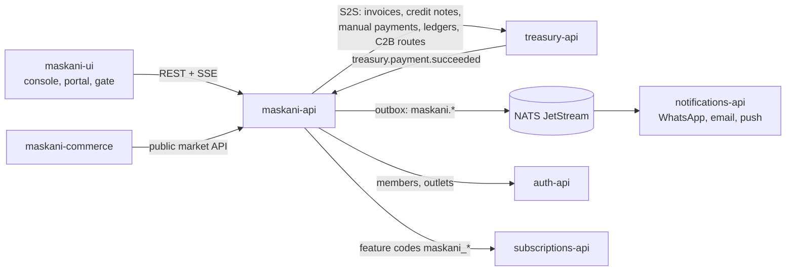
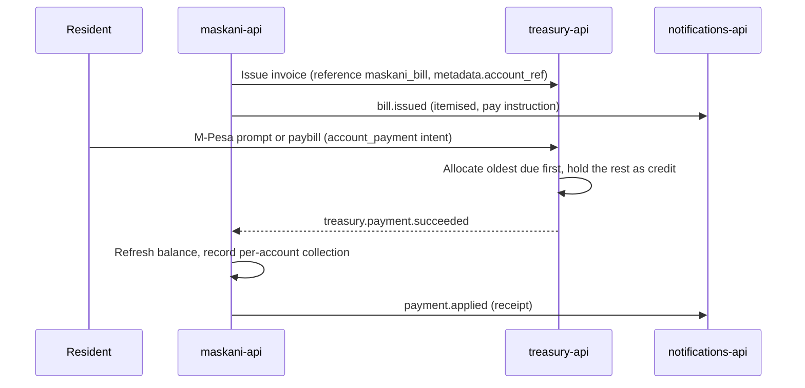

# Maskani architecture

Maskani is the property and estate management product: `maskani-api` (Go, Ent, Atlas migrations),
`maskani-ui` (Next.js console, resident portal and gate tablet at `maskaniapp.codevertexafrica.com`)
and `maskani-commerce` (the public marketplace at `maskani.codevertexafrica.com`). The repositories'
own `docs/` folders hold the full API spec, ERD and event list; this page is the map.

## How it connects

Ownership follows [Cross-Service Data Ownership](cross-service-data-ownership.md): Maskani owns the
register, billing runs, meters, works, gate, notices, documents and its own approvals; it never moves
money. Treasury's account ledger (by `account_ref`) is the balance of record.

## Tenancy and modules

- Every domain table carries `tenant_id` and an Ent tenant guard; requests are scoped to the caller's
  properties (staff) or unit links (portal).
- A property is also an auth-api outlet, so branch-scoped roles apply to properties.
- Modules (`properties`, `billing`, `utilities`, `sales`, `estate`, `maintenance`, `providers`, `gate`,
  `staff`, `communication`) are switched per tenant and overridden per property. A property's
  `use_case` picks a preset module set; subscriptions gate each module by the feature code
  `maskani_<module>`.

## Money flow

- Bank paybills: a fund's `metadata.paybill_account_format` (`{ref}`, `2362010#{ref}` or the bank
  account alone) shapes the pay instruction; statement CSV imports match credits into manual payments.
- Manual payments (bank, cash, cheque, typed M-Pesa) book through
  `POST /s2s/{tenant}/accounts/{ref}/manual-payments` only after approval.
- Credit notes inherit the bill's `account_ref`; the ledger nets them off and the allocator skips
  them. Only unpaid amounts can be credited.
- Late charges are Treasury invoices with `metadata.kind = late_charge`, excluded from the overdue
  base so they never compound.

## Approvals

One engine, `internal/modules/approvals`, shaped like treasury's and inventory's. See the platform
standard [Approvals](../platform-standards/approvals.md). Modules on it: `credit_note`,
`adjustment`, `manual_payment`, `work_order_quote`. Inbox `GET /approvals`, rules `/approvals/rules`.

## Background jobs

Every job runs once per period across pods (`sharedcache.ClaimPeriod`), per the
[multi-replica jobs](../platform-standards/multi-replica-jobs.md) standard.

| Job | Every | Does |
|---|---|---|
| `maskani:c2b-routes` | minute | Registers paybill account routes in Treasury |
| `maskani:billing-resume` | minute | Resumes billing runs a stopped pod left issuing |
| `maskani:billing-schedules` | hour | Starts scheduled runs, reminds about missing readings |
| `maskani:collections-ladder` | hour | Payment plan checks, then one ladder step a day per owing account, working hours only |
| `maskani:late-charges` | hour | Monthly late charge per owing account where switched on |
| `maskani:occupancy-links` | hour | Ends links on their date with their effects; clears stale bill-to |
| `maskani:instalment-reminders`, `instalment-invoicing` | hour | Sale instalments: reminders, overdue, defaults, invoices |
| `maskani:collections-backfill` | hour | Per-account collections from Treasury ledgers for history |
| `maskani:sla-breaches` | minute | Flags work orders past their fix time |
| `maskani:vendor-doc-expiry` | hour | Warns before vendor documents expire |
| `maskani:gate-offline`, `gate-retention` | minute, hour | Gate tablet health; purges old gate data |
| `maskani:scheduled-notices` | minute | Sends notices on their schedule |
| `maskani:daily-stats-rebuild` | hour | Rebuilds dashboard figures |
| `maskani:reservation-expiry` | minute | Releases unpaid reservations |

## Events

Published through the outbox on `maskani.*`, consumed by notifications-api (and Treasury where
noted in the API repo's `docs/events.md`). Staff alerts carry `responders` (the people to reach)
resolved in Maskani: property staff by property role, or role holders for an approval step.

## Media

Uploads live under `tenants/{id}/{kind}/...`. Estate and unit photos are public and cached
immutably; every other kind (documents, readings, works, incidents, vendors) needs a signed link
from `POST /media/sign`.
