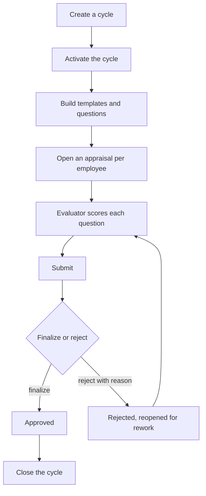
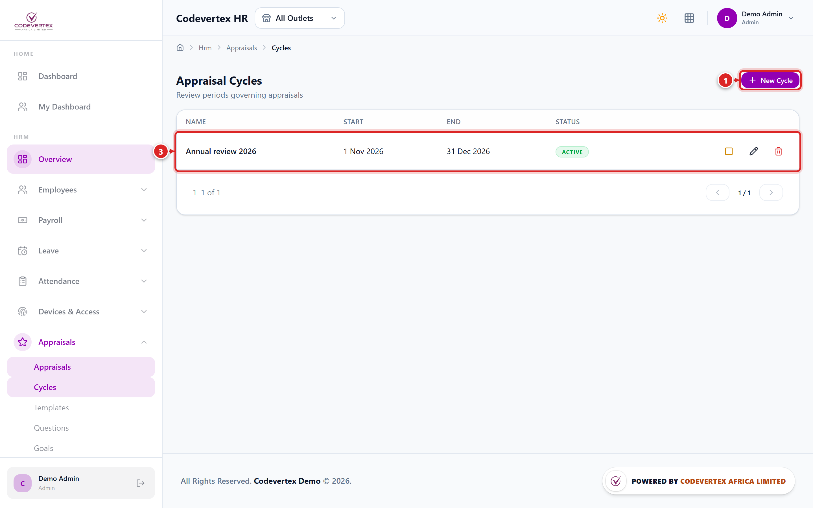
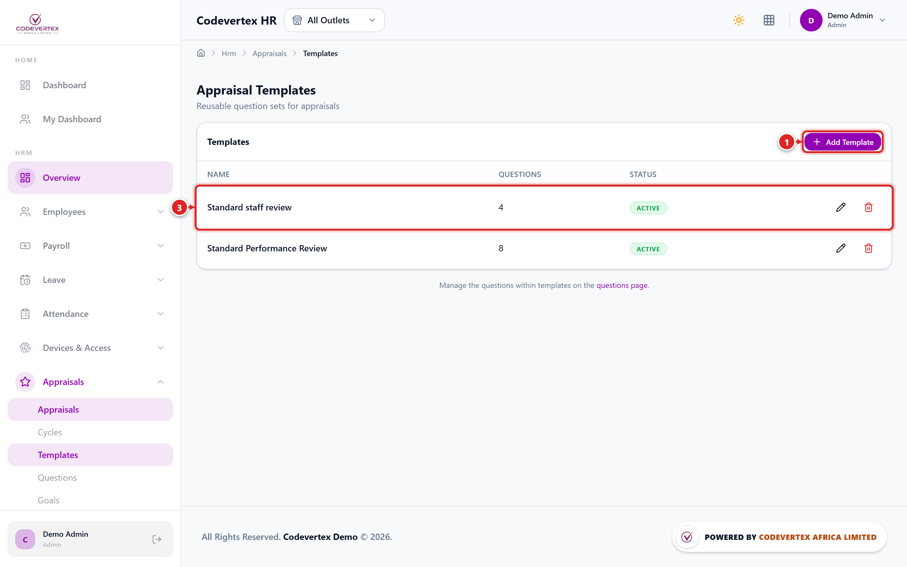
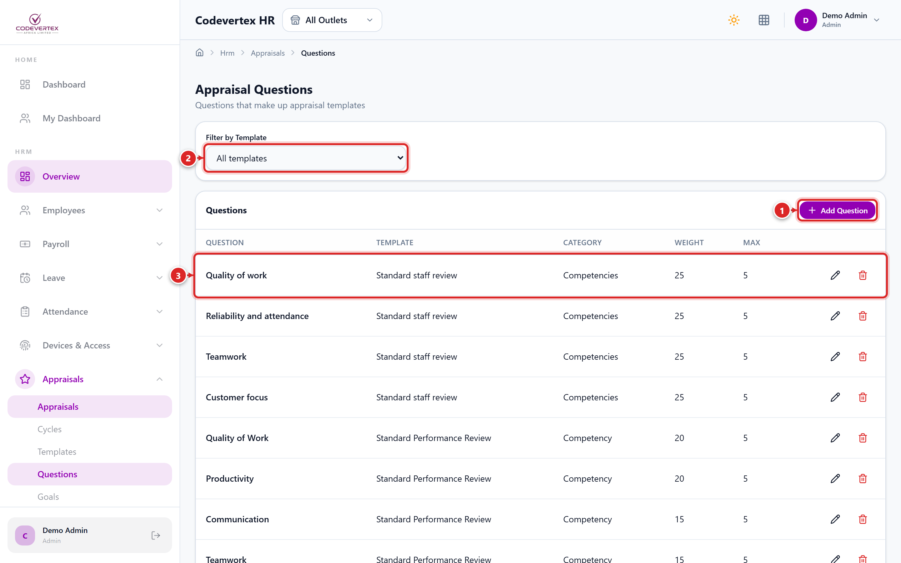
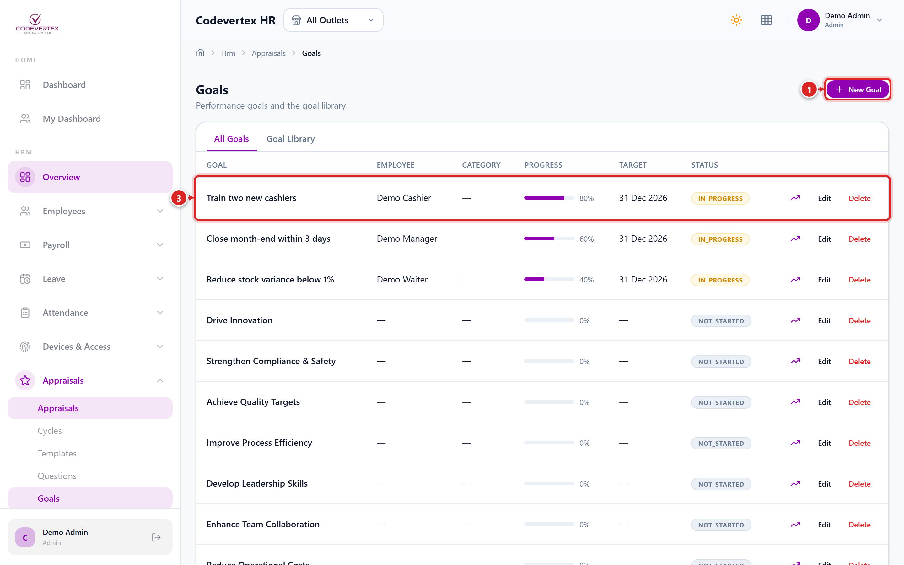
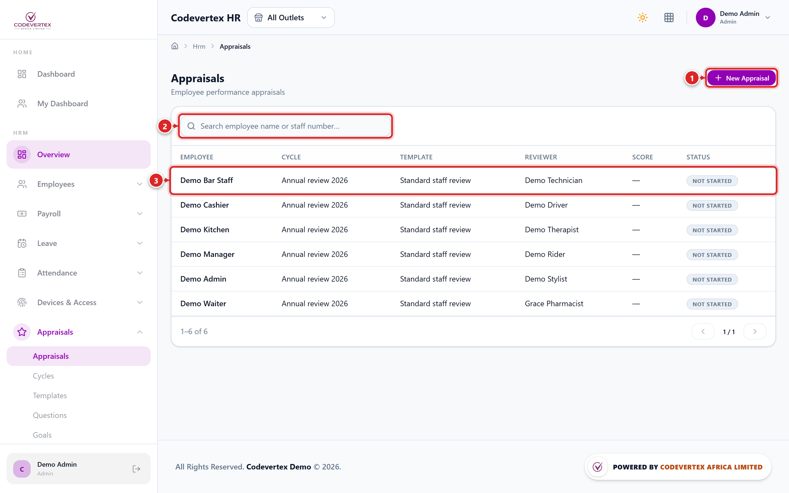
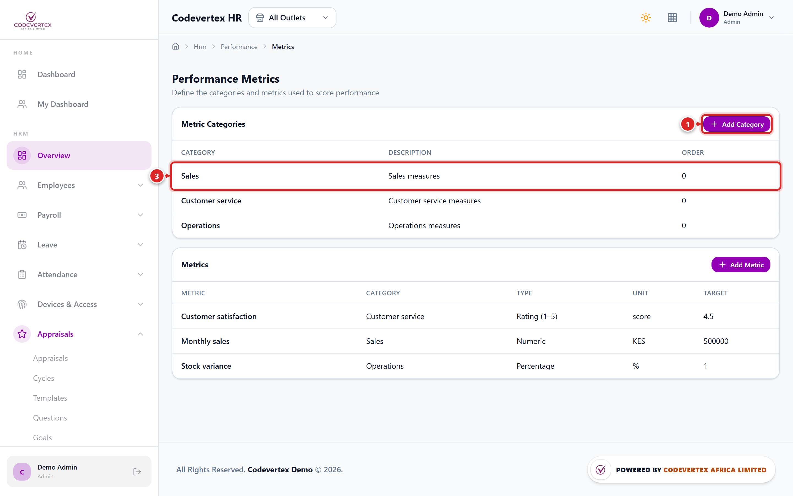
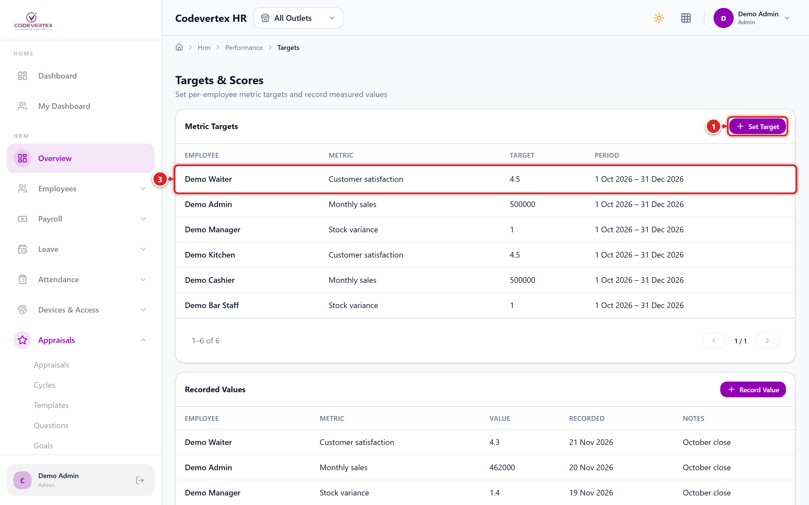
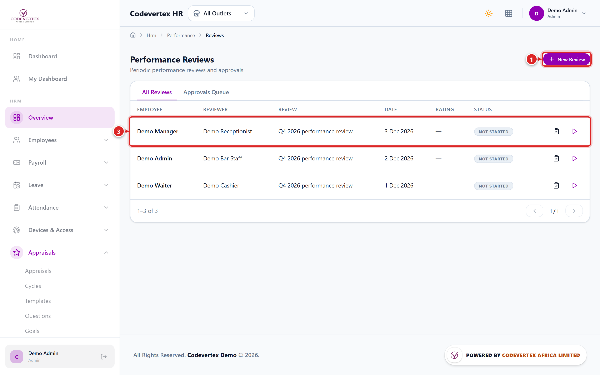

# Appraisals and Performance

Codevertex ERP has two complementary ways to measure how people are doing:

- **Appraisals**: a periodic review against a set of questions, run inside an appraisal cycle,
  with goals tracked alongside.
- **Performance**: measurable metrics with targets per person, recorded values, and periodic
  performance reviews with a rating.

Both are under **HRM → Appraisals** in the menu.

## Appraisal cycles

Go to **HRM → Appraisals → Cycles**. A cycle is a review period, for example "2026 Mid-year",
with a start and end date. All appraisals in it share those dates.

| Action | Effect |
|---|---|
| Activate | Opens the cycle so appraisals can be run in it |
| Close | Ends the cycle when the reviews are done |
| Reopen | Opens a closed cycle again, for late or disputed reviews |

## Templates and questions

Go to **HRM → Appraisals → Templates** to create a reusable question set, for example one for
sales staff and one for managers. A template has a name, a description and an Active switch;
the list shows how many questions each has.

Go to **HRM → Appraisals → Questions** to add the questions. Filter by template to see one set.

| Field | Notes |
|---|---|
| Template | Which template the question belongs to |
| Question | The text the evaluator answers |
| Category | Groups questions, for example Teamwork or Delivery |
| Weight | How much this question counts towards the overall score |
| Max score | The top of the scale for this question |
| Order | Where it appears in the form |

## Goals

Go to **HRM → Appraisals → Goals**. The **All Goals** tab lists each person's goals with a
category, a target date, a weight, a description and a progress bar. Use **Update progress** to
record a new percentage. The **Goal Library** tab holds standard goals you reuse across people.

A goal moves from Not started to In progress to Completed as progress is recorded, or can be
cancelled if it no longer applies.

## Running an appraisal

Go to **HRM → Appraisals → Appraisals** and click **New Appraisal**. Choose the employee, the
cycle and the template.

Open the appraisal to work on it.

1. **Evaluate.** The evaluator scores each question and adds a comment. The responses appear
   under the appraisal with their scores.
2. **Submit.** When the form is complete, submit it for sign-off.
3. **Finalize or reject.** An approver finalizes the appraisal, or rejects it with a reason that
   is shown at the top of the appraisal.
4. **Reopen.** A rejected or finalized appraisal can be reopened for changes.

| Status | Meaning |
|---|---|
| Draft | Created, not yet started |
| In progress | Being evaluated |
| Completed | Submitted and waiting for sign-off |
| Approved | Finalized |
| Rejected | Sent back with a reason |

If you set up an approval workflow for the "Appraisal" module, sign-off follows its steps (for
example line manager, then HR). See [Approvals](approvals.md).

## Performance metrics

Go to **HRM → Appraisals → Metrics**. First add **metric categories** (name, description and
display order), then the **metrics** in each one.

| Field | Notes |
|---|---|
| Category, name | Where the metric sits and what it is called, for example "Monthly sales" |
| Type | Numeric, Percentage, Rating (1 to 5) or Yes / No |
| Unit | For example KES, calls, tickets |
| Min value, max value | The allowed range |
| Default target | The target used when a person has none of their own |
| Description | How the metric is measured |

## Targets and scores

Go to **HRM → Appraisals → Targets & Scores**.

- **Set Metric Target**: pick the employee and metric, the target value, and the period start
  and end.
- **Record Metric Value**: pick the employee and metric, enter the measured value, the date
  recorded and any notes.

Comparing recorded values to targets shows who is on track before the formal review.

## Performance reviews

Go to **HRM → Appraisals → Reviews** and click **New Performance Review**. Choose the employee,
the period, the review date, a rating from 1 to 5 and comments.

Use **Score review** to record the scores, then **Submit review**. Reviews waiting for a
decision are listed on the **Approvals Queue** tab, where an approver approves or rejects them.
Reviews use the same statuses as appraisals, and follow a "Performance Review" approval
workflow when you have one.
