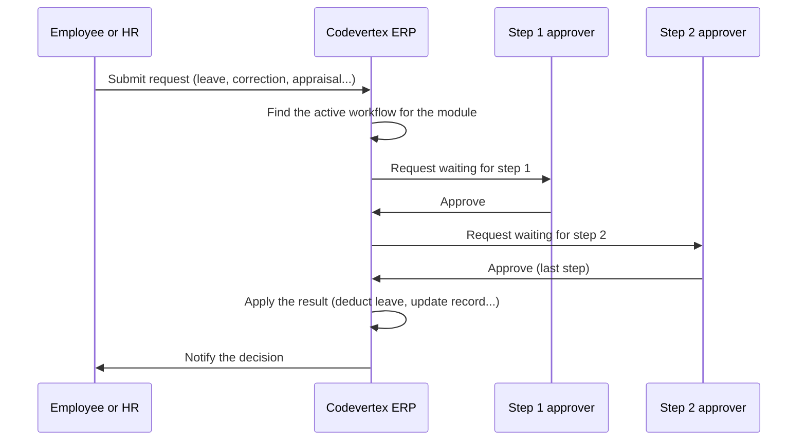
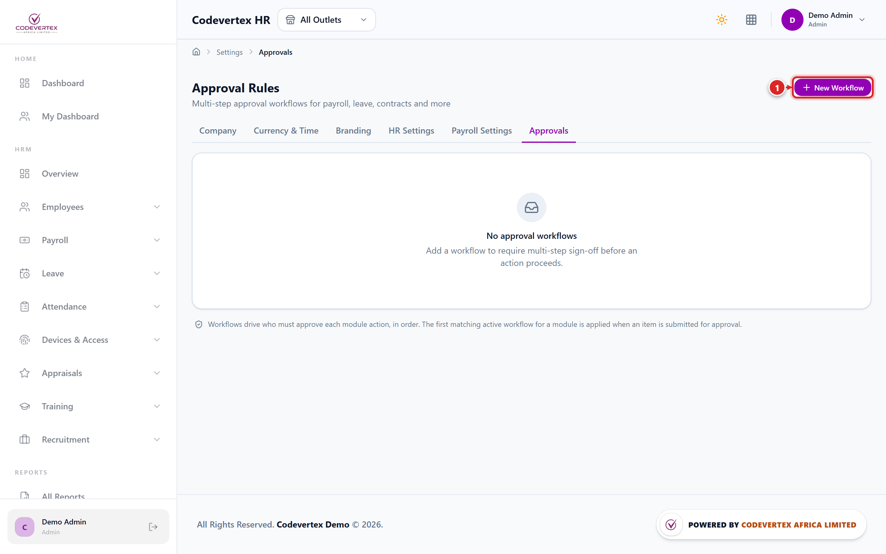

# Approvals

Codevertex ERP has one approval engine shared by every HR module. You describe, once per module,
who has to sign off and in what order. From then on every request in that module follows those
steps, and everyone involved is kept informed.

## Setting up a workflow

Go to **Administration → Settings → Approval Workflows** and click **New Approval Workflow**.

| Field | Notes |
|---|---|
| Module | What the workflow governs (see the table below) |
| Name | For example "Leave: manager then HR" |
| Description | Optional |
| Active | Only an active workflow is used |
| Approval steps | One or more steps, in order. Click **Add Step** for each |

For each step give a label (for example "Line manager") and choose who approves it:

| Approver | Who that is |
|---|---|
| Line Manager (reports-to) | The person the requester reports to |
| Department Head | The head of the requester's department |
| Role (RBAC) | Anyone who holds the role you name, for example `hr_manager` |
| Specific Employee | One named person |

The workflow list shows each workflow's module, its steps in order and whether it is active.
Switch a workflow off to stop using it without deleting it.

## Modules that use approvals

| Module | What is approved | What happens on final approval |
|---|---|---|
| Leave Request | A leave application | Status becomes Approved and the days come off the balance |
| Appraisal | A submitted appraisal | The appraisal is finalized |
| Performance Review | A submitted review | The review is approved |
| Attendance correction | Corrected clock in and out times | The attendance record takes the new times and keeps the old ones in its history |
| Overtime request | Overtime hours | The hours count as approved overtime for payroll |
| Contract | An employment contract | Signed off before it is issued |
| Recruitment Offer | A job offer | Signed off before the offer is made |
| Payroll | A payroll run | Signed off before the run is paid (see the payroll pages) |
| General | Anything else your company wants signed off | Recorded as approved |

## How a request moves

- Each step is decided in order. **Approve** moves the request to the next step, and approval at
  the last step approves the whole request.
- **Reject** at any step ends the request straight away, with a reason the requester sees.
- A step can be **escalated**: it is marked escalated and the request moves on to the next step
  (or is approved if it was the last one). Use this when an approver is away.
- A request that is still pending can be **cancelled**.
- The result is applied only once the request is fully approved. While steps are still waiting,
  a leave request, for example, stays Pending and no days are deducted.

## Where approvers decide

Approvers decide in the module where the request lives:

- **HRM → Leave → Requests**, on the **Approvals Queue** tab.
- **HRM → Appraisals → Appraisals**: open the appraisal and use **Finalize** or **Reject**.
- **HRM → Appraisals → Reviews**, on the **Approvals Queue** tab.
- **HRM → Attendance**, on the corrections and overtime request pages.

Each shows the request with **Approve** and **Reject** buttons for people allowed to decide the
current step. For a role step, anyone holding that role can decide; for a manager, department
head or named person step, that person decides.

## Notifications

The ERP announces each stage of a request: when it is submitted, when a step is approved, when
it is finally approved or rejected, and when it is cancelled. The requester is notified of the
final decision; for leave this arrives as a leave decision notification.

## When no workflow is set up

You do not have to configure workflows before you start.

- **Leave, appraisals and performance reviews** with no active workflow are decided in a single
  step by anyone with permission to approve them.
- **Attendance corrections and overtime requests** with no active workflow get a single
  **HR review** step, decided by HR staff who manage attendance. A request is never left
  without someone who can decide it.

Add a workflow later and every new request in that module follows it; requests already in
progress finish the way they started.
