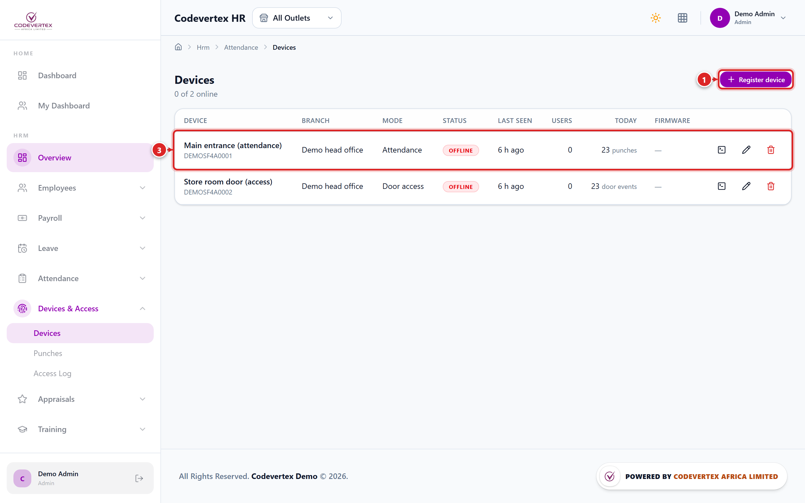
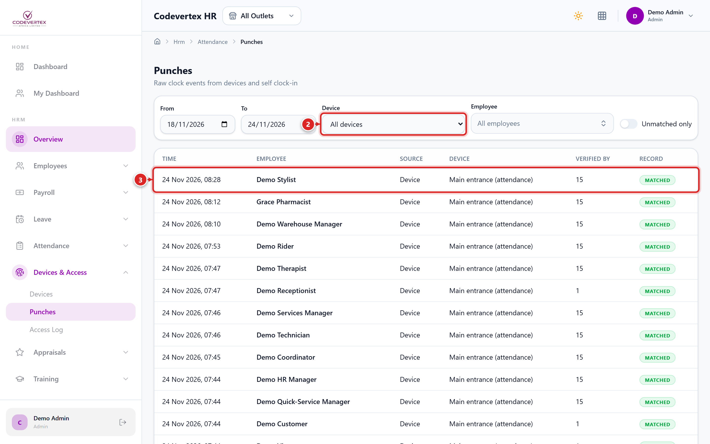
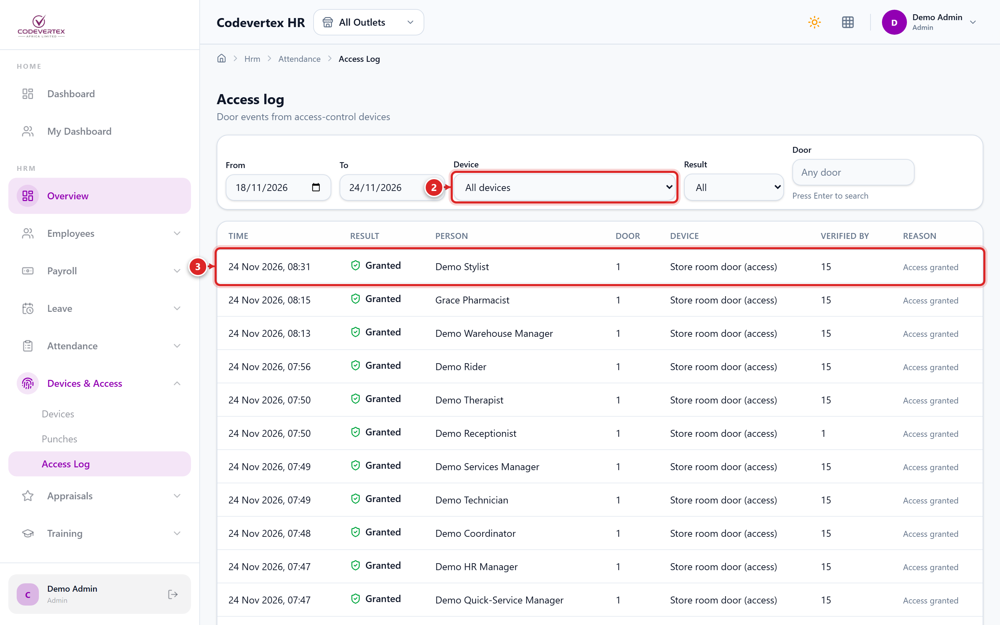
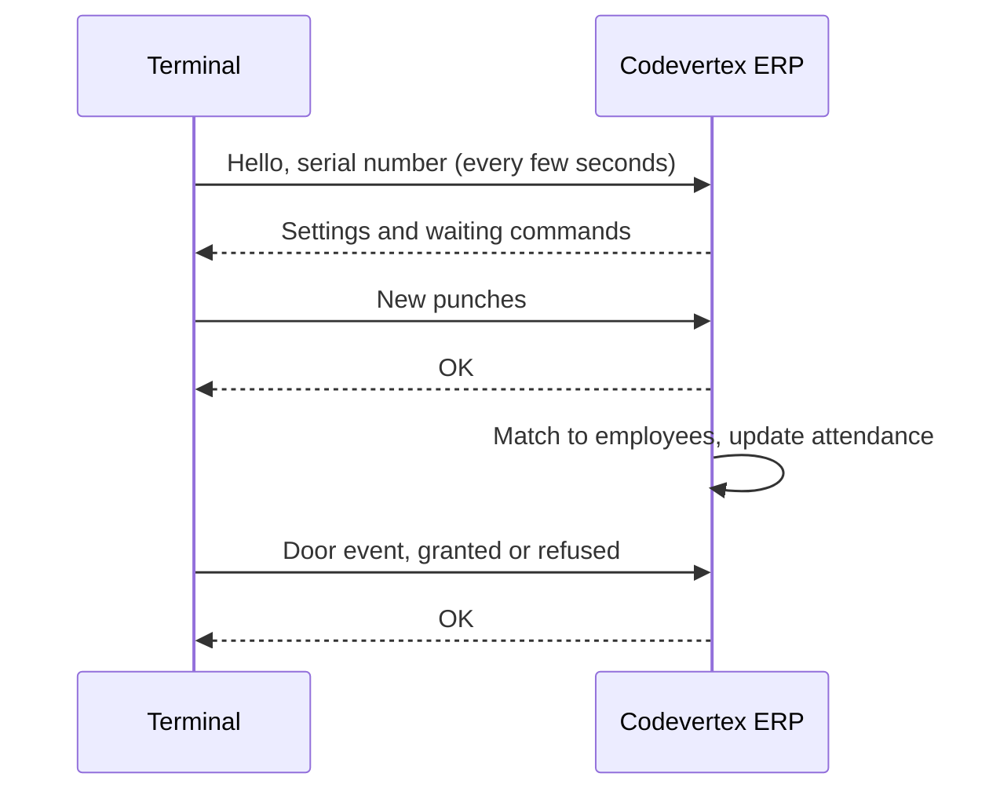

# Biometric Devices and Access Control

Codevertex ERP works with ZKTeco terminals that support the cloud push protocol, such as the
SenseFace 4A (face, fingerprint, palm and card). Terminals send punches and door events straight to
the ERP over the internet, so no computer has to stay on at each site.

## Connecting a terminal

1. On the terminal, open the cloud server settings and enter the ERP server address your Codevertex
   contact gives you. Choose attendance push mode for clock-in terminals; a terminal that controls a
   door can stay in access control mode.
2. In the ERP, go to **HRM → Attendance → Devices** and select **Register device**. Enter the serial
   number from the label (also under Menu → System Info on the terminal), a name such as *Main
   gate*, the branch and work site.
3. Optionally list the site's internet addresses under **Allowed internet addresses**. Punches that
   claim this serial from any other address are refused.
4. Within a minute the terminal shows as online.

Only registered, active terminals are accepted. A terminal that loses internet keeps its punches
and sends them when the connection returns; punches sent twice are kept once.

## Linking staff to the terminal

Each employee has a **device number** (the user ID on the terminal), set on the employee's profile.
Use **Send users** on the device to put everyone on the terminal, then enrol faces or fingers at the
terminal. Punches from a device number that is not linked yet appear as unmatched on the
**Punches** page and are attached automatically once the number is linked.

## Commands

From a device you can send users, open the door, restart the terminal, reload its stored punches or
clear them. Each command shows whether it was sent and the terminal's answer.

## Door access log

Terminals on doors report every entry: granted, refused, unknown face or card, and entries outside
working hours. See **HRM → Attendance → Access log**, or the access report for a date range.

