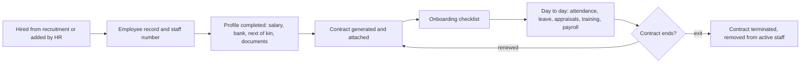
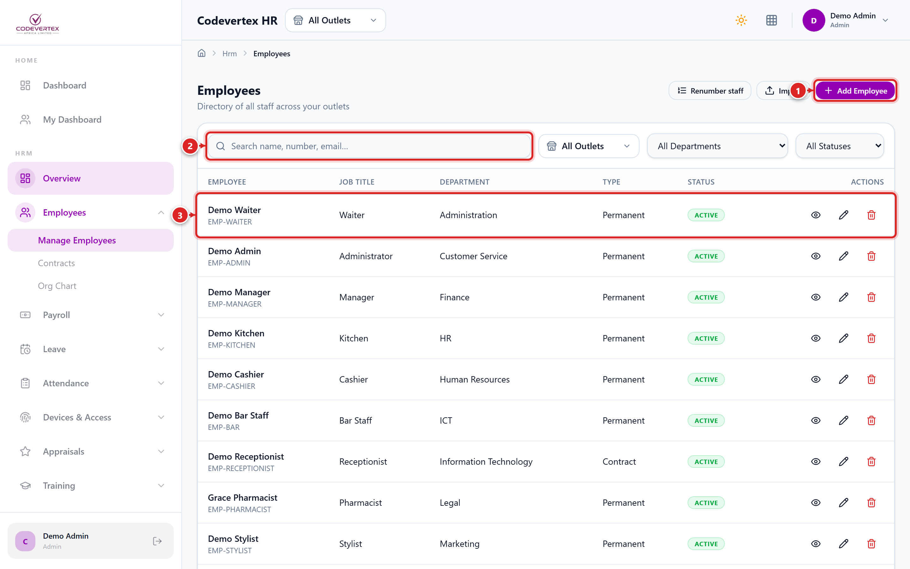
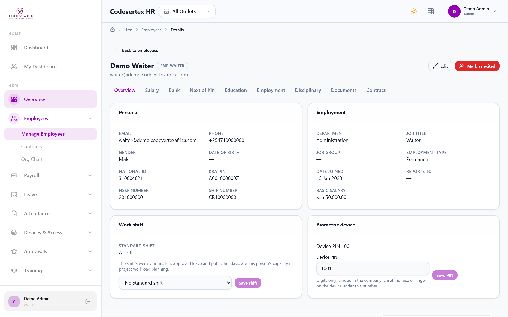
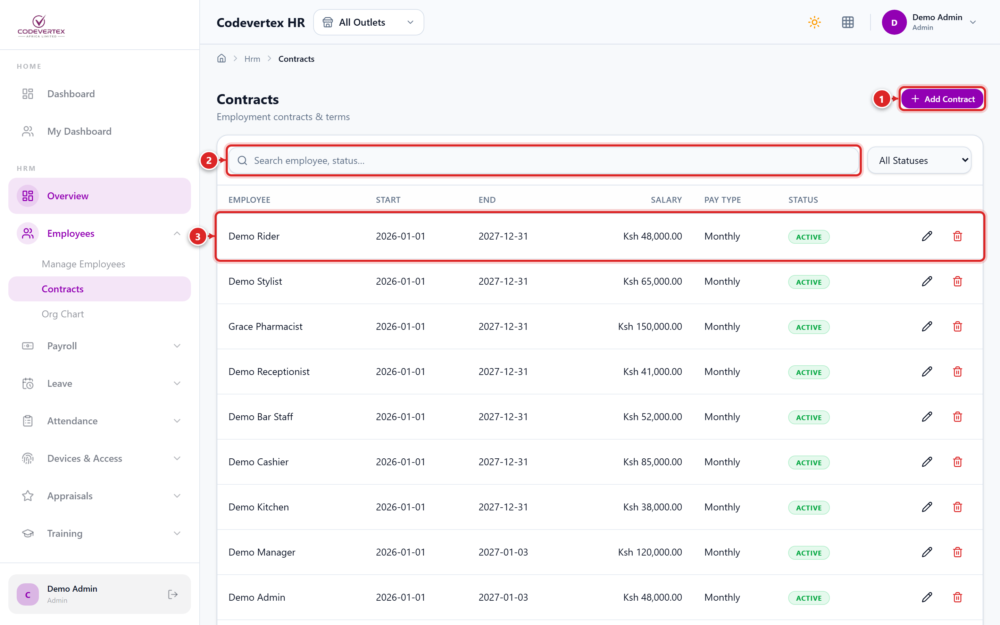
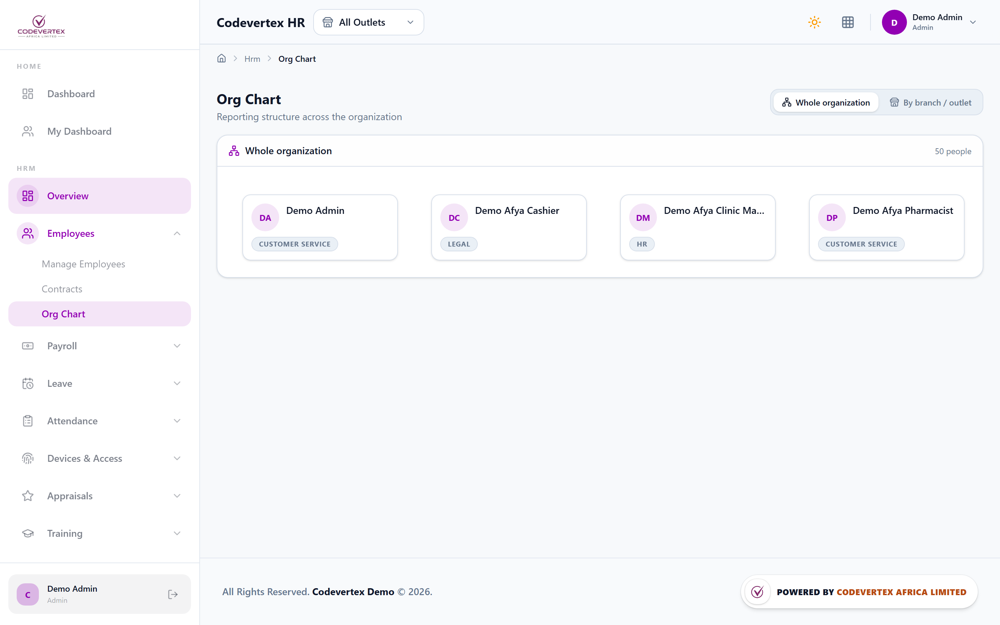

# Employees

The employee record is the centre of HR in Codevertex ERP. Leave, attendance, appraisals,
training and payroll all hang off it. This page covers adding people, what each tab on the
profile holds, contracts, the org chart, staff numbers and how someone leaves.

## The employee directory

Go to **HRM → Employees → Manage Employees**. The list shows each person's job title,
department, employment type and status. Search by name, staff number or email, and filter by
branch, department or status (Active, On Leave, Suspended, Terminated).

## Adding an employee

Click **Add Employee**. The form has two steps.

**Step 1: Personal**

| Field | Notes |
|---|---|
| First name, last name | Required |
| Middle name | Optional |
| Email | Used to link the person to their self-service login |
| Phone number | Optional |
| Gender, date of birth | Date of birth cannot be in the future |
| National ID | Checked for a valid format |
| KRA PIN | Checked for the KRA format (a letter, nine digits, a letter) |

**Step 2: Employment**

| Field | Notes |
|---|---|
| Department, job title, job group | Picked from the lists under **Administration → HR Settings** |
| Employment type | Permanent, Contract, Casual, Consultant or Intern |
| Date joined | The start date |
| Basic salary | A starting figure; refine it on the Salary tab |
| Director, Shareholder | Tick for directors and shareholders, who are paid fees or dividends and exit by resolution rather than under employment law |

Click **Create Employee**. The ERP gives the person a staff number straight away and opens
their profile so you can fill in the rest.

## Importing employees from a CSV file

For many staff at once, click **Import** on the employee list.

1. Click the template link to download `employees-import-template.csv`.
2. Fill one row per person. The columns are `employee_number`, `first_name`, `last_name`,
   `email`, `gender`, `national_id`, `pin_no` (KRA PIN), `shif_or_nhif_number`, `nssf_no` and
   `residential_status`. Staff number, first name and last name are required.
3. Upload the file.

Each row is checked and created on its own, so one bad row does not stop the rest. When the
upload finishes you see the total, how many were created and how many failed, with the reason
for each failed row. Fix those rows and upload them again.

The import also loads each person's NSSF number and SHIF number in bulk, which payroll uses on
the statutory returns. For one person, enter them in the employee form.

## The employee profile

Click a name in the list to open the profile. The staff number shows next to the name, with a
badge for directors and shareholders. **Edit** opens the same two step form.

| Tab | What it holds |
|---|---|
| Overview | Contact details, national ID, KRA PIN, department, job title, job group, employment type, date joined and basic salary. Also the **Work shift** and **Biometric device** cards (below) |
| Salary | Basic salary, currency, pay frequency, payment method, effective date, PAYE category, payout channel and mobile money number, and the KRA tax reliefs: insurance premium, pension contribution, mortgage interest and the disability exemption |
| Bank | Bank accounts: bank, branch, account name and number |
| Next of Kin | Name, relationship, phone, email and address |
| Education | Institution, qualification, field of study, grade, dates and a certificate link |
| Employment | Previous employers: employer, designation, dates and reason for leaving |
| Disciplinary | Incidents with date, category, action taken, description, a document link and a status of Open, Resolved or Closed |
| Documents | Uploaded files with a title and document type. Preview any file in the browser |
| Contract | The employment contract, edited and generated as a PDF (see below) |

### Standard work shift

On the Overview tab, the **Work shift** card sets the person's standard shift. Attendance uses
it to judge lateness and overtime when no roster or assignment applies, and its weekly hours,
less approved leave and public holidays, are the person's working capacity for project
planning. Choose **No standard shift** to leave it empty.

### Device PIN

The **Biometric device** card holds the person's device PIN: digits only, up to nine, and
unique in the company. Enrol the face or finger on the terminal under this number, then use
**Sync users** on the device so it picks up the change. See
[Biometric Devices and Access Control](devices-and-access.md).

## Contracts

### The contract on the profile

On the **Contract** tab, pick the contract type and the ERP fills in standard terms using the
person's name, role, pay and your company details. Edit the wording in the editor, then:

- **Save** keeps your wording for this person.
- **Preview PDF** shows the finished contract with your logo and signature lines.
- **Generate & attach** creates the PDF and files it on the **Documents** tab.

If you switch the contract type with unsaved changes, the ERP asks before discarding them.

### The contracts list

Go to **HRM → Employees → Contracts** to see every contract in one place, with start and end
dates, salary, pay type (monthly, hourly, daily or fixed) and status.

| Status | Meaning |
|---|---|
| Pending | Agreed but not yet started |
| Active | In force |
| Expired | Past its end date |
| Terminated | Ended early |

To **renew** a contract, add a new contract for the employee with the new start and end dates
and salary, and set the old one to Expired. Filter the list by status, or sort by end date, to
see which contracts are coming up for renewal.

## Org chart

Go to **HRM → Employees → Org Chart**. The chart draws your reporting lines from each person's
line manager. Switch between the **org** view (one tree from the top down) and the **branch**
view (people grouped by branch, head office last).

The same line manager is who a "Line Manager" step in an approval workflow goes to, so keep
reporting lines up to date.

## Staff numbers

New employees get the next number in the format `SLUG/YYYY/###`, for example
`ACME/2026/014`. The prefix starts as your company's short name and the running number starts
again each year. Change the prefix or padding under **Administration → Settings → Document
Numbering**.

Payslips, contracts and attendance are linked to the person, not to the number, so changing the
format never breaks history. After a change of format, an administrator can re-issue clean numbers to every active
employee, in the order they were added: on **HRM → Employees**, choose **Renumber staff** and
confirm.

## When someone leaves

1. Open **HRM → Employees → Contracts**, edit the person's current contract and set its status
   to **Terminated**, with the end date and a note.
2. Run their final pay in payroll.
3. Remove their device PIN so they can no longer use the biometric terminals, and deactivate
   their login under **Administration → Users & Security → Users**.
4. On the employee's profile choose **Mark as exited** and confirm. They leave the active
   directory and payroll, and their history (payslips, attendance, leave) is kept. **Reinstate**
   brings them back if they return.

Exits and staff turnover in the HR reports are counted from the termination date.
