# Getting Started with HR

This page walks a new company through setting up Codevertex ERP for HR, in the order that saves
the most rework. Each step feeds the next: departments and job titles appear in the employee
form, roles decide who can approve, and approval workflows decide who signs off leave and
appraisals. Plan on about an hour for a small company.

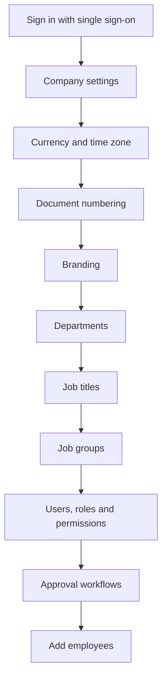

## 1. Sign in

Codevertex ERP uses single sign-on. You sign in once with your Codevertex account and the same
session opens the ERP and the other Codevertex services your company uses. There is no separate
ERP password. If you were invited by email, use the temporary password from the invitation the
first time and set your own when asked.

## 2. Company settings

Go to **Administration → Settings → Company**.

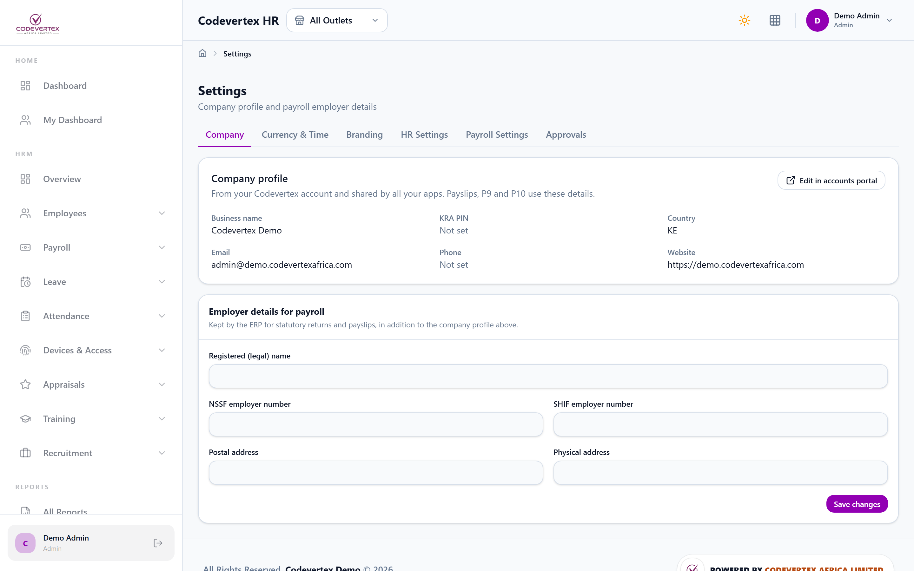

| Field | What it is used for |
|---|---|
| Business name and legal name | Shown on payslips, contracts and reports |
| KRA PIN | The employer PIN on statutory returns and P9 cards |
| Registration number | Shown on documents that need it |
| Email, phone, website, address, city, country | Contact details printed on documents |
| Time zone, date format, time format | How dates and times are shown |
| Fiscal year start | The month your financial year begins |

## 3. Currency and time zone

Go to **Administration → Settings → Currency & Time**. Pick the default currency (for example
KES), the time zone, the date and time formats, and the fiscal year start date. The time zone
matters for attendance: a clock-in at 08:05 is judged against the shift in your local time.

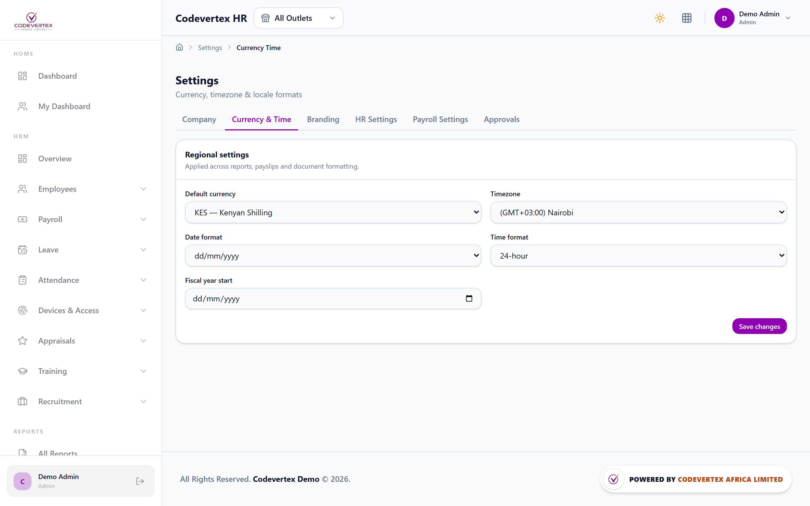

## 4. Document numbering

Go to **Administration → Settings → Document Numbering**. Each document type has its own number
format built from a prefix, a separator, a date part, a running number with padding, and a reset
frequency (never, daily, monthly or yearly). The **Sample** column shows what the next number
will look like.

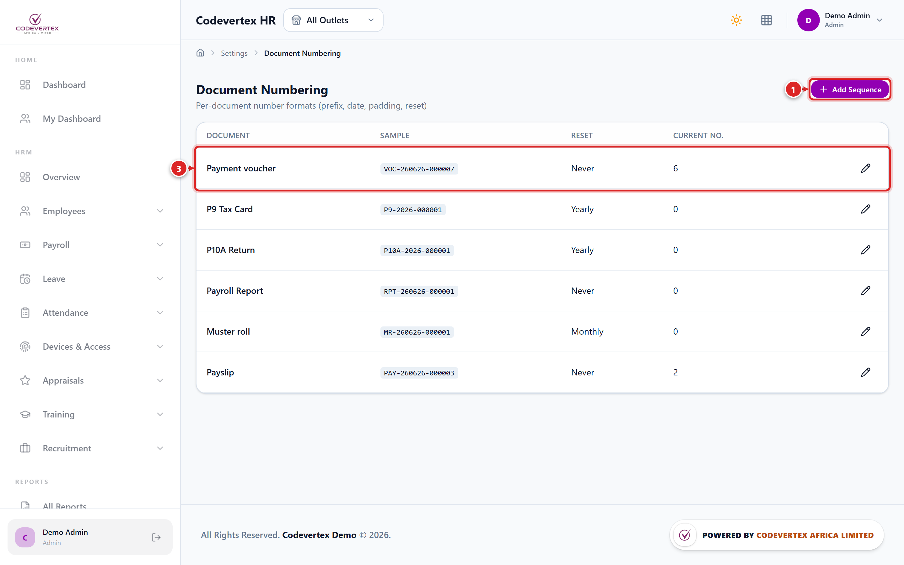

Employee numbers are issued automatically when you add an employee. They read
`SLUG/YYYY/###`, for example `ACME/2026/001`: your company's short name, the year and a
three digit running number that starts again each year. Once the first employee has been
created, the employee number sequence appears in this list and you can change its prefix or
padding like any other.

## 5. Branding

Go to **Administration → Settings → Branding** to see your logo and brand colours. Branding is
managed once in the Codevertex accounts portal and applied to every service, so the page links
you to the editor there. Your logo then appears on payslips, contracts and the careers page.

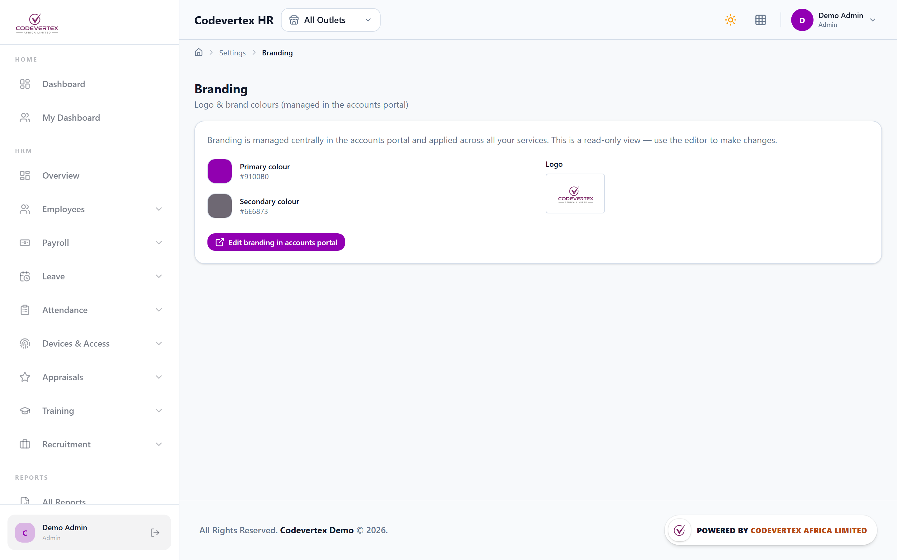

## 6. Departments

Go to **Administration → HR Settings → Departments**. Add each department with a name, an
optional code and description, and a cost center. The cost center is where payroll costs land
for staff whose time is not charged to a project.

## 7. Job titles

Go to **Administration → HR Settings → Job Titles**. Add a title, an optional code and a
description for each role you hire for. Job titles are used on the employee record and on job
postings.

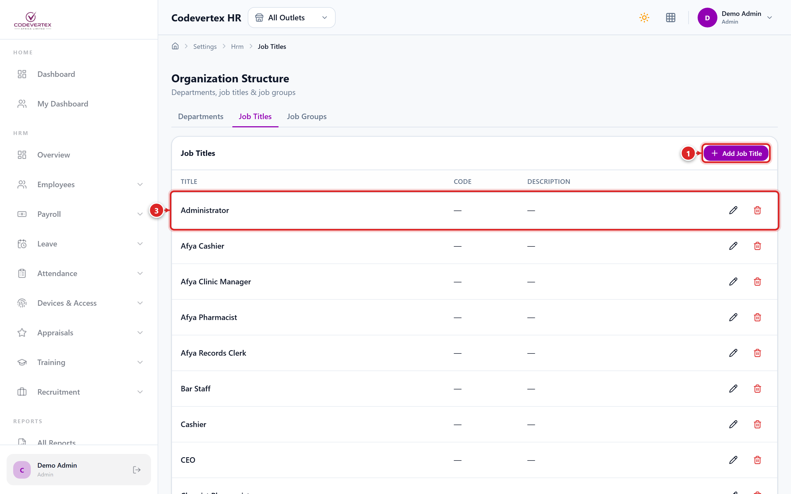

## 8. Job groups

Go to **Administration → HR Settings → Job Groups**. A job group is a pay grade: a name, a
grade, and a minimum and maximum salary. Assign one to each employee to keep salaries inside an
agreed band.

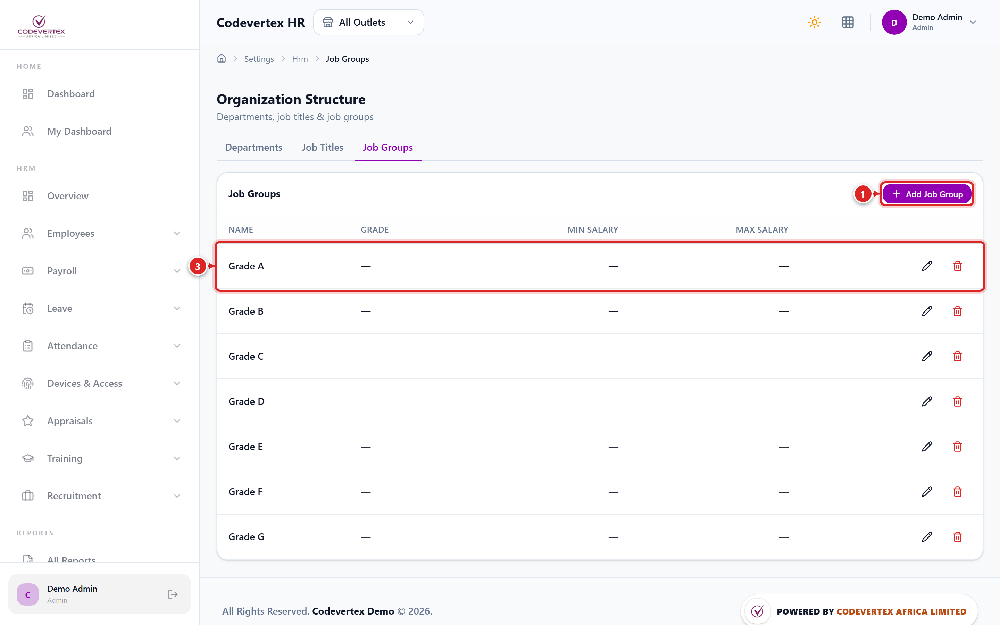

## 9. Users, roles and permissions

User accounts belong to the Codevertex platform, so one person has one login across all your
services. Inside the ERP you decide what each person can do through roles.

- **Administration → Users & Security → Users**: invite a person with their email, name, phone
  and roles. A new account gets a one time temporary password, shown after you save. From the
  same list you can manage roles, reset a password, and activate or deactivate a user.
- **Administration → Users & Security → Roles**: create ERP roles (for example HR officer,
  line manager, payroll clerk) and tick the permissions each one has.
- **Administration → Users & Security → Permissions**: the full catalogue of ERP permissions,
  for reference.

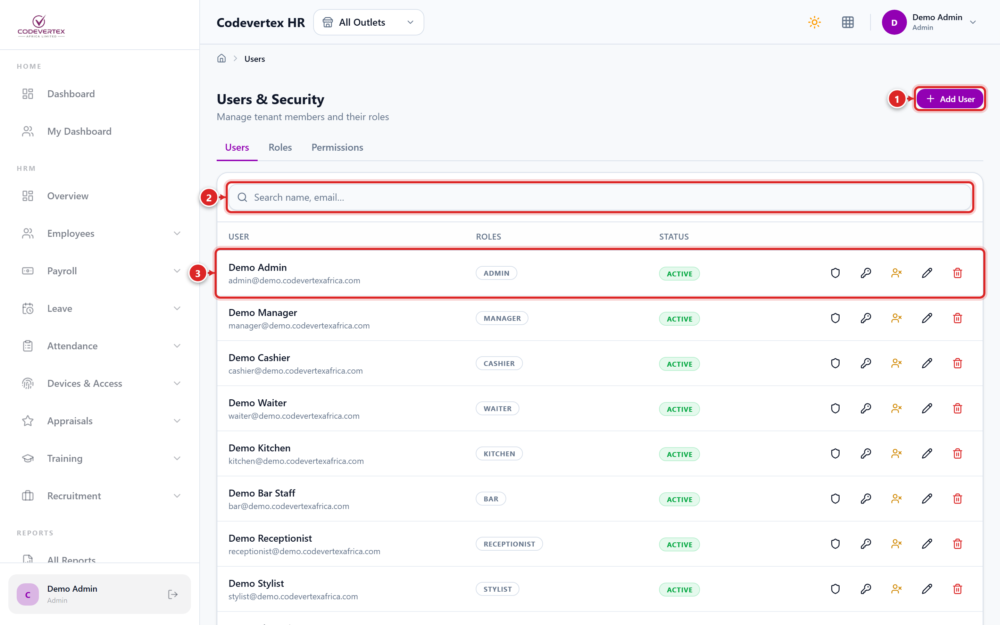

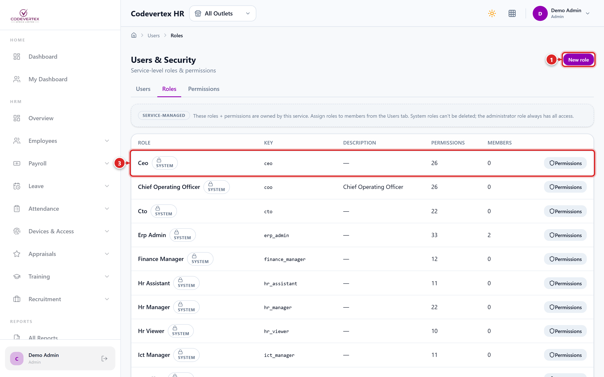

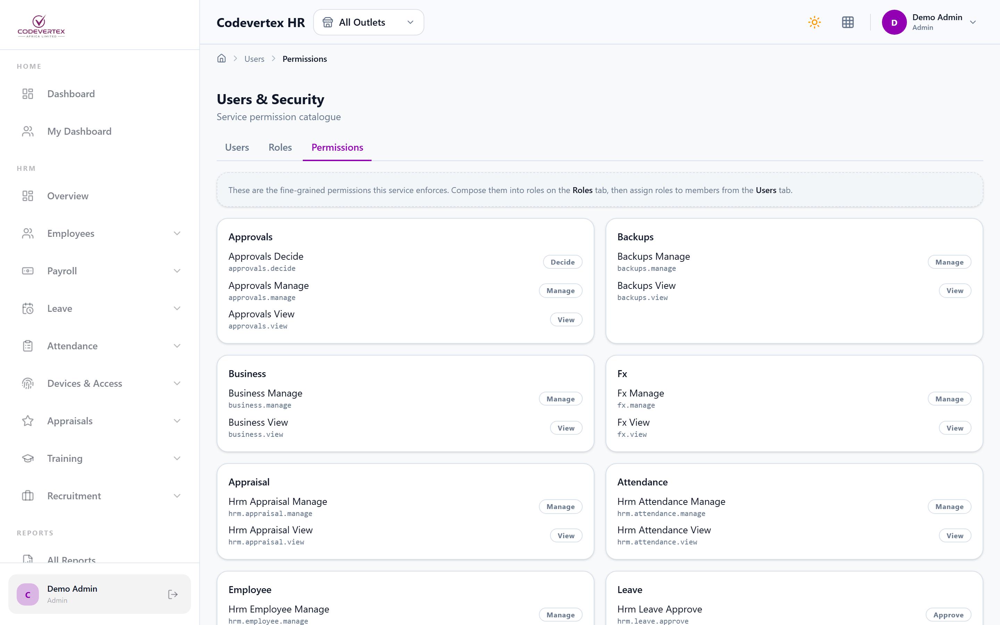

Permissions are grouped by area, such as viewing employees, managing leave, approving leave,
managing appraisals and managing attendance. A menu item only shows for people who hold the
permission behind it, so staff with no HR role see only **My Dashboard**.

## 10. Approval workflows

Go to **Administration → Settings → Approval Workflows**. A workflow is a list of approval steps
for one module, such as leave requests, appraisals, performance reviews, contracts, payroll or
recruitment offers. Each step names who approves: the employee's line manager, the head of
their department, anyone holding a given role, or a specific person. A request moves to the
next step only when the current step approves it.

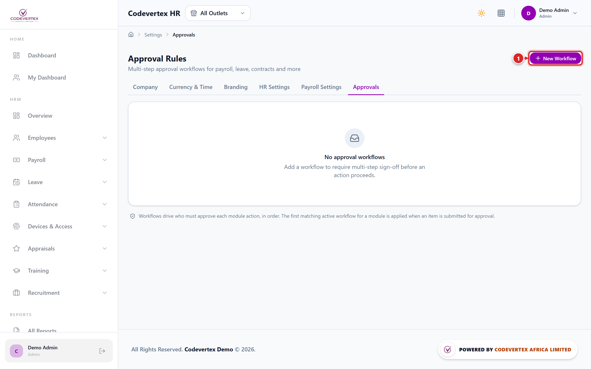

[How approvals work](approvals.md) covers this in detail.

## Next: add your people

With the structure in place, go to [Employees](employees.md) to add staff one at a time or
import them from a CSV file. After that, set up [Leave](leave.md) types and entitlements so
staff can apply from [Self-service](self-service.md).
