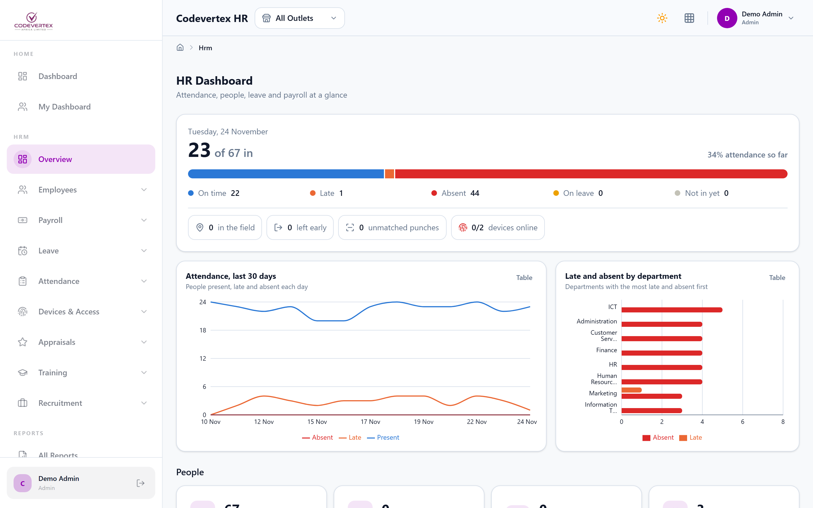
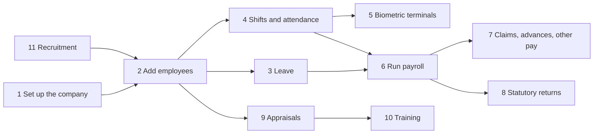
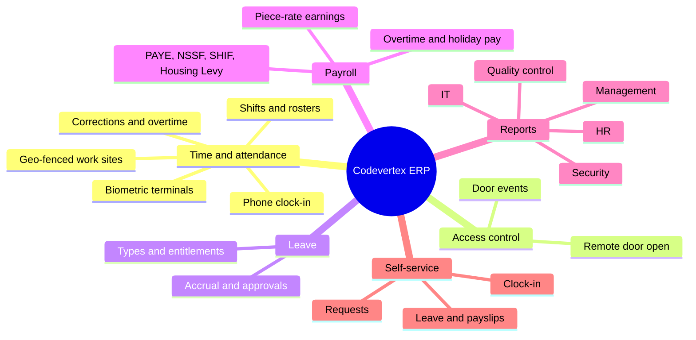
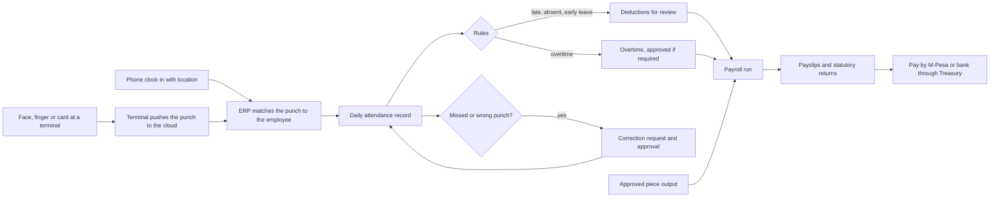
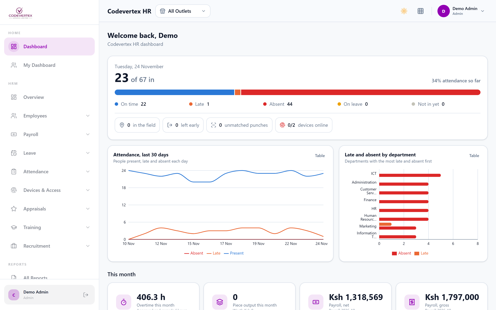

# ERP: People, Time and Payroll

Codevertex ERP runs your people operations: staff records, departments and branches, time and
attendance from biometric terminals and phones, shifts and leave, payroll with Kenyan statutory
deductions, piece-rate pay, approvals and reports. This guide is for tenant admins, HR, payroll
and supervisors, and for anyone comparing what the ERP offers before a live demo.

[Download the Codevertex ERP brochure (PDF)](assets/Codevertex-ERP.pdf){ .md-button .md-button--primary download="Codevertex-ERP.pdf" }

### From setup to payday

The guide follows the order a business adopts the ERP. Start at step 1 and work down; each page
links to the next.

1. **[Getting Started](getting-started.md)**: company settings, numbering, branding, departments,
   job titles, users and roles, approval workflows.
2. **[Employees](employees.md)**: adding and importing staff, the employee profile, contracts, the
   org chart and exits.
3. **[Leave](leave.md)**: leave types, entitlements, accrual, requests and approvals.
4. **[Time and Attendance](time-and-attendance.md)**: shifts and rosters, attendance records,
   lateness, absence, overtime, corrections and geo-fenced phone clock-in.
5. **[Biometric Devices and Access Control](devices-and-access.md)**: ZKTeco terminals such as the
   SenseFace 4A, door events and remote commands.
6. **[Payroll](payroll.md)**: payroll settings, the payroll run, payslips, what attendance and piece
   work add, and paying staff through Treasury.
7. **[Claims, Advances and Other Pay](payroll-extras.md)**: expense claims, advances and loans,
   casual and consultant pay, staff purchases, losses, labour cost per project.
8. **[Statutory Returns](statutory-returns.md)**: P9, P10, NSSF, SHIF, Housing Levy, NITA and bank
   schedules.
9. **[Appraisals and Performance](appraisals-and-performance.md)**: review cycles, goals, metrics
   and targets.
10. **[Training](training.md)**: courses, enrolments and evaluations.
11. **[Recruitment](recruitment.md)**: job postings, the careers page, applicants and onboarding.
12. **[Staff Self-Service](self-service.md)**: what employees do from their phones.
13. **[Approvals](approvals.md)**: how approval workflows work across the ERP.
14. **[Reports](reports.md)**: reports for HR, security, quality control, IT and management.
15. **[Integrated Services](integrated-services.md)**: sign-in, subscriptions, Treasury,
    notifications, projects, POS and logistics.
16. **[Plans, Support and Customisation](plans-and-support.md)**: prices, support levels and
    customisation.

**Screenshot labels.** Numbered badges on screenshots mark: **1** the page's main action (Add, New,
Request, Process), **2** search or filters, **3** the first record in the list.

## How the parts fit together

## Dashboards

The home dashboard shows today's workforce at a glance: who is expected, who is in, late, absent,
on leave, working in the field or left early, plus this month's overtime and piece earnings.
What each person sees follows their role: HR sees people figures, security roles also see
unmatched punches and terminals online, and management roles see payroll and piece earnings.

## Before you start

ERP access is granted per role from **My Organization → Team** (see
[Managing Your Organisation](../organisation/managing-your-organisation.md#team)). Staff who only
clock in, apply for leave and download payslips use **My Dashboard** (self-service) and need no
admin role.
