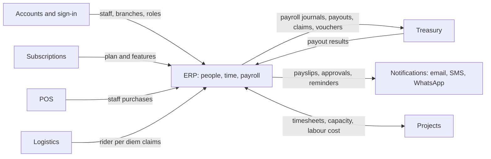

# Integrated Services

Codevertex ERP is one part of a platform. It shares sign-in, staff, branches and plans with the
other Codevertex services, and hands money, messages and project time to the service that owns each
of them. Nothing is exported and re-imported between them.

| Service | What it does with the ERP |
|---|---|
| **Accounts and sign-in** | One sign-in for every Codevertex app, with two-step verification. Your organisation, branches (outlets), team members and roles are kept here and reach the ERP automatically, so a new branch or staff account does not have to be entered twice. Branding (logo and colours) comes from here too. |
| **Subscriptions** | Your plan decides which ERP features are open. Upgrades take effect without reinstalling anything. See [Subscriptions & Billing](../subscriptions-and-billing.md). |
| **[Treasury](../treasury/index.md)** | Each processed payroll posts its journal (salaries, statutory deductions and liabilities) to your books. Net pay can be paid out by M-Pesa or bank from Treasury, and the result returns to the payroll run. Expense claims, casual worker payments and consultant vouchers (with withholding tax) are paid the same way. Businesses without the ERP pay staff through Treasury payment vouchers instead. |
| **[Notifications](../notifications/index.md)** | Payslip emails, approval requests and decisions, leave reminders and other staff notices are sent by email, SMS or WhatsApp using your templates and channels. |
| **Projects** | Timesheet hours are billed to projects once, labour cost and unbilled hours show per project, and project managers see each person's free capacity, which counts shifts, leave and public holidays. |
| **[POS](../pos/index.md)** | Staff purchases made at the till can be recovered from pay in instalments. |
| **Logistics** | Riders who are staff earn per diem through ERP claims, so delivery pay follows the same approvals and payroll rules. |

## Where each kind of data lives

Each service owns its own records and the others read them, which keeps one version of the truth:

- Staff records, shifts, attendance, leave and payroll belong to the ERP.
- Sign-in, organisation, branches and roles belong to Accounts.
- Money (journals, payments, payouts and tax other than payroll taxes) belongs to Treasury. Payroll
  taxes (PAYE, NSSF, SHIF and the Housing Levy) are calculated in the ERP.
- Messages and their delivery belong to Notifications.
