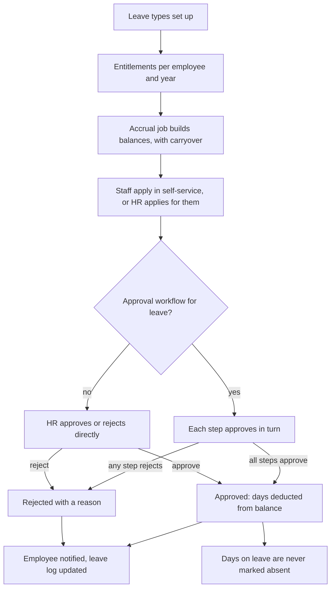
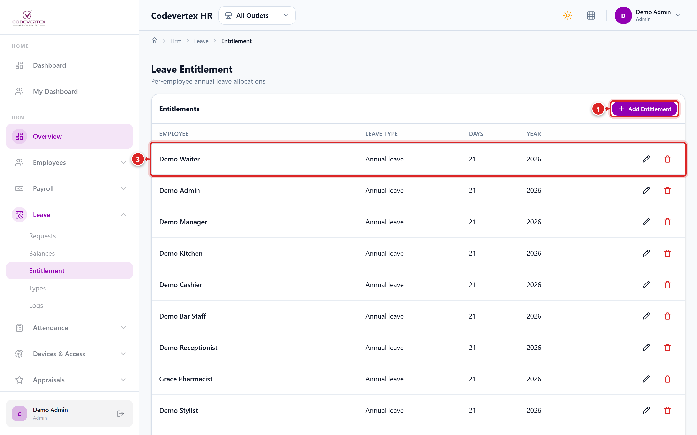
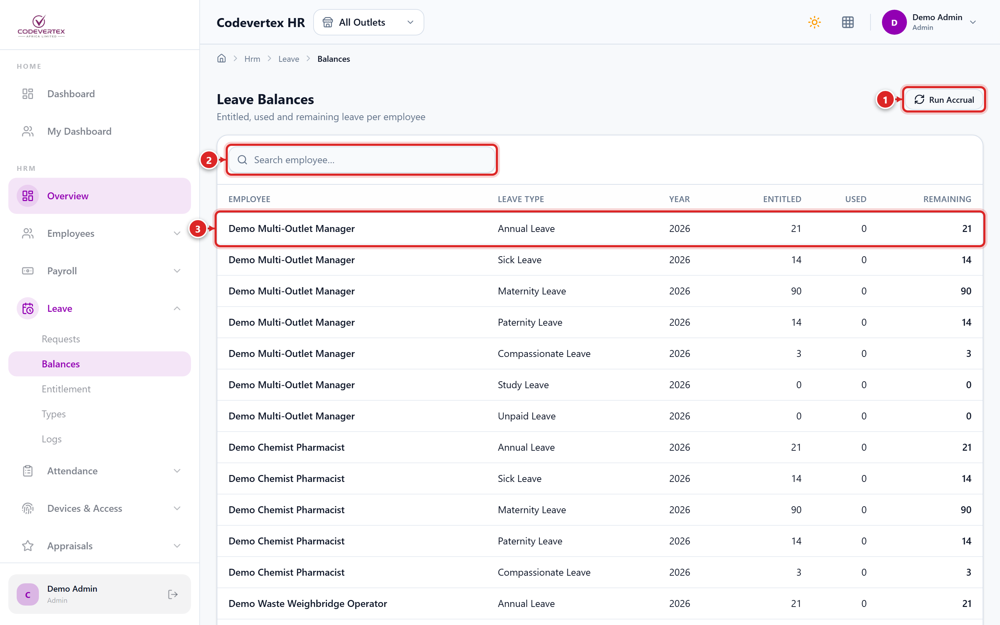
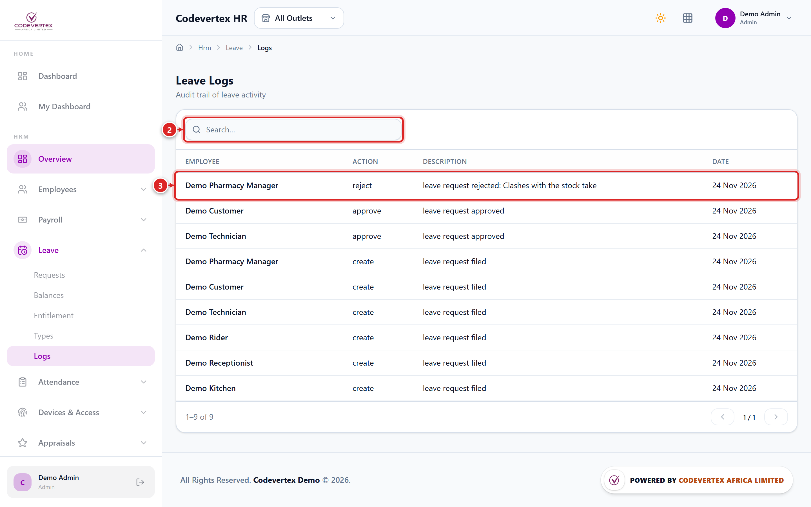

# Leave

Leave in Codevertex ERP runs from a leave type, through each person's yearly entitlement and
balance, to a request that is approved and deducted. Approved leave also protects the person in
attendance: a day on approved leave is never marked absent.

## Leave types

Go to **HRM → Leave → Types**.

| Field | What it does |
|---|---|
| Name | For example Annual, Sick, Maternity, Paternity, Compassionate |
| Max days | The default number of days a year for this type, used when a person has no entitlement of their own |
| Paid | Whether the leave is paid |
| Carry forward | Whether unused days move into next year |
| Requires approval | Whether requests need an approver |
| Description | Notes for staff |

## Entitlements

Go to **HRM → Leave → Entitlement** to give a person a different number of days from the
default, for example more annual leave for long service. Each entitlement is one employee, one
leave type, a number of days and a year.

## Accrual and balances

A background job runs once a day and builds every active employee's balance for each active
leave type in the current year:

- **Entitled** is the person's entitlement for the year, or the type's default days if they
  have none, plus any days carried forward from last year (capped at the type's carryover
  limit, and only for types that allow carry forward).
- **Used** is the days taken on approved leave.
- **Remaining** is entitled less used, never below zero.

Running it again never undoes days already taken; it only refreshes what each person is
entitled to. If you have just changed an entitlement and want the balances updated straight
away, click **Run Accrual** on the balances page.

Go to **HRM → Leave → Balances** to see entitled, used and remaining days per person and type.

## Requests

Go to **HRM → Leave → Requests**.

**Staff** apply from **My Dashboard → Apply for Leave**. **HR** can apply on someone's behalf
with **Apply for Leave** on the requests page. The form asks for:

| Field | Notes |
|---|---|
| Employee | The person going on leave |
| Leave type | One of your leave types |
| Start date, end date | The end date cannot be before the start date |
| Reason | Optional |

A new request starts as **Pending**. The page has two tabs: **All Requests**, which you can
filter by status (Pending, Approved, Rejected), and **Approvals Queue**, which shows only what
is waiting for a decision.

## Approving and rejecting

Approvers see pending requests in the **Approvals Queue** with **Approve** and **Reject**
buttons. Rejecting asks for a reason, which the employee sees.

- **With a leave approval workflow** (set under **Administration → Settings → Approval
  Workflows**, module "Leave Request"), each step approves in order. The request stays Pending
  until the last step approves it. A rejection at any step ends it.
- **Without a workflow**, anyone with permission to approve leave decides it in one step.

When a request is approved, its days are taken off the person's balance for that year. The
employee is notified of the decision either way. See [Approvals](approvals.md).

## Leave logs

Go to **HRM → Leave → Logs** for the audit trail: every request filed, approved, rejected or
cancelled, with who did it and when.

## How leave affects attendance and payroll

- **Attendance.** The overnight absence check skips anyone on approved leave that day, so they
  are never marked absent and no absence penalty is raised against them. Approved leave also
  comes off the person's working capacity in project planning; leave that is still pending does
  not.
- **Payroll.** Because days on approved leave are not absences, they do not create attendance
  deductions in the payroll run. Approve leave before you run payroll for the month so the
  attendance figures are final.

See [Time and Attendance](time-and-attendance.md) for the absence rules.
