# Payroll extras

Besides the monthly run on [Payroll](payroll.md), the Payroll menu handles money that moves between
the company and its people outside basic salary: expense claims, salary advances and loans, casual
workers, consultants, staff purchases, losses and damages, attendance deductions and per diem. It
also shows what labour costs each project.

Everything here that involves money reaches the books through Treasury, so finance sees it without
anyone keying it in again.

## Expense claims

Go to **Payroll → Claims**. A claim pays an employee back for money they spent on the company's
behalf. The list shows each claim's employee, type, amount, date, whether it is taxable and its
status: **Pending**, **Approved** or **Paid**.

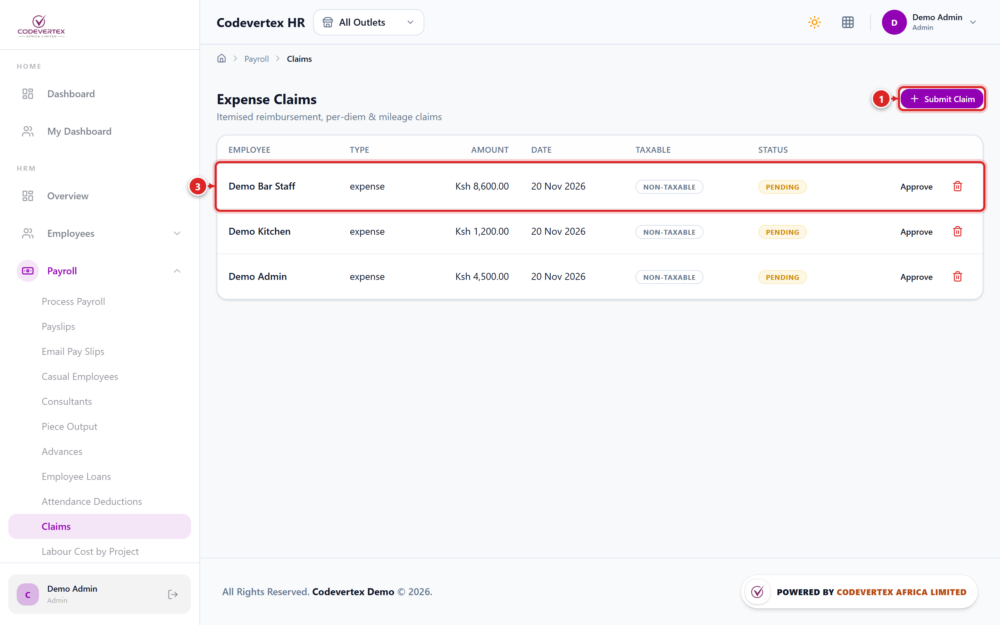

### Choosing the claim type

| Claim type | Use it for | The amount is |
| --- | --- | --- |
| Reimbursement | receipts for travel, accommodation, meals, meetings, medical, training or office supplies | the sum of the expense lines |
| Per diem | daily allowance for days away | days times the daily rate |
| Mileage | use of a private vehicle | distance times the rate on each route |
| Other | anything else that is itemised | the sum of the expense lines |

### Making a claim

1. Click **Submit Claim**.
2. Fill in the claim details: **Employee**, **Claim Type**, **Effective Date**, a **Category** where
   offered, and optionally a **Project** and **Cost Center** so the cost lands on the right budget.
   Switch on **Taxable** only for a claim that counts as income. Add a **Description**.
3. Save. The claim opens so you can add its detail.

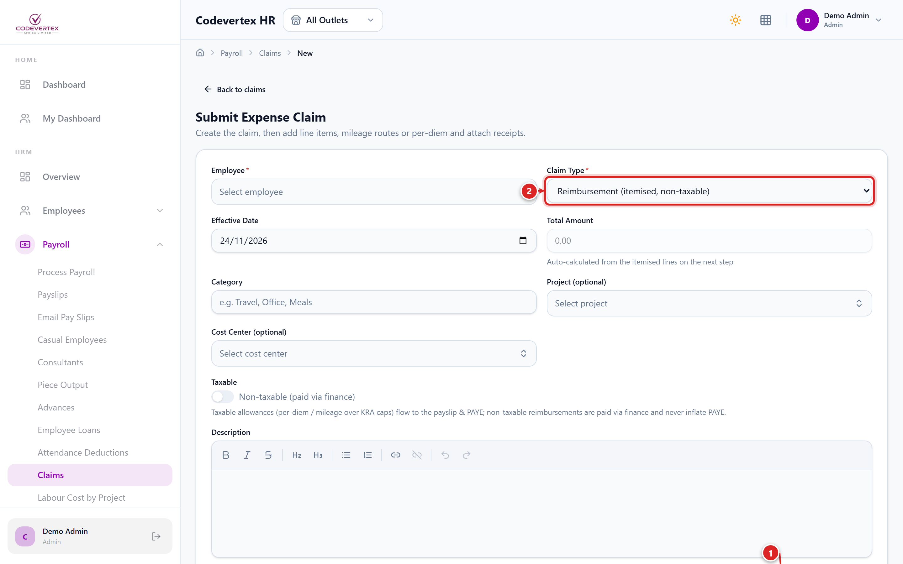

4. Add the detail for the claim type: **Expense Lines** (one per receipt, each with the date of the
   expense, a category and amount), **Mileage Routes** (date, from, to and distance), or the
   **Per-Diem** days and rate. The total
   updates from the lines as you go.
5. Under **Attachment**, click **Upload receipt** to attach the receipt or supporting document.
6. **Save claim**.

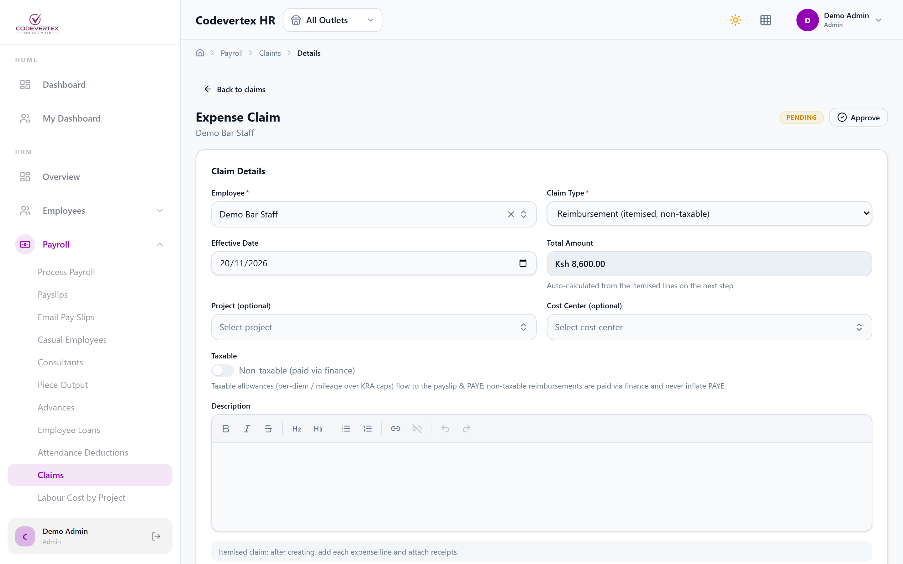

### Approving and paying a claim

**Approve** on the claim (or the tick in the list) needs the payroll manage permission. Before it
approves, the ERP checks the claim against your Treasury budgets:

- Within budget, or a budget set to warn: the claim is approved.
- Over a budget set to **Stop**: approval is refused with an over-budget message. An approver who
  holds the approvals permission can approve it over budget.

An approved claim is locked against further edits, and Treasury books the reimbursement as an amount
owed to the employee. A non-taxable reimbursement is paid from Treasury, not through the payslip, so
it never adds to PAYE. While a claim is pending, Treasury already holds it against the budget, so
the budget shows money the company has agreed to pay back.

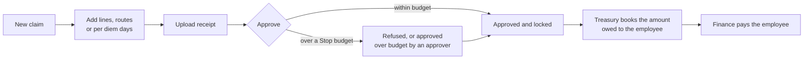

## Per diem

Per diem claims are raised for you when a staff driver or rider finishes a trip in Logistics. Set
the rules under **Settings → Payroll → Per diem**.

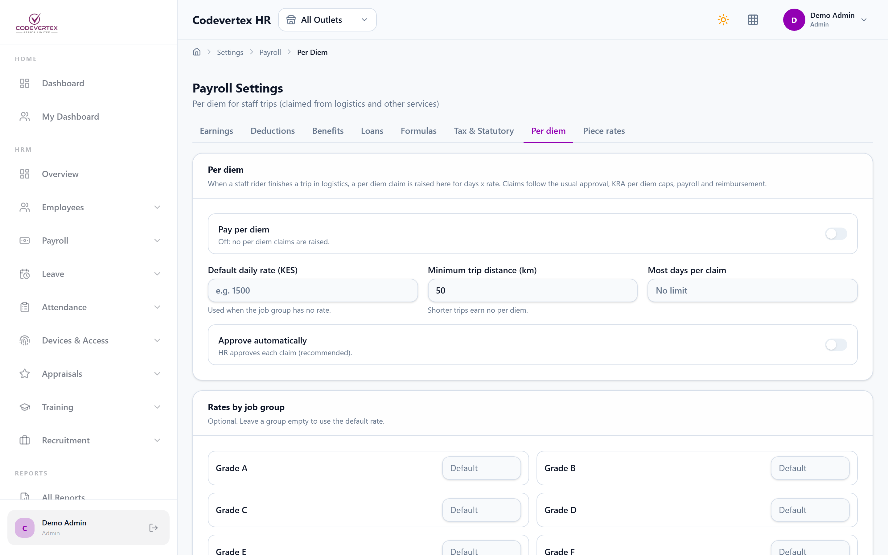

| Setting | What it does |
| --- | --- |
| Pay per diem | On: finished trips raise per diem claims. Off: none are raised |
| Default daily rate (KES) | Used when the person's job group has no rate of its own |
| Minimum trip distance (km) | Shorter trips earn no per diem |
| Most days per claim | The cap on days in one claim; empty means no cap |
| Approve automatically | On: claims are approved as they arrive. Off: HR approves each claim |
| Rates by job group | Optional daily rate per job group; an empty group uses the default rate |

A per diem claim is the number of days times the rate, and it follows the same approval and payment
as any other claim. Either the default daily rate or at least one job group rate must be set before
per diem can be switched on.

## Salary advances and loans

Go to **Payroll → Advances** for salary advances. **Payroll → Losses & Damages** works the same way
(see below).

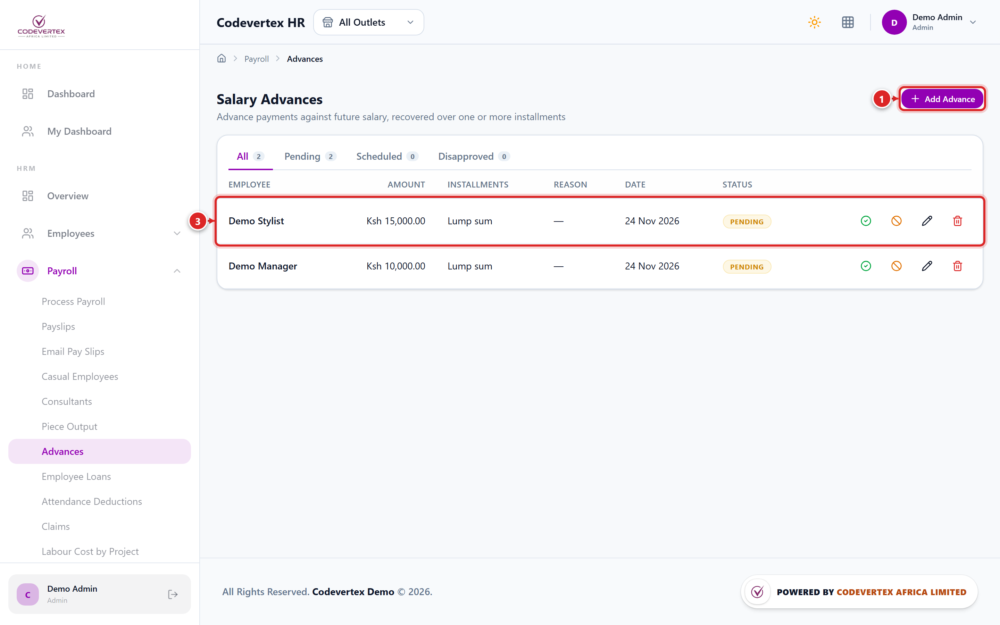

1. Click **Add Advance**, pick the **Employee** and enter the **Value / Amount**, the **Effective Date** and a
   **Reason**.
2. Set **Recover in N installments**: 1 takes it all from the next payslip, 2 or more spreads it.
   The form shows the **Per-installment amount**. For example, KES 30,000 over 3 installments is
   KES 10,000 a month.
3. Save. The advance is **Pending**.
4. **Approve & schedule** to start recovering it from the employee's upcoming payslips, or
   **Disapprove** to stop it.

The tabs filter by **Pending**, **Scheduled** and **Disapproved**.

Each payroll run takes the installment after PAYE, and never more than what is still outstanding.
The repayment is written to the advance when the month is disbursed, and the record closes once it
is fully recovered. If a disbursed month is reversed, that month's repayment is undone.

Staff loans follow the same pattern. The loan products are set under
**Settings → Payroll → Loans** (name, interest rate, maximum amount and repayment period). To lend
to someone, go to **Payroll → Employee Loans**, choose the product, the employee, the principal, the number
of installments and the first month. The list shows each loan's balance and every recovery; each
month's installment comes off the payslip after PAYE, and the loan closes when it is repaid.

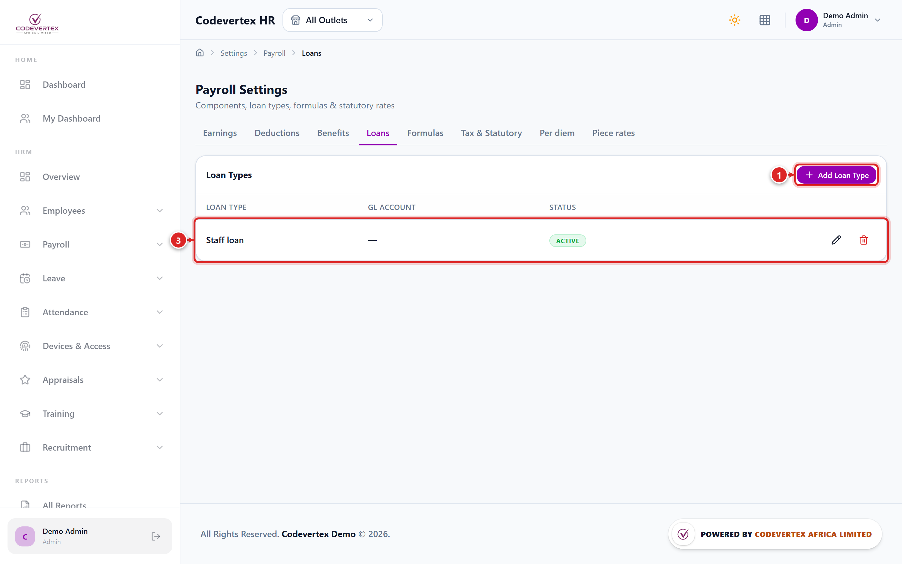

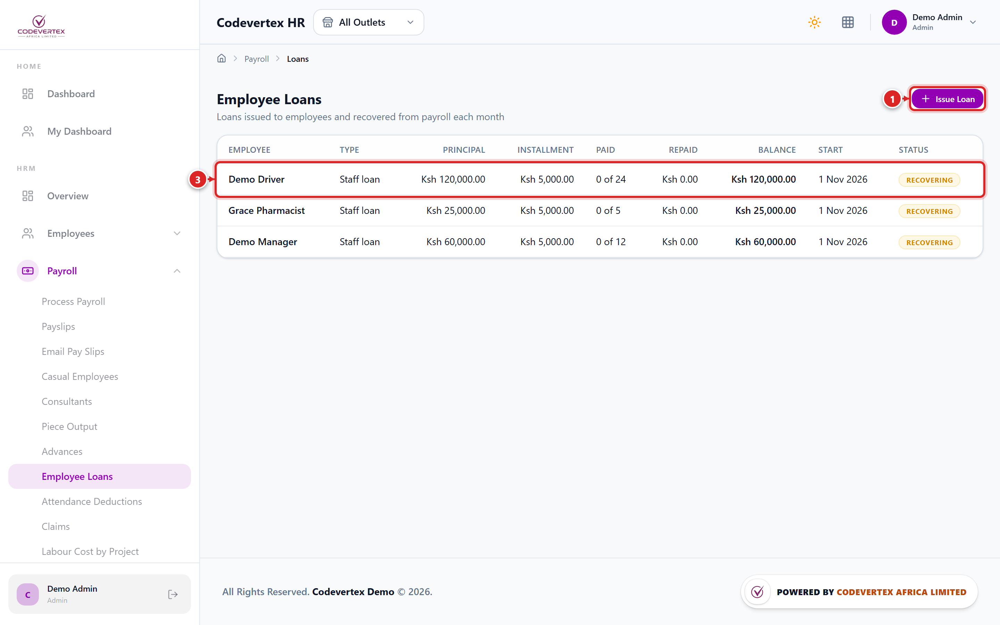

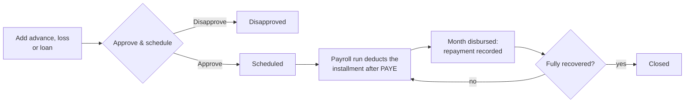

## Losses and damages

Go to **Payroll → Losses & Damages** to charge an employee for a loss or damage they are responsible
for. The form, the approval and the recovery in installments are the same as for salary advances.

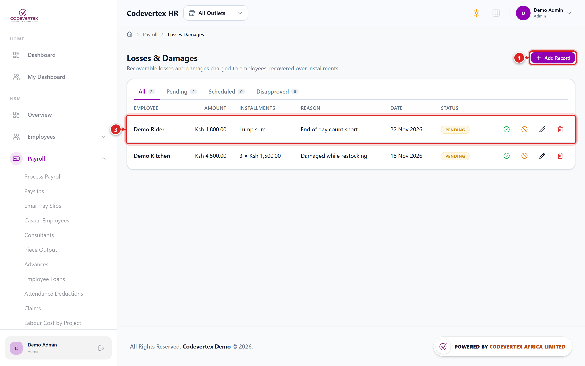

## Staff purchases

Go to **Payroll → Staff Purchases**. When a staff member takes goods from a POS shop on credit or
layaway, to be paid from salary, the purchase appears here with how much is open, the principal,
how much has been recovered and what is outstanding.

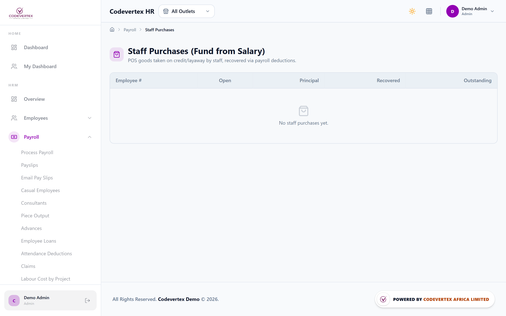

Each payroll run recovers from the payslip, after PAYE, up to what is outstanding. When the month is
disbursed, POS is told how much was recovered and reduces the staff member's credit or layaway
balance, so the shop and payroll always agree.

## Casual labour

Go to **Payroll → Casual Employees**. Casual workers are paid
by the unit, outside the PAYE run.

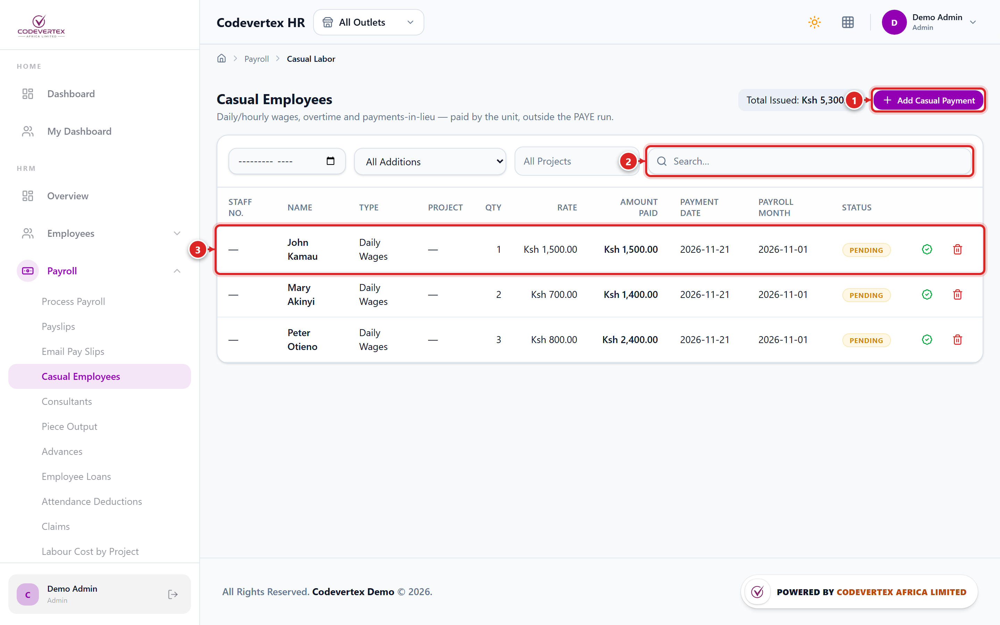

Click **Add Casual Payment** and choose who is paid under **Payment To**:

| Payment To | When to use it | You fill in |
| --- | --- | --- |
| Casual Employee (direct) | a casual worker registered as an employee | the **Casual Employee** |
| Informal Worker (reimburse engager) | someone not on record, paid in cash by a supervisor or project manager who is then paid back | the **Worker Name** and who engaged them under **Engaged By** |

Then fill in:

| Field | What it holds |
| --- | --- |
| Addition Type | Daily Wages, Hourly Wages, Overtime @1.5x, Overtime @2x or Payment in Lieu of Leave |
| Quantity (days/hours) | how many days or hours |
| Rate | the rate per day or hour |
| Salary Payment Option | Bank Transfer, Equity Bank, Mobile Money, Cash or Cheque |
| Payroll Month, Payment Date | when it belongs and when it was paid |
| Project | optional; the project the cost belongs to |

The amount is the quantity times the rate: 6 days at KES 800 is KES 4,800. A record starts
**Pending**. **Approve** posts the cost to Treasury, labelled with the worker's name and charged to
the project. For a direct casual employee that is a wage cost paid to the worker; for an informal
worker it is an amount owed back to the person who engaged them.

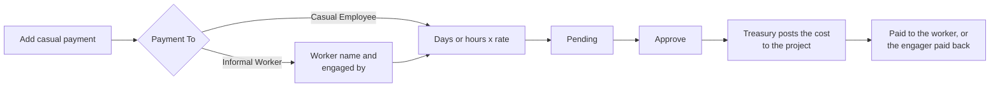

## Consultants

Go to **Payroll → Consultants**. A consultant is an employee set up with the consultant employment
type. They are paid by payment voucher with withholding tax, not through PAYE.

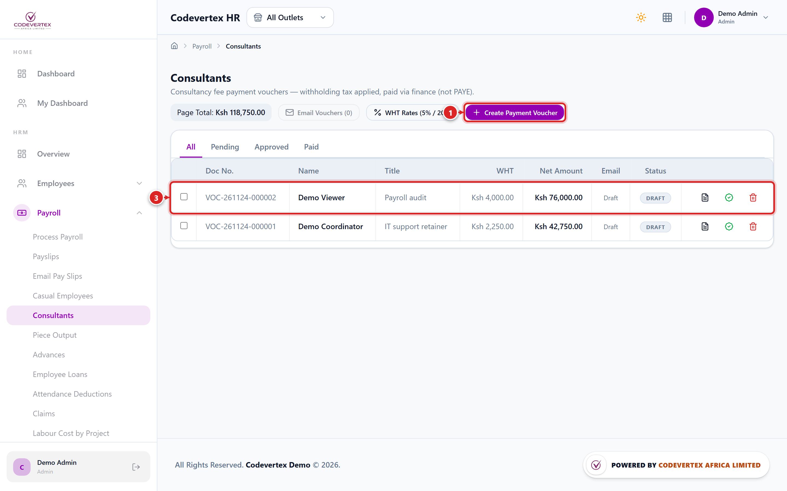

1. Click **Create Payment Voucher**.
2. Pick the **Consultant**, add a **Title / Description**, the **Period** and optionally a
   **Project**.
3. Enter the **Gross Fee** and any **Other Deductions**.
4. Leave **Resident** on for a Kenyan resident (5% withholding tax) or switch it off for a
   non-resident (20%). If your company has set its own active withholding tax rate, that rate is
   used instead.
5. Save. The form previews the tax and net before you save.

The net is the gross fee less withholding tax less other deductions. For a resident consultant with
a KES 100,000 fee and KES 2,000 of other deductions, withholding tax is KES 5,000 and the net is
KES 93,000. Each voucher gets a VOC number and a branded PDF, and **Email Vouchers** sends each
consultant their voucher.

When a voucher is approved:

- Treasury posts it: *Consultant Fees* for the gross, the net owed to the consultant, the tax to
  *Withholding Tax Payable* and any other deductions, charged to the project.
- The net is paid to the consultant by bank transfer through Treasury, and the voucher moves to
  **Paid**.

The tabs filter by **Pending**, **Approved** and **Paid**.

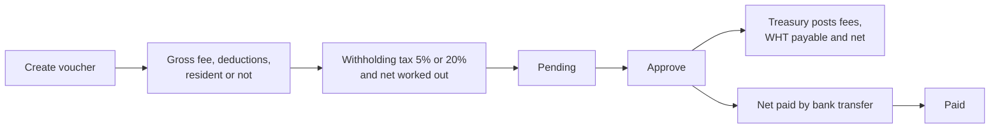

## Attendance deductions

Go to **Payroll → Attendance Deductions**. Lateness and unexcused absence are priced from attendance
and your attendance rules, and only approved deductions reach payslips.

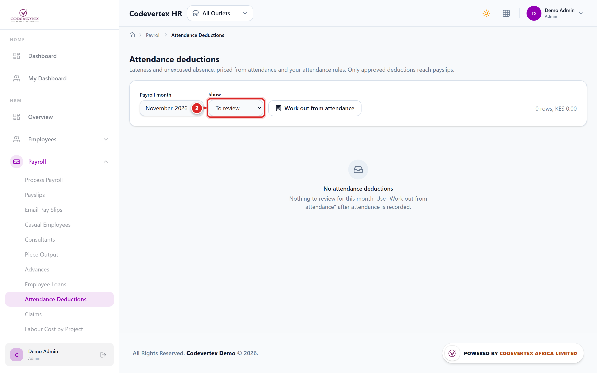

1. Pick the **Payroll month** and click **Work out from attendance**. The page lists each deduction
   with the total rows and amount.
2. Use **Show** to switch between **To review**, **Approved**, **Waived**, **On payslip** and
   **All**.
3. Tick rows and click **Approve**, **Waive** (to excuse them) or **Reopen** (to send an approved or
   waived row back for review).

When the month's payroll runs, approved deductions go onto the payslips and move to **On payslip**.

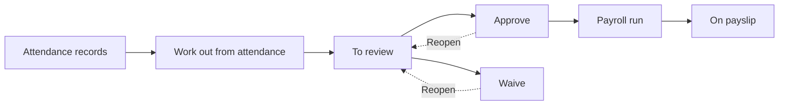

## Labour cost and project allocations

**Payroll → Project Allocations** ties employees and consultants to projects so their pay is shared
across them. Each allocation has the **Employee / Consultant**, the **Project**, an
**Allocation %** or a **Fixed Amount**, and optionally a **Cost Center**.

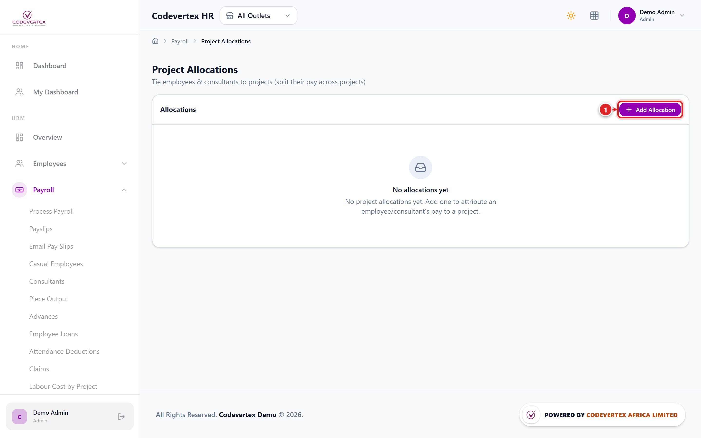

**Payroll → Labour Cost by Project** shows, for a payroll month, the gross pay charged to each project and its
share of the total. Pay not allocated to a project is charged to the employee's department cost
centre. The same split goes to Treasury when the month is disbursed, so project budgets show their
labour cost.

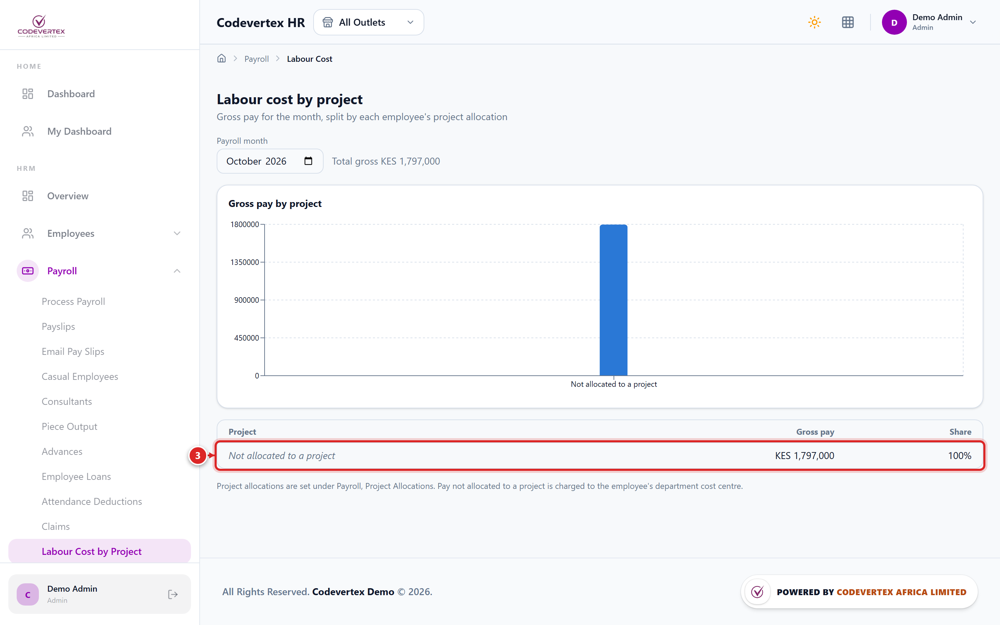
