# Payroll

Payroll in Codevertex ERP calculates Kenyan PAYE, NSSF, SHIF, the Affordable Housing Levy and the
NITA levy, produces payslips and statutory returns, and pays staff by M-Pesa or bank through
Treasury. This page follows a pay month from settings to the ledger. Expense claims, advances,
casual workers and consultants are on [Payroll extras](payroll-extras.md), and the returns you file
are on [Statutory returns](statutory-returns.md).

## How a pay month flows

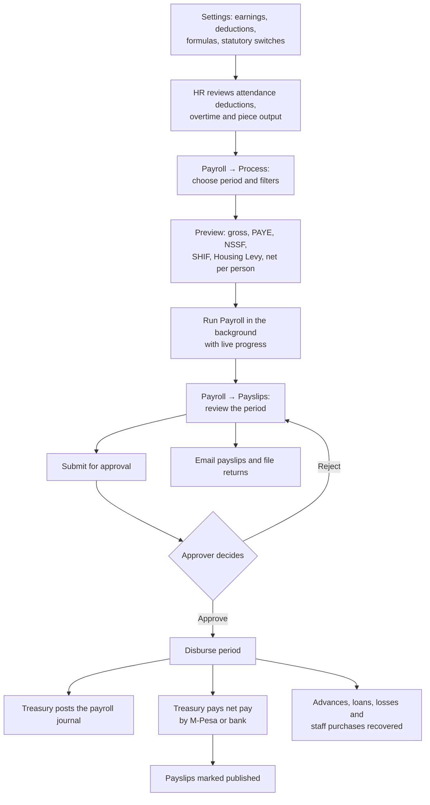

Payroll is part of the HR and payroll plan. Casual workers and consultants are paid outside this run
(see [Payroll extras](payroll-extras.md)); the run covers regular employees on a permanent or
fixed-term contract that is active for the period.

## Payroll settings

Go to **Settings → Payroll**. The tabs are Earnings, Deductions, Benefits, Loans, Formulas, Tax &
Statutory, Per diem and Piece rates.

### Earnings, deductions and benefits

**Settings → Payroll → Earnings** (and the Deductions and Benefits tabs) hold the pay components
you add to employees.

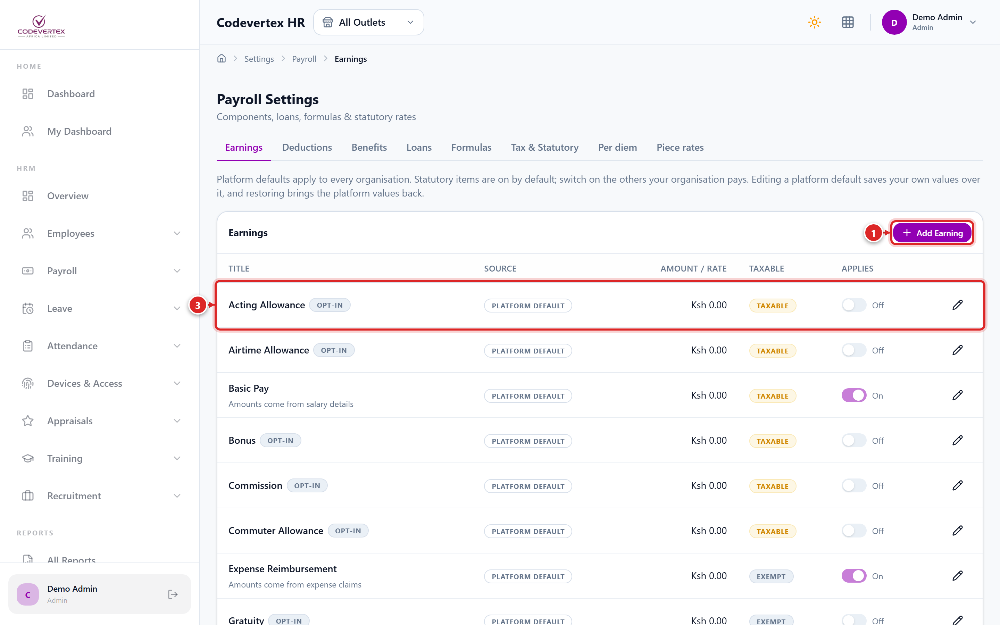

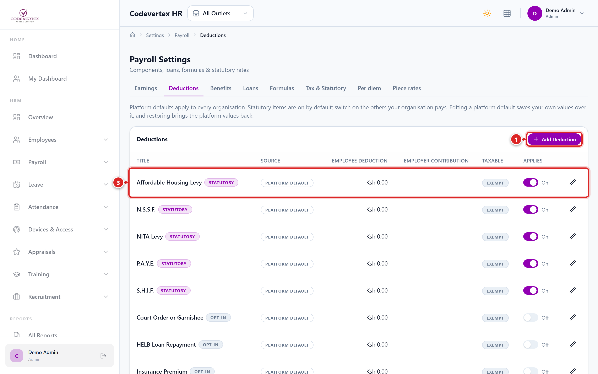

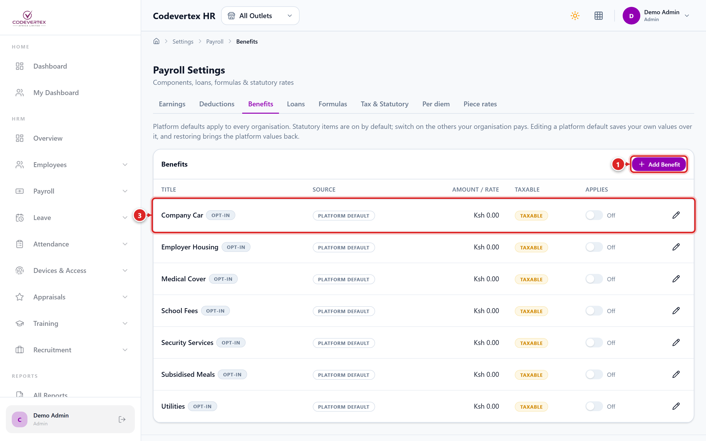

Every company starts with the full Kenyan catalogue of earnings, deductions and benefits, kept up
to date by Codevertex. You do not copy or recreate them:

- **Statutory** items (PAYE, NSSF, SHIF, Housing Levy, NITA) are on for everyone. They follow the
  switches on the **Tax & Statutory** tab.
- Items payroll manages itself, such as basic pay, overtime, loans and claims, are on and locked.
- Everything else, such as allowances, SACCO, HELB and staff benefits, is **Opt-in**: turn it on
  with the **Applies** switch when your company uses it.
- The **Source** column shows *Platform default* or *Customised*. Editing a platform item saves your
  own values for your company only; **Restore platform default** brings the platform values back.

| Field | What it does |
| --- | --- |
| Title | The name printed on the payslip |
| Fixed Amount, or % of Basic Pay | Either a fixed monthly amount or a percentage of basic pay |
| Employer Fixed Amount, or Employer % of Basic | Deductions only: what the employer adds on top, such as a matched pension |
| Calculation Mode | Deductions only: fixed amount, % of basic or % of gross |
| Registration No | Deductions only: the scheme or SACCO number for the remittance |
| Checkoff | Deductions only: the employer deducts on the employee's behalf and remits it |
| Unit, Rate per Unit, Quantity | Earnings only: pay by days, hours or pieces |
| Non-cash | Benefits only: an in-kind benefit that is taxed but not paid in cash |
| Taxable | Whether the amount counts towards PAYE |
| Active, Effective From, Effective To | When the component applies |

### Loans

**Settings → Payroll → Loans** lists the loan products you offer staff: name, interest rate, maximum
amount and repayment period in months. An employee's loan is recovered from pay each month after
PAYE until it is repaid, and then it closes on its own. See
[Payroll extras](payroll-extras.md#salary-advances-and-loans).

### Formulas: versioned statutory rates

**Settings → Payroll → Formulas** holds the rate tables the payroll engine uses: PAYE bands for a
primary and a secondary employee, NSSF tiers, SHIF, legacy NHIF, the Affordable Housing Levy and
NITA. Each formula has an effective date, and one formula per type is current.

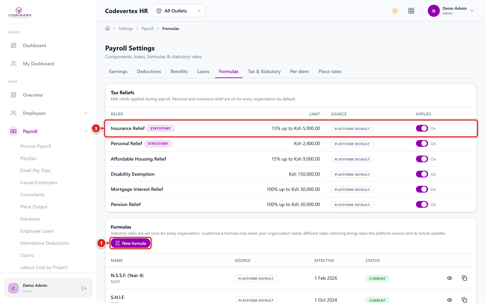

How versioning works:

- When a rate changes, add a new formula with the date it starts. Do not edit a past one: earlier
  months keep the rates that applied to them.
- The formula used for a month is the one in force on that month's date.
- Codevertex keeps the national rates up to date. They are listed as *Platform default* and every
  company uses them, so a new rate applies to everyone from its start date. The rates follow the
  statutory rates approved in Codevertex Treasury.
- If your company needs a different rate, use **Customise** on that formula. Only that formula is
  copied for your company; **Restore** returns you to the national one.
- **Tax Reliefs** at the top of the tab work the same way: personal and insurance relief are on by
  default, and each relief has its own switch.
- If a statutory rate is missing for a period, the run stops with an error naming it. It never
  quietly deducts zero.

The national rates in force are:

| Item | Rate |
| --- | --- |
| PAYE (primary employee) | 10% up to KES 24,000; 25% to 32,333; 30% to 500,000; 32.5% to 799,999; 35% above |
| PAYE (secondary employee) | 35% on the whole amount, with no relief |
| Personal relief | KES 2,400 a month, set under **Tax Reliefs** on the Formulas tab |
| NSSF (from 1 February 2026) | 6% on Tier I up to KES 9,000 and Tier II from 9,001 to 108,000, matched by the employer; at most KES 6,480 each side |
| SHIF | 2.75% of gross pay, employee only |
| Affordable Housing Levy | 1.5% of gross pay, matched 1.5% by the employer |
| NITA | KES 50 per employee per month, paid by the employer only |

The **Tax Reliefs** panel on the same tab lists each relief with its status, amount and effective
date. Reliefs that the law repealed are marked inactive, so months after the repeal get no relief
for them.

Example for gross pay of KES 50,000 in a month after 1 February 2026: NSSF is KES 540 on Tier I
(6% of 9,000) plus KES 2,460 on Tier II (6% of 41,000), KES 3,000 in all, and the employer adds
another KES 3,000. SHIF is KES 1,375 and the Housing Levy is KES 750, with KES 750 more from the
employer.

### Tax & Statutory switches

**Settings → Payroll → Tax & Statutory** turns each statutory item on or off for your company:
PAYE, NSSF, SHIF / NHIF, Housing Levy and NITA. All are on by default. A switched-off item is
skipped entirely when payroll runs, and a switched-off NITA gives an empty NITA return. Rates
themselves are on the Formulas tab.

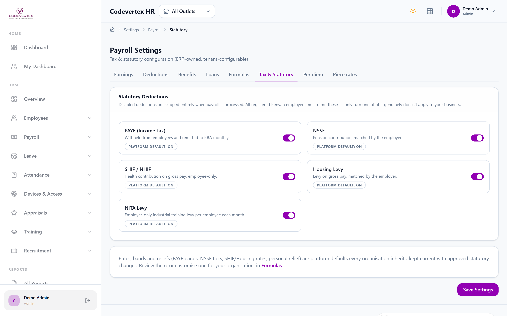

## What attendance adds to payroll

When you run payroll for a month, the ERP brings in, for each person:

- **Lateness and absence deductions** that HR has approved under **Payroll → Attendance
  deductions** (see [Payroll extras](payroll-extras.md#attendance-deductions)).
- **Overtime pay**: overtime hours (only approved ones when approval is required) times the hourly
  rate times the overtime multiplier.
- **Holiday pay**: hours worked on a national or county public holiday at the holiday multiplier.
- **Piece earnings**: approved piece output for the month.

Overtime, holiday and piece earnings are taxable and appear as separate lines on the payslip.
Overtime and holiday pay only start once **Pay overtime in payroll** is switched on in attendance
settings (see [Time and attendance](time-and-attendance.md)), so turning on attendance never
changes existing payslips by surprise.

The hourly rate comes from the person's shift hours per week (times 52, divided by 12), or the
company's standard monthly hours when no shift is set.

### Piece rates

Go to **Settings → Payroll → Piece rates**. Each rate has a code, a name, the unit (piece, crate,
bag, metre), the rate, optionally a department, and the dates it applies from and to. When a rate
changes, add a new one from the new date; past output keeps the rate it was recorded at.

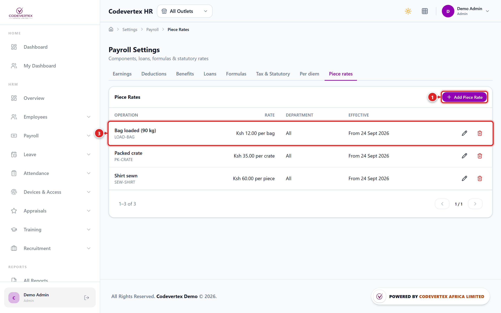

### Recording and approving piece output

Supervisors record each person's output per day under **Payroll → Piece Output**: the rate, the
quantity and any quantity rejected by quality control. The paid quantity is the quantity less the
rejects. Output is then approved or rejected in bulk. Approved output is paid in that month's
payroll and marked paid with the payslip, so it is never paid twice.

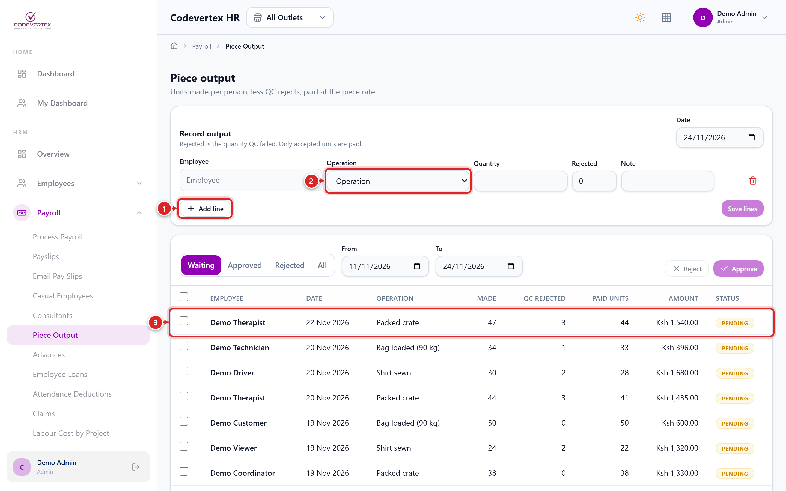

## Running payroll

Go to **Payroll → Process Payroll**. The page walks through four steps: Period, Preview, Run and Disburse.

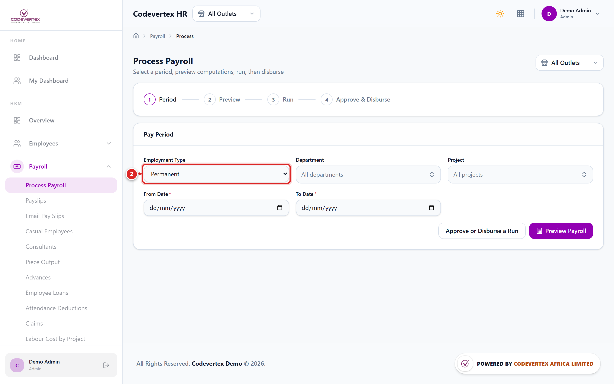

1. **Period.** Set the **From Date** and **To Date** of the pay month. Narrow the run if you need to
   by **Employment Type**, **Department** or **Project**; leave them empty for everyone.
2. **Preview.** **Preview Payroll** works out each person's gross pay, PAYE, NSSF, SHIF, Housing
   Levy, total deductions and net pay without saving anything. Check the figures here.
3. **Run.** **Run Payroll** generates the payslips. The run works in the background and the page
   shows a progress bar with how many employees are done, for example "120 of 300 employees (40%)".
   You can leave the page; the run carries on. Only one run per company can be in progress at a
   time, and starting a second one points you to the run already going. If a run stops part way,
   the page shows the reason and a **Run Again** button.
4. **Submit, approve, disburse.** When the run completes, **Submit for approval** sends the month
   to its approvers (your payroll approval workflow under **Settings → Approvals**, or anyone with
   the payroll manage permission when no workflow is set). Once approved, **Disburse Payroll**
   appears for users allowed to pay out. An unapproved month can never be paid. Running the same
   period again puts it back to draft for a new approval, and never changes a payslip already
   paid.

Within each payslip, the engine works out gross pay from basic pay, earnings, benefits, overtime,
holiday and piece pay; takes the statutory deductions; applies PAYE after personal relief; and then
recovers advances, loans, losses and damages and staff purchases, never more than the amount still
outstanding.

## Reviewing and approving payslips

Go to **Payroll → Payslips**. Payslips are grouped by month. Expand a month to see each employee,
and click a row to open that payslip.

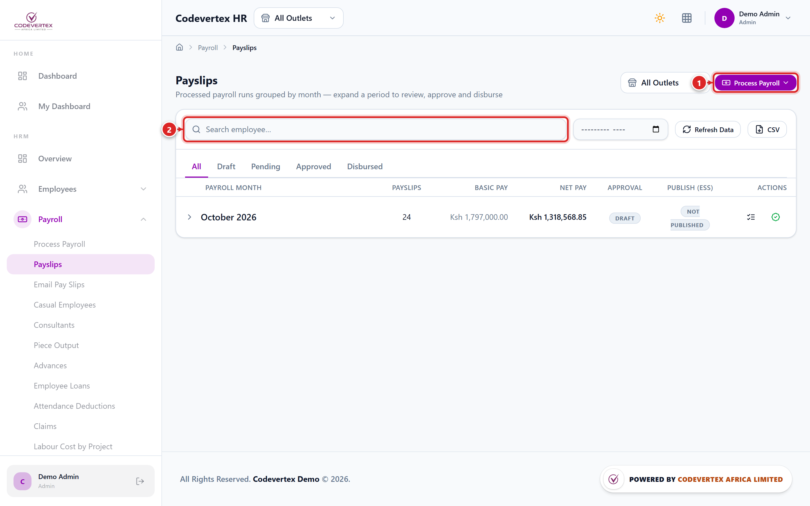

| Status | Meaning |
| --- | --- |
| Draft | generated by the run, not yet reviewed |
| Pending | waiting for review |
| Approved | signed off and ready to disburse |
| Disbursed | paid out; the month also shows **Published** once Treasury has accepted the payout |

On each month's row:

- **View muster roll** opens the [muster roll](statutory-returns.md#muster-roll) for that month.
- **Submit for approval** sends the month to its approvers; **Approve** or **Reject** appear for
  the person whose step it is.
- **Disburse period** (needs the payroll disburse permission) appears only once the month is
  approved. If some payouts fail, the page says which; disbursing again retries only those, and
  nobody is ever paid twice.
- **Reverse** (needs the payroll disburse permission) is offered while none of the month has been
  paid out yet.

Processing, approving and disbursing are separate permissions, so the person who runs payroll does
not have to be the person who pays it.

### A single payslip

The payslip page shows the earnings, deductions, employer contributions and net pay, with a personal
information strip (payment mode, bank, ID, KRA PIN, SHIF and NSSF numbers, department and region).
**Print / Preview PDF** opens the payslip PDF, from where you can download it, print it or open it
in a new tab.

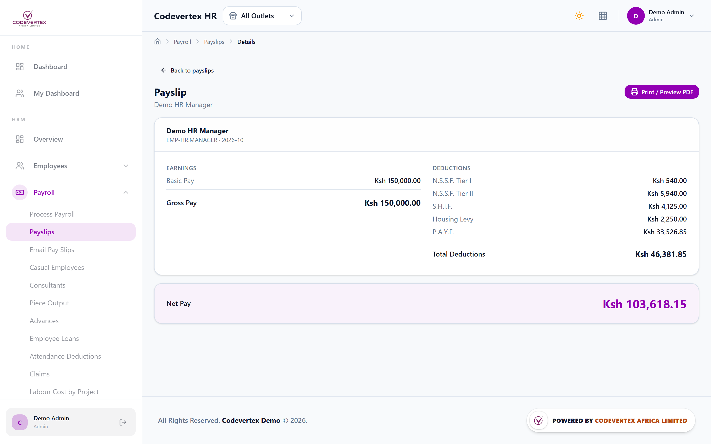

### Emailing payslips

From **Payroll → Payslips**, open **Process Payroll → Email Pay Slips**, or go to
**Payroll → Email Pay Slips**.

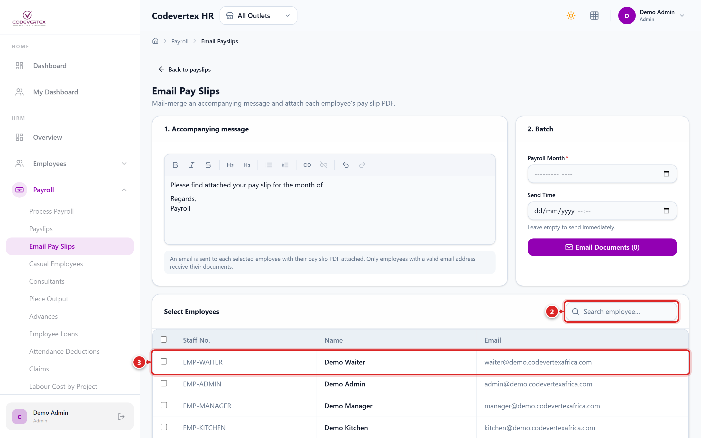

1. Write the **accompanying message** each employee receives.
2. Pick the **Payroll Month**, and a **Send Time** if you want the emails to go later (leave it empty
   to send now).
3. Tick the employees and click **Email Documents**.

Each employee receives their own payslip PDF attached. Only employees with a valid email address on
record receive one.

## Paying staff through Treasury

**Disburse** does three things at once for the month's completed payslips:

1. **Posts the payroll to the books.** Treasury receives the payroll and books the salary cost
   against *Accrued Salary Payable* and *Statutory Deductions Payable*. Gross pay is attributed to
   projects (from [project allocations](payroll-extras.md#labour-cost-and-project-allocations)) and
   to each employee's department cost centre, so budgets see the labour cost.
2. **Pays net pay.** Treasury pays each employee by the channel on their salary details: M-Pesa,
   Airtel Money or bank transfer, with bank transfer used when no channel is set. If your finance
   team requires sign-off on payroll payouts, Treasury holds the batch for finance approval with a
   one-time code, and the result says it is pending finance approval.
3. **Settles recoveries.** Each advance, loan, loss and staff purchase recovered on the payslips is
   updated with the amount repaid. For staff purchases, POS is told so the staff member's credit or
   layaway balance goes down.

When Treasury accepts the payout, the month's payslips are marked **Published**. Disbursing the same
month again does nothing new, so a double click never pays or posts twice.

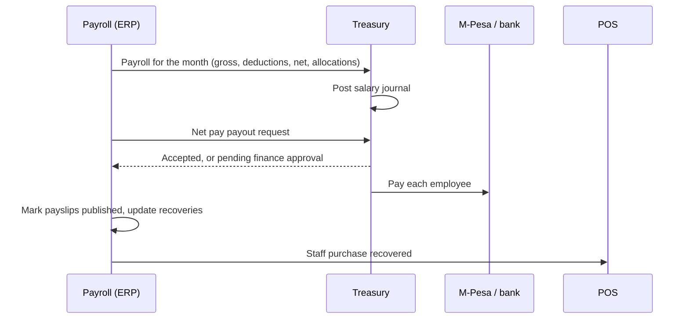

When you later pay PAYE, SHIF, NSSF and the Housing Levy, record the payment in Treasury against
*Statutory Deductions Payable*. See
[Vouchers & approvals](../treasury/vouchers-and-approvals.md#paying-staff).

### Reversing a disbursed month

If a month was wrong, it can be reversed as long as none of its payouts has been made yet. Treasury posts the opposite journal, the
recoveries written for that month are undone, and the payslips go back to unpublished and rejected so
they can be corrected and run again. On **Payroll → Process** or **Payroll → Payslips**, open
the month's actions, choose **Reverse** and confirm. Reversal needs the payroll disburse
permission.

## When your plan has no ERP payroll

A company whose plan does not include ERP payroll pays salaries and casual wages through Treasury
payment vouchers instead. One payment voucher can pay several people, one line each, with the
lines on *Salaries and Wages*. See
[Vouchers & approvals](../treasury/vouchers-and-approvals.md#paying-staff).
