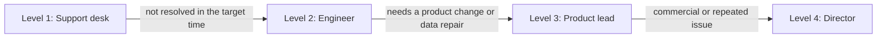

# Plans, Support and Customisation

[Download the Codevertex ERP brochure (PDF)](assets/Codevertex-ERP.pdf){ .md-button .md-button--primary download="Codevertex-ERP.pdf" }

## Plans

ERP is available monthly or as a one-time licence. Prices are in KES and exclude VAT and terminal
hardware. Current prices are also shown on [codevertexafrica.com](https://www.codevertexafrica.com),
which reads them live from our billing system; if the two differ, the website is correct.

| Plan | Monthly | One-time licence | Annual support (licence) | Staff |
|---|---|---|---|---|
| Starter | 10,000 | 250,000 | 50,000 | Up to 10 |
| Growth | 20,000 | 600,000 | 120,000 | Up to 30 |
| Professional | 35,000 | 1,200,000 | 240,000 | Unlimited |
| Enterprise | Quoted | 2,000,000 | 400,000 | Unlimited, dedicated setup |

Monthly plans include hosting and Standard support, with a one-time setup fee of KES 10,000.
One-time licences have their own setup fee and an annual support plan. See
[Subscriptions & Billing](../subscriptions-and-billing.md) for how billing and renewals work.

## Support levels

| Level | Price per month | What it covers |
|---|---|---|
| Standard | Included | Monday to Friday, 8:00 to 17:00, by WhatsApp, email and phone. First response: critical 4 hours, high 1 business day, normal 3 business days |
| Priority | KES 15,000 | Monday to Saturday, 7:00 to 21:00. Critical issues answered within 1 hour with a workaround target of 8 hours, a named engineer, alerts when a terminal goes offline, and a monthly health check |
| Premium | KES 35,000 | Critical issues 24 hours a day, 7 days a week with a 30 minute response, a quarterly on-site review in Nairobi, and 4 customisation hours each month |

**Severity.** Critical: no one can clock in at a site, payroll cannot run on pay day, or the system
is unavailable. High: one terminal offline, a report or approval not working, wrong figures for some
staff. Normal: questions, how-to requests and small layout issues.

Each level has a time limit for the severity; when it passes, the issue moves up and you are told
who owns it.

| Other services | Price (KES) |
|---|---|
| Terminal setup (cloud push, staff linking, enrolment walk-through) | 3,500 per device |
| On-site visit within Nairobi | 5,000 per visit |
| On-site visit outside Nairobi | Travel at cost |

## Customisation

Shifts, rosters, grace periods, overtime rules and multipliers, geo-fence behaviour, leave types,
approval steps, piece rates, report filters, document numbering and branding are settings your
administrators change themselves at no cost.

| Change | Charge |
|---|---|
| Settings and configuration | Free, or done by us on request under your support level |
| A new report layout or export format | Fixed quote per report |
| A new workflow, integration or feature | Fixed quote per agreed scope, or KES 4,000 per hour |
| Premium support customers | 4 hours each month included |

Every change is agreed in writing with what will be delivered, the price and the date before work
starts.

## Growing

Add branches, terminals and staff as you grow, and add other Codevertex products on the same sign-in
and staff records: [Treasury](../treasury/index.md) for accounts and payments,
[Inventory](../inventory/index.md), [POS](../pos/index.md) and more.
