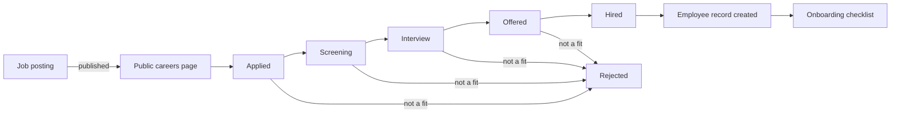
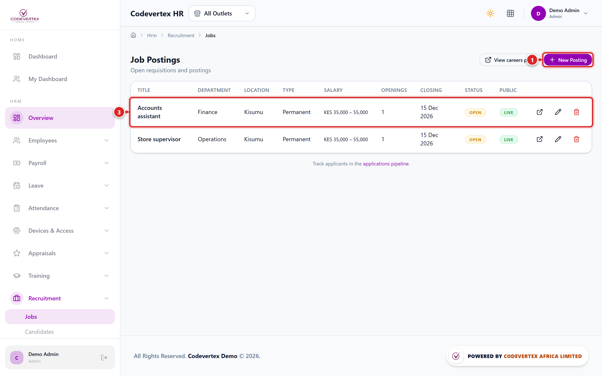
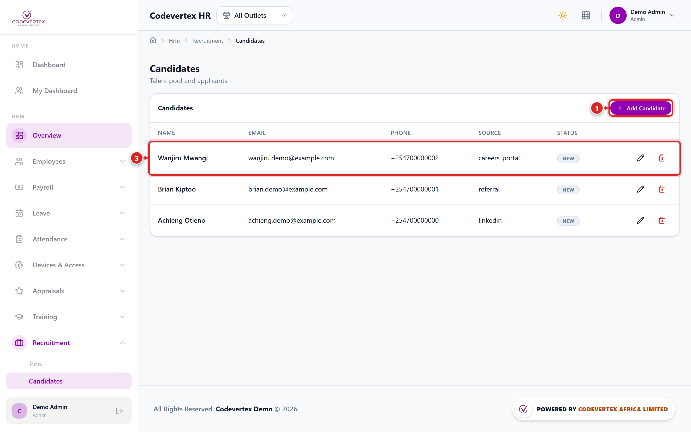
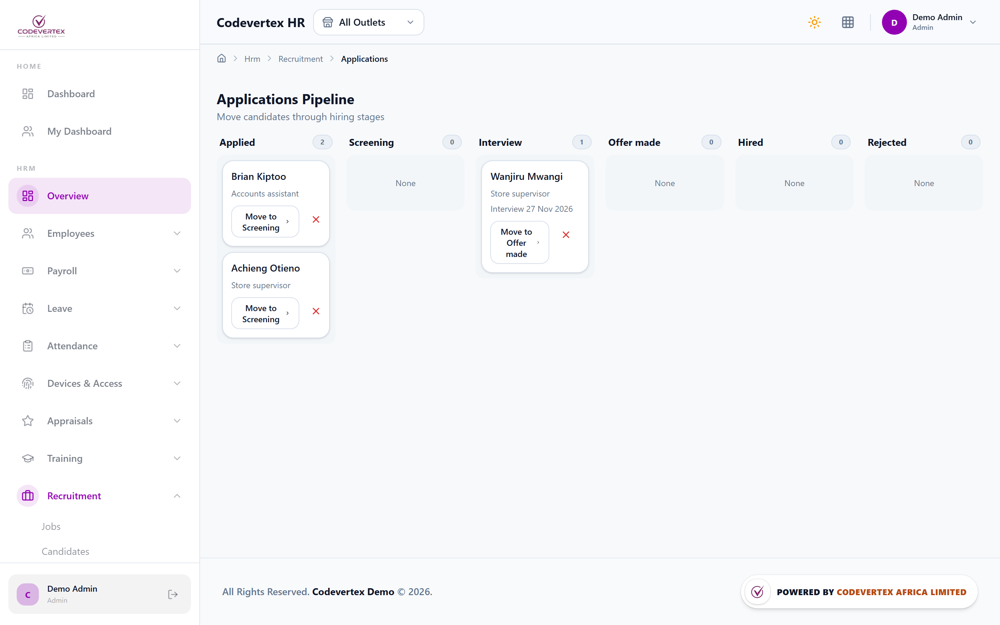
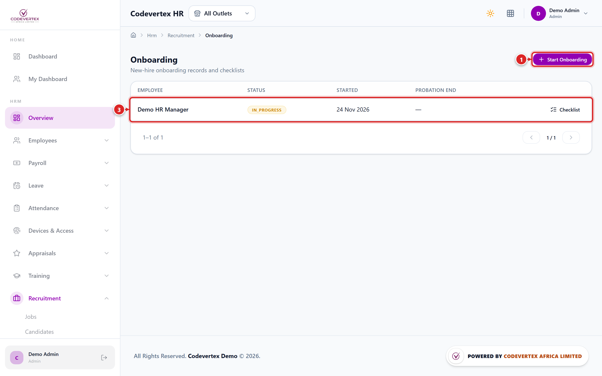

# Recruitment

Recruitment in Codevertex ERP takes a vacancy from a job posting, through a public careers page
and a hiring pipeline, to a new employee with an onboarding checklist. Find it under
**HRM → Recruitment**.

## Job postings

Go to **HRM → Recruitment → Jobs** and click **New Posting**.

| Section | Fields |
|---|---|
| Role | Job title (pick one, or add a new title from the form), department, location, employment type and number of openings |
| Compensation | Currency and an optional minimum and maximum salary, shown on the careers page |
| Description | What the job is about |
| Requirements | What the applicant needs |
| Responsibilities | What the person will do |
| Publishing | Status (Draft, Open or Closed), closing date, and **Publish to public careers portal** |

The list shows each posting's department, location, type, salary band, openings, closing date,
status and whether it is public. **View careers page** opens your public careers portal in a new
tab, and the link icon on a live posting opens that posting's public page, ready to share.

## The public careers page

Every company has a public careers page at `/careers/<your-company>` on the ERP address, for
example `/careers/acme`. It lists every posting that is both **Open** and published to the
careers portal, with your logo. Each posting has its own page.

Applicants fill in their full name, email, phone and a cover letter, and attach their CV. Name
and email are required. When they apply:

- The ERP finds the candidate by email, or adds a new one, so the same person applying to two
  jobs has one candidate record.
- The same email cannot apply twice to the same posting.
- The application starts at **Applied** with the source set to the careers portal.
- The applicant gets an email confirming that the application was received.

Share the link on your website, social media and job boards.

## Candidates

Go to **HRM → Recruitment → Candidates** for your talent pool: everyone who has applied or been
added by hand, with their name, email, phone and CV. Add people you meet through referrals or
events here too.

## The applications pipeline

Go to **HRM → Recruitment → Applications**. Applications are shown as cards in columns, one
column per stage. Move a card to the next stage when the candidate passes that step.

| Stage | What happens |
|---|---|
| Applied | New application waiting to be screened |
| Screening | CV and requirements being checked |
| Interview | Interview arranged; the date is recorded |
| Offered | Offer made; the offer terms are recorded |
| Hired | Candidate accepted. Final stage |
| Rejected | Not taken forward; the reason is recorded. Possible from any stage before Hired |

A candidate moves one stage at a time and cannot skip ahead. The candidate gets an email when
they move to Interview, receive an offer, or are rejected.

If you have an approval workflow for the "Recruitment Offer" module, offers follow its steps.

## From hire to employee

When you move an application to **Hired**, the ERP does three things at once:

1. Creates the employee record from the candidate's name and email, with a staff number.
2. Starts onboarding for the new employee.
3. Seeds the standard onboarding checklist.

Then open the new employee under **HRM → Employees → Manage Employees** to complete their
profile and contract (see [Employees](employees.md)).

## Onboarding

Go to **HRM → Recruitment → Onboarding** to follow each new hire's onboarding: status, start
date and end of probation. You can also start onboarding by hand for someone who did not come
through the pipeline with **Start Onboarding**.

Open an onboarding to see its checklist. The standard tasks are:

| Area | Tasks |
|---|---|
| IT | Provide laptop and equipment; create email and system accounts; grant building and door access |
| HR | Collect the signed contract; collect statutory details (KRA PIN, NSSF, SHIF); collect bank and payment details; add the employee to payroll |
| Training | Company orientation; role specific training; safety and compliance induction |

Give each task a person responsible and a due date, tick tasks off as they are done, and use
**Add custom task** for anything specific to the role. Onboarding moves from Not started to In
progress, and is marked **Completed** automatically when every task is ticked.
