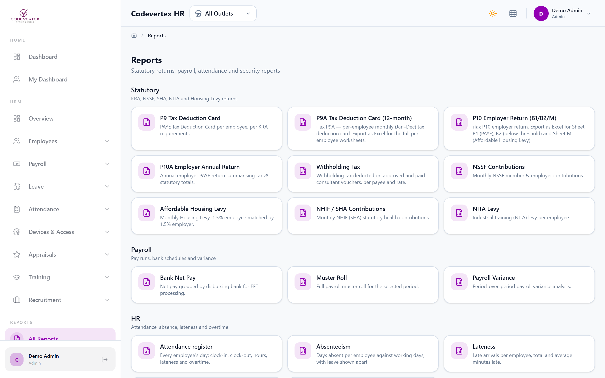
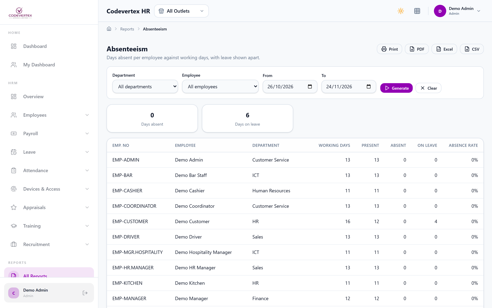
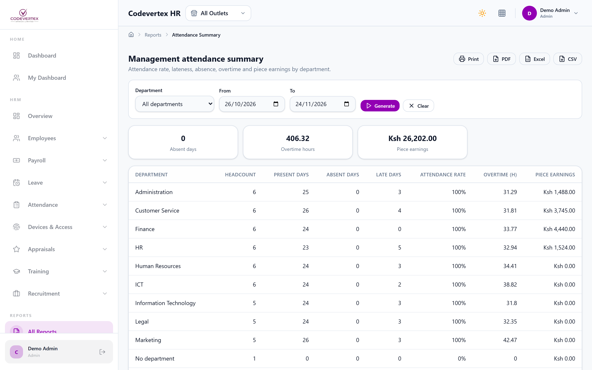
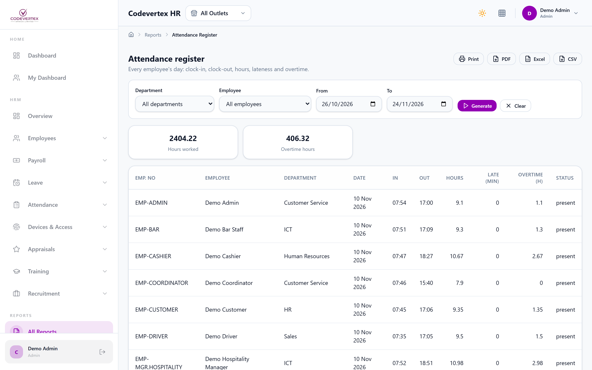
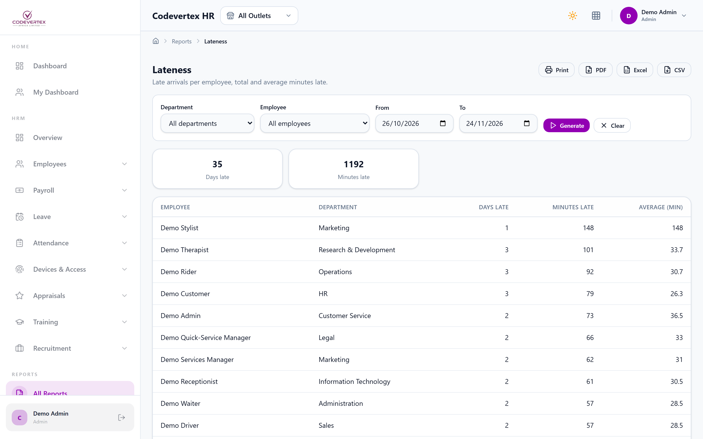
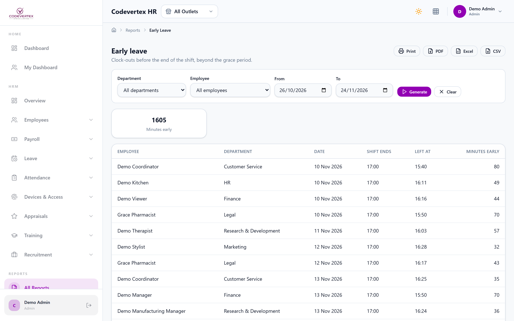
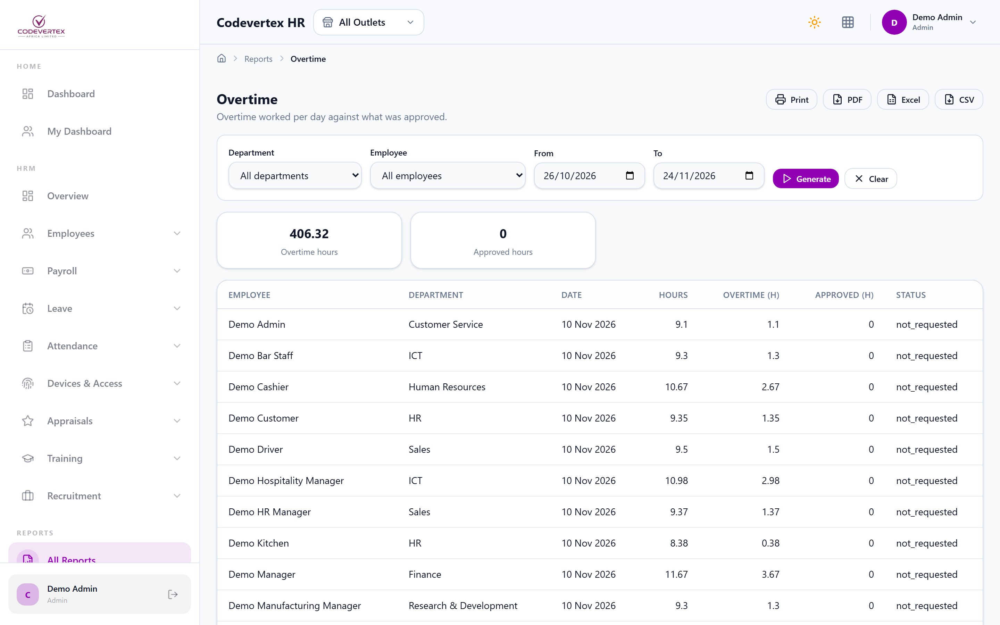
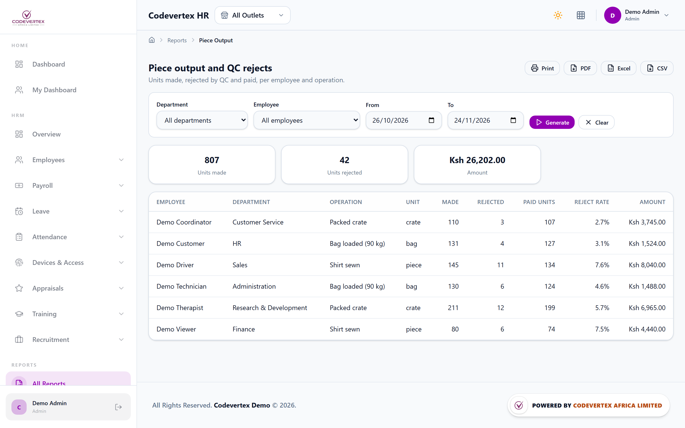
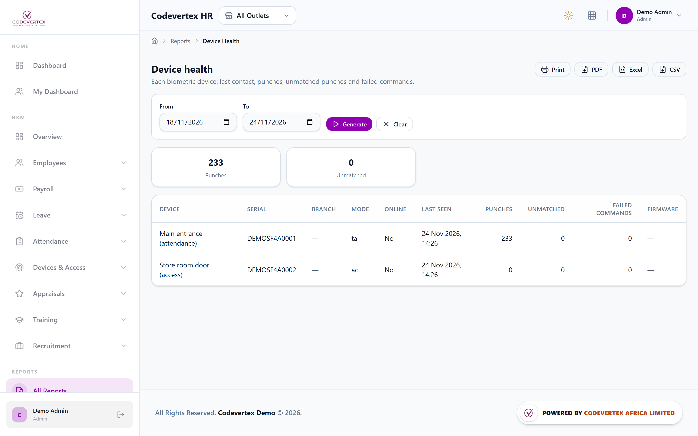

# Reports

Go to **Reports**. Reports are grouped by the department that uses them. Each one filters by date
range, department, branch and employee, and downloads as PDF, Excel or CSV.

| Department | Report | What it shows |
|---|---|---|
| HR | Attendance register | Each person's daily in, out, hours, lateness, overtime and status |
| HR | Absenteeism | Working days, days present, absent and on leave, and the absence rate |
| HR | Lateness | Late days, total and average minutes late |
| HR | Early leave | Each early departure with the shift end and minutes missed |
| Security | Access log | Door events, refused attempts and entries outside working hours |
| Quality control | Piece output | Quantity, rejected and paid pieces, reject rate and amount |
| IT | Device health | Each terminal's status, last contact, punches, unmatched punches and failed commands |
| Management | Attendance summary | Per department: headcount, present, absent and late days, attendance rate, overtime and piece pay |
| Management | Overtime | Overtime worked against approved hours |
| Payroll | [Statutory returns](statutory-returns.md) | P9, P9A, P10, P10A, withholding tax, NSSF, SHIF, Housing Levy and NITA |
| Payroll | [Payroll reports](statutory-returns.md#bank-net-pay) | Bank net pay schedule, [muster roll](statutory-returns.md#muster-roll) and [payroll variance](statutory-returns.md#payroll-variance) |

