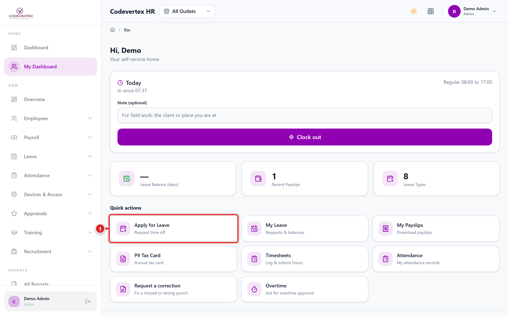
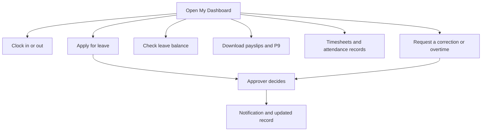
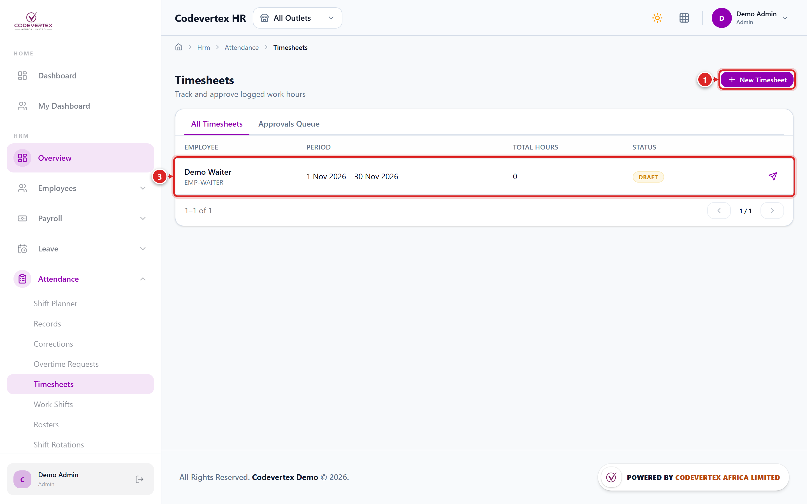

# Self-service (My Dashboard)

**My Dashboard** is where every member of staff starts. It works on a phone as well as a
computer, so most people never need anything else. Open it from **Home → My Dashboard**.

## What you see

At the top is a greeting and the **clock in** card. Below it are three tiles:

| Tile | Shows |
|---|---|
| Leave Balance (days) | Your remaining days this year across all leave types |
| Recent Payslips | How many payslips you have |
| Leave Types | How many leave types you have a balance for this year |

Then a set of quick actions. You only see the ones your role allows.

| Action | What it does |
|---|---|
| Apply for Leave | Request time off |
| My Leave | Your requests and balances |
| My Payslips | View and download your payslips |
| P9 Tax Card | Your annual P9 for your tax return |
| Timesheets | Log and submit your hours |
| Attendance | Your daily attendance records |
| Request a correction | Fix a missed or wrong clock in or out |
| Overtime | Ask for overtime to be approved |

## Clocking in and out

1. Tap **Clock in** when you start and **Clock out** when you finish. The button shows which one
   is next.
2. Your phone asks for your location the first time. Allow it. The ERP reads your location only
   when you tap the button, never in the background.
3. If your company requires a photo, take one when the card asks. You cannot clock in without
   it.
4. Add a note if you want, for example "client site".

If the location is not very accurate (more than about 100 metres), the card tells you, so move
near a window or outdoors and try again. Whether you can clock in away from a work site depends
on your company's settings; see [Time and Attendance](time-and-attendance.md).

## Leave

**Apply for Leave** and **My Leave** both open your own leave page, with your requests and your
balances for the year. Tap **Apply for Leave** there, choose the leave type and the start and end
dates, and add a reason if you want. The form shows how many days it takes, which public holidays
and days off are not counted, and your remaining balance. You can only apply for yourself.

Your request shows as Pending until it is decided. You get a notification when it is approved or
rejected, and approved days come off your balance. While it is pending you can cancel it with the
cross on its row; once it is approved, ask HR. Your account must be linked to your employee record;
if the page says it is not, ask HR. See [Leave](leave.md).

## Payslips and P9

**My Payslips** lists your payslips by month; open one to view or download it as a PDF.
**P9 Tax Card** gives your yearly P9 for filing your KRA return.

## Timesheets and attendance

**Timesheets** is where you log and submit hours when your work is recorded by timesheet.
**Attendance** shows each day's first in, last out, hours worked, minutes late and overtime.

HR sees everyone's timesheets under **HRM → Attendance → Timesheets**, with an **Approvals Queue**
tab for the ones waiting on them.

## Corrections and overtime

Forgot to clock out, or the terminal was offline? Tap **Request a correction**, pick the day,
enter the times it should have and give a reason. Your approver sees the original times next to
the new ones. If it is approved, your record is updated and the original times are kept in the
history.

Tap **Overtime** to ask for overtime to be approved. When your company pays only approved
overtime, approved hours are what reach payroll.

Both go to the approvers set by your company. If none are set, they go to HR for review, so a
request is never left waiting with nobody to decide it. See [Approvals](approvals.md).

## Using it on your phone

Open the ERP address in your phone's browser and sign in. To put it on your home screen like an
app:

- **Android (Chrome):** tap the menu (three dots), then **Install app** or **Add to Home
  screen**.
- **iPhone (Safari):** tap the Share button, then **Add to Home Screen**.

It then opens full screen from its own icon.
