# Statutory returns

The statutory and payroll reports are built from processed payslips, so they always match what
employees were paid. Find them under **Reports → Statutory (KRA)** and **Reports → Payroll
Reports**, or on the **Reports** page, which groups every report by the department that uses it.

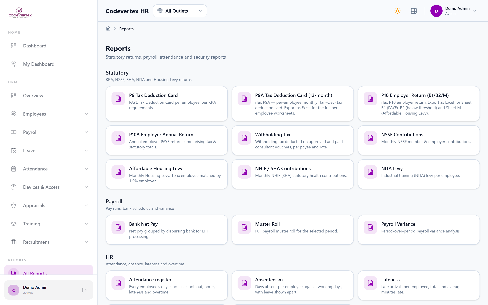

## Running and exporting a report

1. Open the report. It runs straight away for the current year, and the monthly returns open on last
   month. Change the **Year** or **Month** and press **Generate** for another period. Most can be
   narrowed by **Department**, and some by **Employee** or **Region**.
2. The table shows one row per employee (or per bank, or per category) with totals at the foot.
3. Export it:
    - **PDF** opens the printable document in a preview, from where you download or print it.
    - **Excel** downloads a workbook. For the P9A and P10 this is the iTax layout you upload.
    - **CSV** downloads the rows for your own spreadsheet.

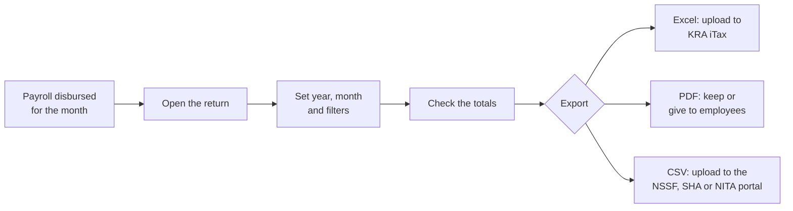

## The returns at a glance

| Report | What it shows | Filters | Filed or used where | When |
| --- | --- | --- | --- | --- |
| P9 Tax Card | each employee's PAYE for the year | year, department, employee | given to each employee | after the tax year, by the end of February |
| P9A Tax Card (12-month) | each employee's PAYE month by month, January to December | year, department, employee | KRA iTax and each employee | after the tax year |
| P10 Employer Return | the employer's PAYE, with Sheet B1, Sheet B2 and Sheet M | year, department | KRA iTax | every month, by the 9th of the next month |
| P10A Annual Return | the year's PAYE and statutory totals per employee | year, department | KRA iTax | after the tax year, by the end of February |
| Withholding Tax | tax withheld per payee | year, month or date range | KRA iTax | every month |
| NSSF | employee and employer NSSF | year, month, department | NSSF employer portal | every month, by the 9th of the next month |
| NHIF (SHA) | SHIF contributions | year, month, department | SHA employer portal | every month, by the 9th of the next month |
| Housing Levy | employee and employer levy | year, month, department | KRA iTax | every month |
| NITA | the training levy per employee | year, month, department | NITA portal | every month |
| Bank Net Pay | net pay grouped by bank | year, month, department | your bank | each pay day |
| Muster Roll | the full payroll with every pay component | year, month, department, region | your records | each pay month |
| Variance | this month against last month | year, month | review before you pay | each pay month |

Due dates are set by each authority and can change. The dates above are the current ones.

## P9 Tax Card

**Reports → Statutory (KRA) → P9 Tax Card** is the PAYE tax deduction card for each employee for the
year. Columns: employee, KRA PIN, National ID, gross pay, NSSF, pension, SHIF, Housing Levy,
mortgage, disability exemption, total deductions, chargeable pay, tax charged, personal relief,
insurance relief and PAYE tax. The totals give chargeable pay, PAYE and net pay for everyone
selected.

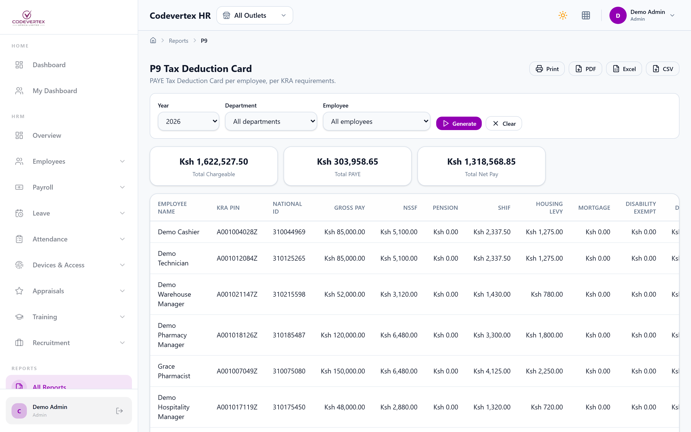

Give each employee their P9 after the year closes so they can file their own return.

## P9A Tax Card (12-month)

**Reports → Statutory (KRA) → P9A Tax Card (12-month)** shows each employee's tax card month by month,
January to December, with total gross, chargeable pay, PAYE and net. **Excel** produces a worksheet
per employee in the iTax P9A layout.

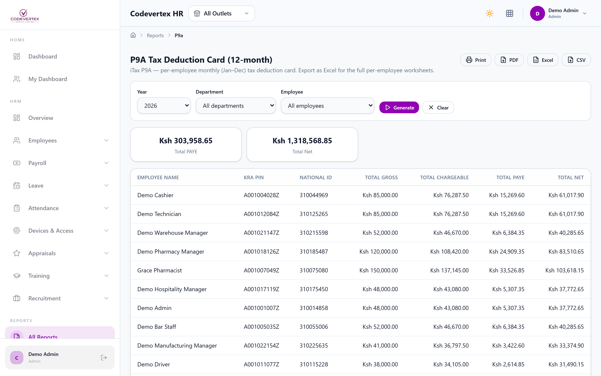

## P10 Employer Return

**Reports → Statutory (KRA) → P10 Employer Return** is the employer's PAYE return: gross pay,
chargeable pay, PAYE and whether each employee is liable to PAYE. **Excel** produces the iTax
sheets: B1 for employees who pay PAYE, B2 for employees below the PAYE threshold, and M for the
Affordable Housing Levy. Upload it on KRA iTax and pay the PAYE and Housing Levy shown.

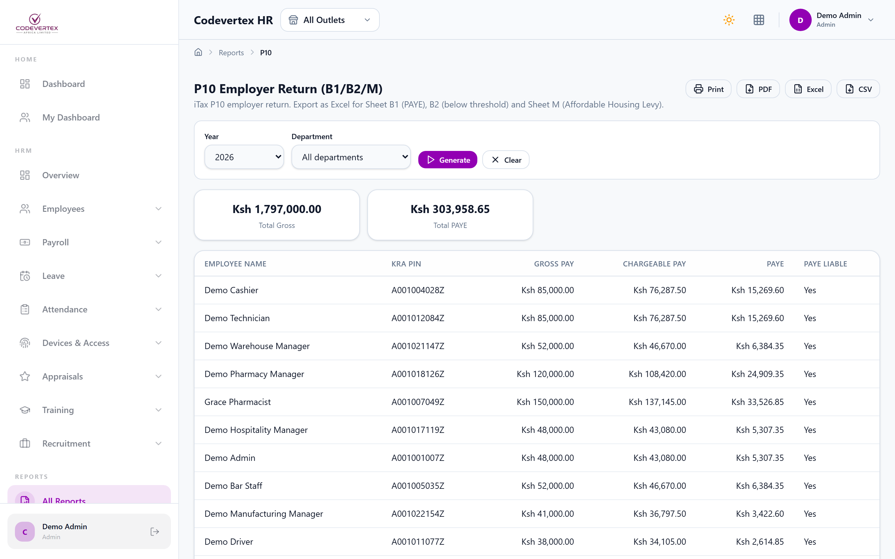

## P10A Annual Return

**Reports → Statutory (KRA) → P10A Annual Return** summarises the year for each employee: total gross
pay, PAYE, NSSF, SHIF and Housing Levy. File it on KRA iTax after the year closes.

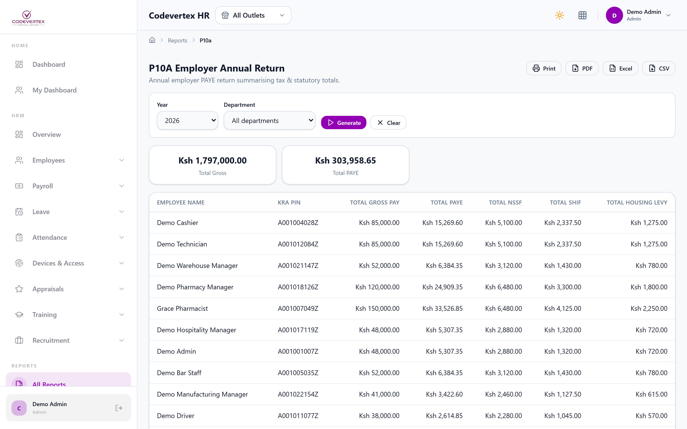

## Withholding Tax

**Reports → Statutory (KRA) → Withholding Tax** lists the tax withheld for the period: payee, payment
type, gross amount, rate, tax withheld and net payment, with totals. Withholding tax on consultant
fees is worked out on each consultant voucher (see
[Payroll extras](payroll-extras.md#consultants)) and booked in Treasury to *Withholding Tax
Payable*.

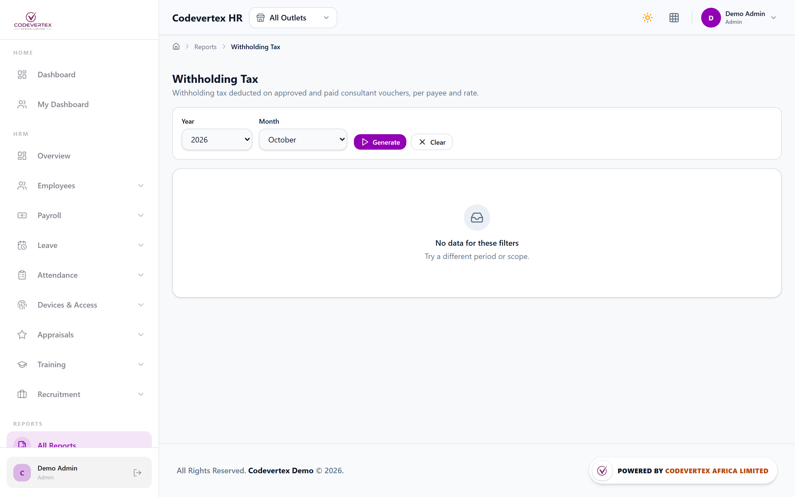

## NSSF

**Reports → Statutory (KRA) → NSSF** shows each employee's gross pay, pensionable earnings (the pay
NSSF was charged on), NSSF contribution and the member and employer rates for the month. Upload it to the NSSF employer portal and pay the total,
which is the employee and employer shares together.

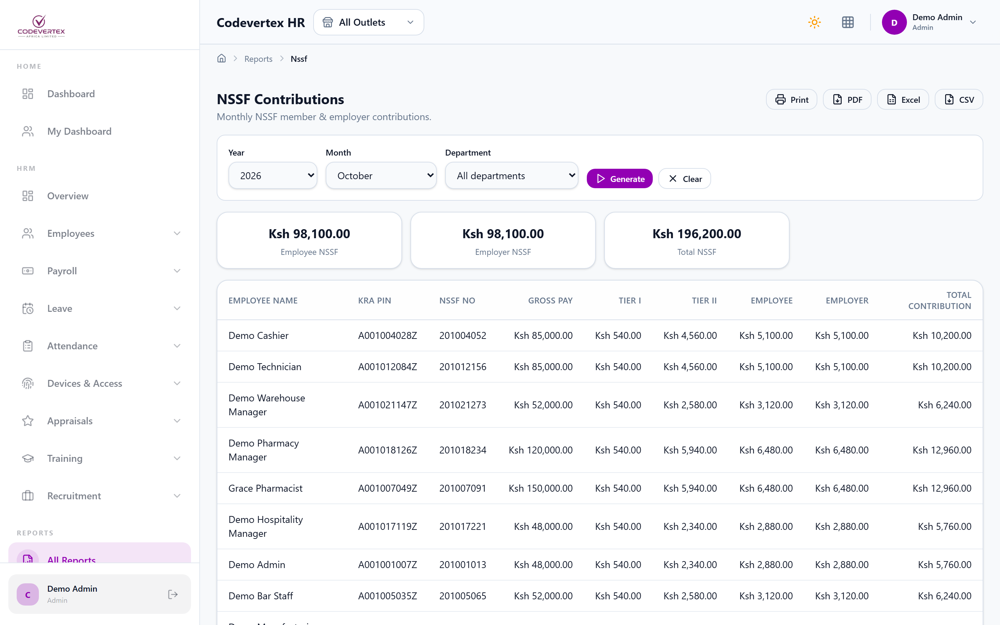

## NHIF (SHA)

**Reports → Statutory (KRA) → NHIF (SHA)** shows each employee's SHIF (formerly NHIF) number,
gross pay, the gross salary SHIF was charged on, contribution and coverage type for the month. SHIF is paid by the employee only. File and pay it on
the Social Health Authority (SHA) employer portal.

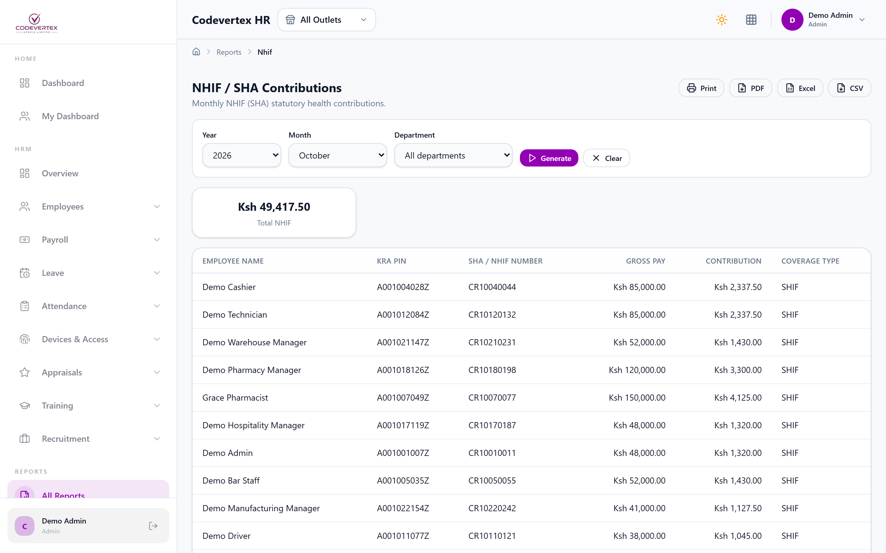

## Housing Levy

**Reports → Statutory (KRA) → Housing Levy** shows each employee's ID number, gross pay, the gross
salary the levy was charged on, the employee's 1.5%, the employer's 1.5% and the total levy. The
levy is declared on KRA iTax (Sheet M of the P10) and paid with it.

### Which pay each levy is charged on

Each earning can count for some levies and not others (see
[Payroll](payroll.md#which-levies-an-earning-counts-for)), so the pay a levy is charged on can
differ from gross pay. The NSSF return shows **pensionable earnings**, and the SHIF and Housing Levy
returns show the **gross salary** each levy was charged on. Sheet M of the P10 uses the same Housing
Levy figure, and its employer column is what payroll charged the employer.

Payslips processed before payroll recorded these figures show gross pay in those columns, and the
employer's Housing Levy equal to the employee's, as the returns always did.

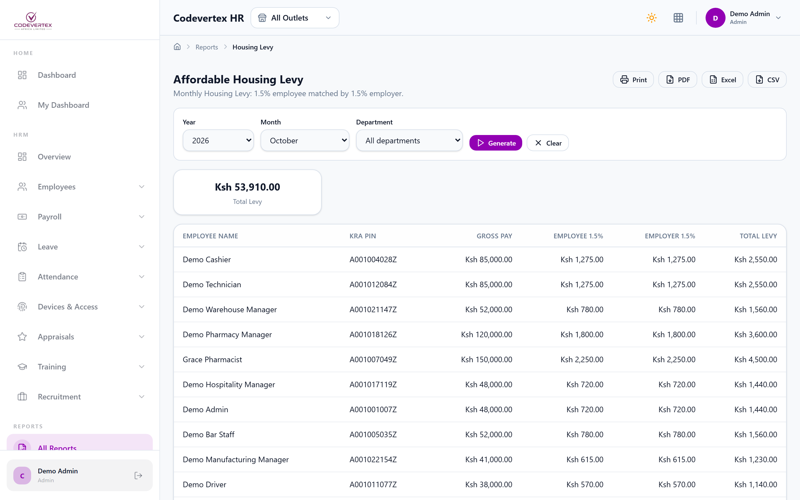

## NITA

**Reports → Statutory (KRA) → NITA** shows the training levy for each employee for the month, KES 50
per employee by default, paid by the employer only. When NITA is switched off under
**Settings → Payroll → Tax & Statutory**, the return is empty. Pay it through the NITA portal.

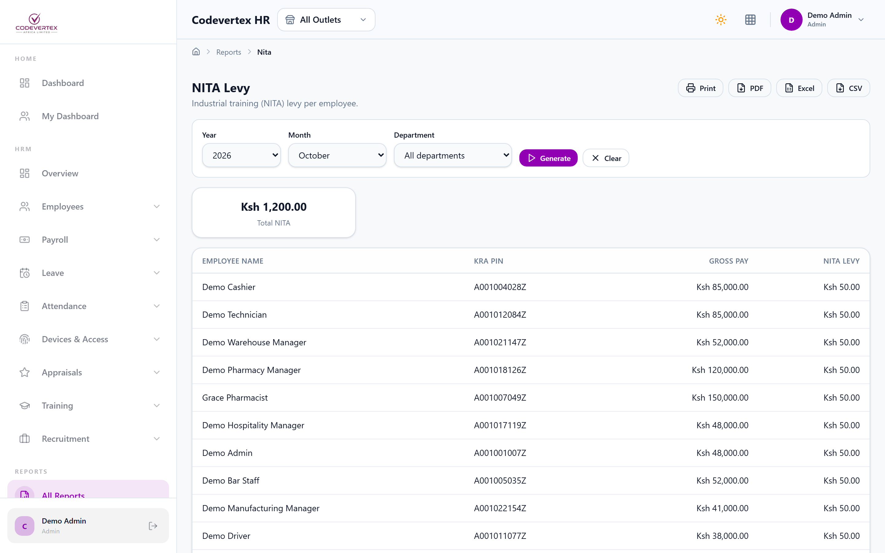

## Bank Net Pay

**Reports → Payroll Reports → Bank Net Pay** groups the month's net pay by bank: bank name, number of
employees, number of accounts, total net pay and a reference number. Use it when you pay salaries by
bank transfer from your own banking, or to check what Treasury paid.

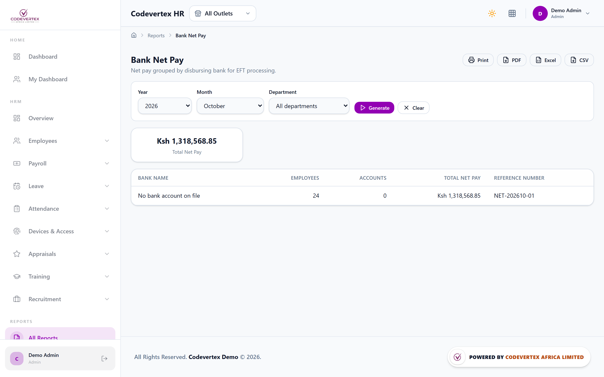

## Muster Roll

**Reports → Payroll Reports → Muster Roll** is the full payroll for the month: staff number,
employee, department, basic pay, gross, deductions and net pay, with a column for every earning,
benefit, statutory deduction, other deduction and employer contribution, and a quantity column for
items paid by the unit. The first column stays in place as you scroll across, and the foot shows
grand totals. Use **Edit Columns** to choose what to show.

The **View muster roll** button on a month in **Payroll → Payslips** opens it already set to that
month.

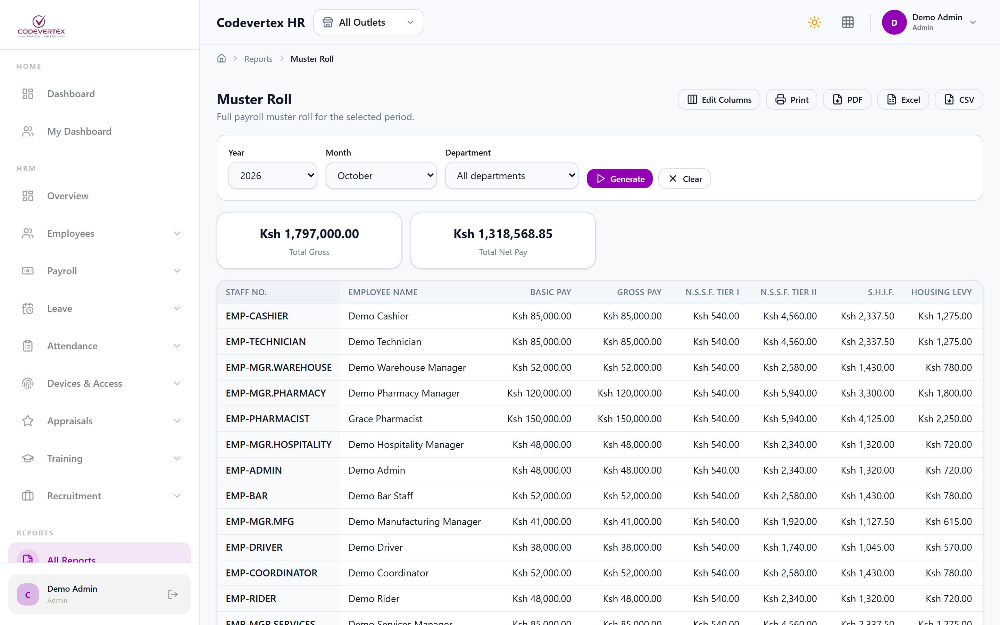

## Payroll Variance

**Reports → Payroll Reports → Variance** compares the chosen month with the month before, by
category: current period, previous period, the difference in KES and in percent, and whether it
went up or down. Run it before you approve a month to catch an unexpected change.

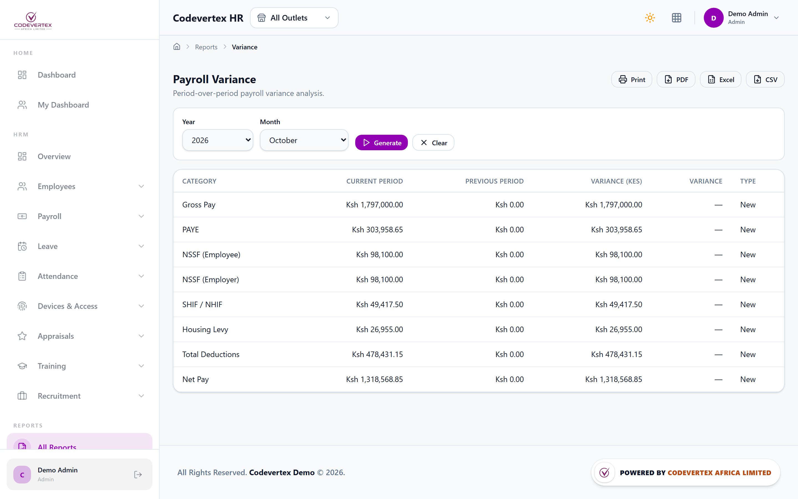
