# Time and Attendance

Attendance in Codevertex ERP starts with a punch, from a biometric terminal or a phone, and ends as
an approved daily record that payroll can use. This page covers how that works and the settings
that control it. Terminal setup is on [Biometric Devices and Access Control](devices-and-access.md).

## Shifts, rosters and the work day

Go to **HRM → Attendance**.

- **Work shifts**: start, end and grace minutes for each shift (day, evening, night). A night shift
  that crosses midnight counts as one work day.
- **Rosters and the shift planner**: plan who works which shift each week on a grid.
- **Rotations**: pick the shifts in order and how long each one runs (for example one week each);
  the ERP moves people to the next shift automatically and shows the next change.
- **Off days**: a day off granted to one employee, with the reason.
- **Overrides**: a one-off change to one employee's day: *Day off*, *Changed shift* (new start and
  end) or *Half day*. Cells you paint in the shift planner appear here as *Set in shift planner*.

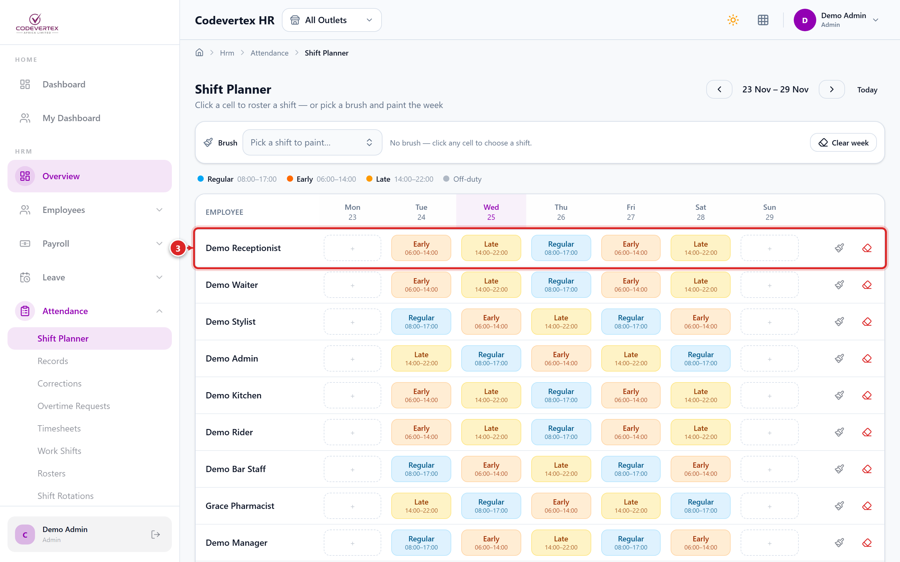

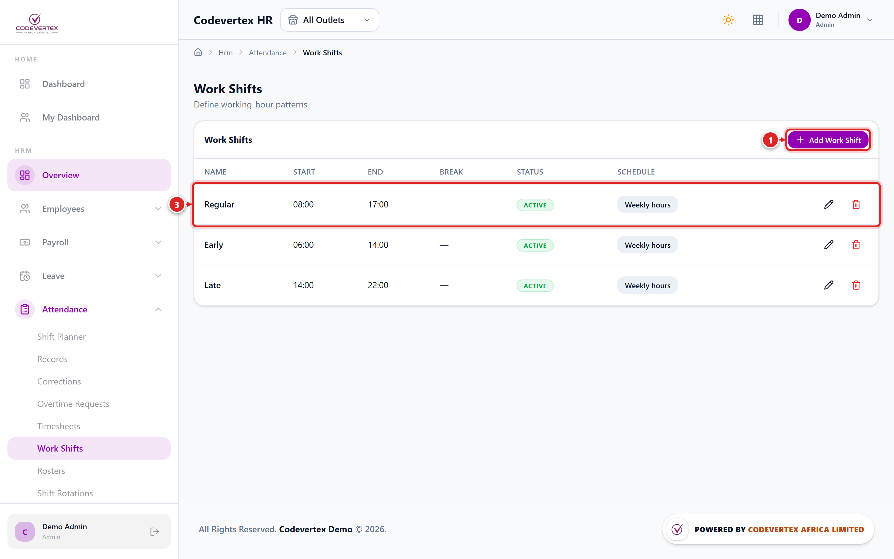

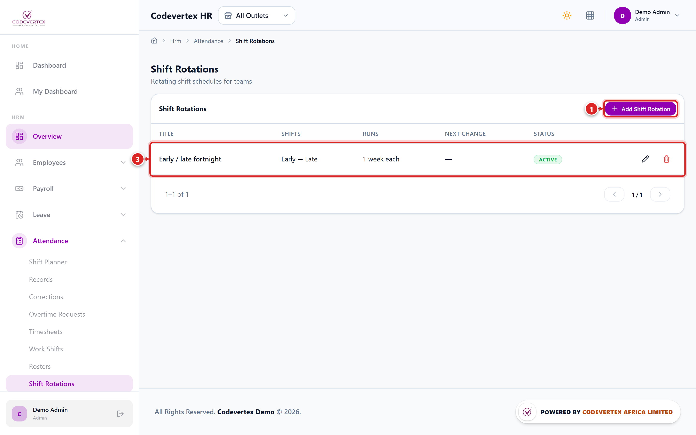

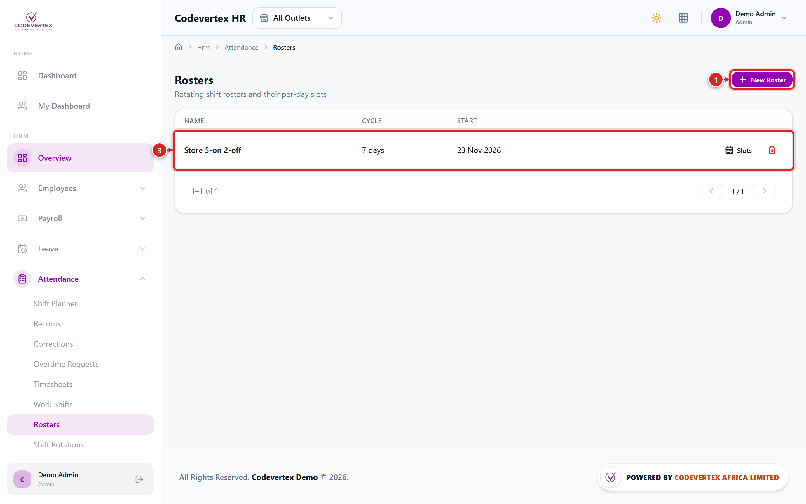

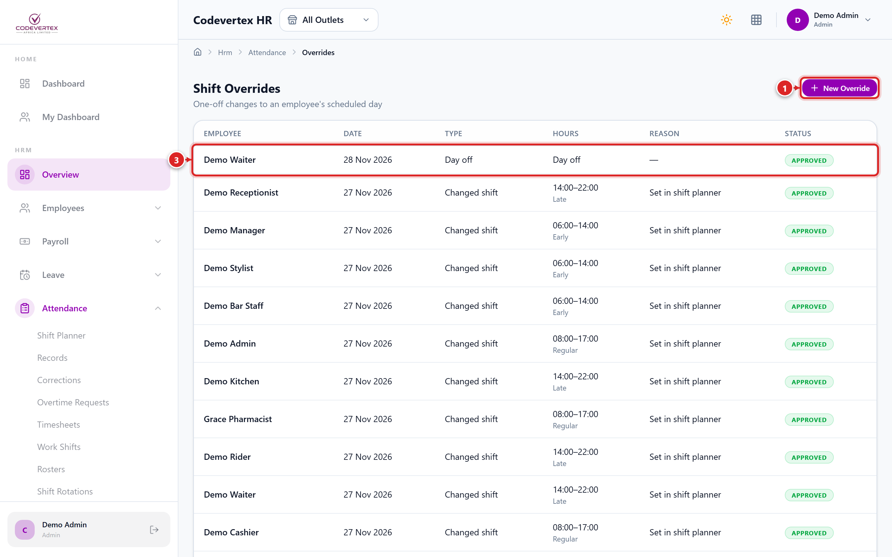

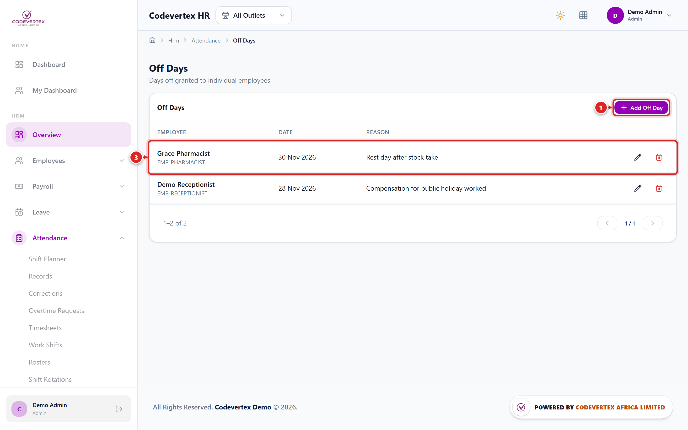

For each punch the ERP decides which shift applies, in this order: an approved override for that
day, the roster, the person's shift assignment, the person's standard shift, then the company
default shift.

## From punches to attendance records

Each person gets one record per work day: first in, last out, hours worked, minutes late, minutes
left early and overtime. Punches from terminals and phones are paired automatically. Punches that
arrive twice (a terminal resending after the internet came back) are kept once.

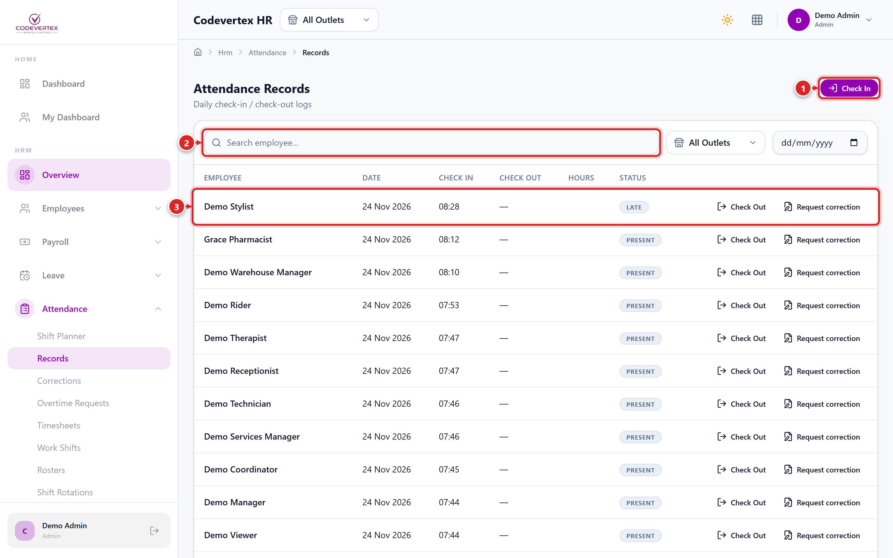

## Rules: lateness, absence, early leave and overtime

Open **HRM → Attendance → Settings**. Every value here is yours to set; nothing is fixed in the
system.

| Setting | What it does |
|---|---|
| Grace minutes (on the shift) | How long after the shift start a clock-in still counts as on time |
| Early leave grace | How long before the shift end a clock-out still counts as a full day |
| Overtime threshold and cap | Hours per day after which time counts as overtime, and the most that can count |
| Minimum work hours | Fewer hours than this marks a half day |
| Overtime and holiday multipliers | Pay rates for overtime and for work on public holidays |
| Overtime needs approval | When on, only approved overtime is paid |
| Pay overtime in payroll | Turns overtime and holiday pay in the payroll run on or off |
| Automatic absence | Marks rostered staff absent overnight when they did not clock in and were not on leave, off or on a public holiday |
| Geo mode and tolerance | How phone clock-ins outside a work site are handled (see below) |
| Require a photo | Asks staff for a photo when they clock in from the phone |
| Terminal online window | How recent a terminal's last contact must be to show as online |

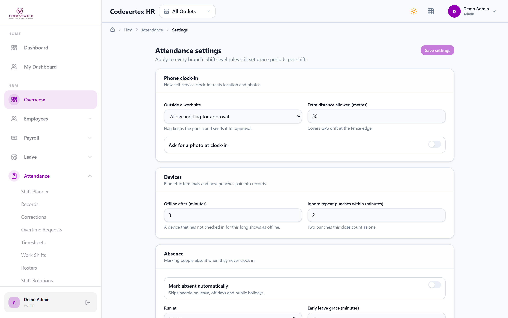

**HRM → Attendance → Rules** adds rules per branch or department on top of these settings. Each
rule has a type (lateness, overtime, absenteeism, work hours, breaks or holidays) and shows only the
fields for that type, for example *15 min grace, fixed amount per late arrival* or *3 absences in a
row or 5 a month, warning*. Penalties are prepared as deductions for HR to review before payroll.

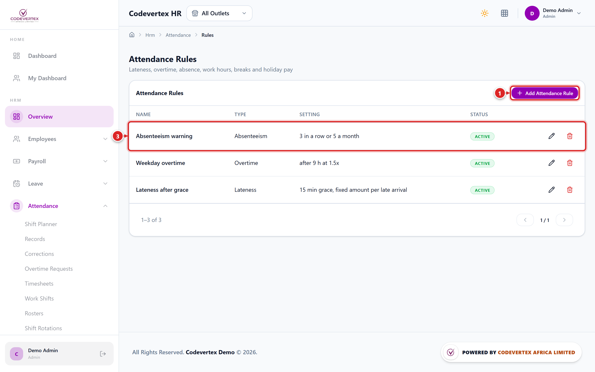

## Corrections and overtime requests

Nobody edits a punch silently. When someone forgets to clock out or a terminal was offline, the
employee (from self-service) or HR raises a **correction** with the right times and a reason. It
goes to the approvers set under **Settings → Approvals**. Once approved, the record is updated and
keeps the original times, the new times, who asked, who approved and when. If no approval workflow
is set up, corrections go to an HR review step so they are never stuck.

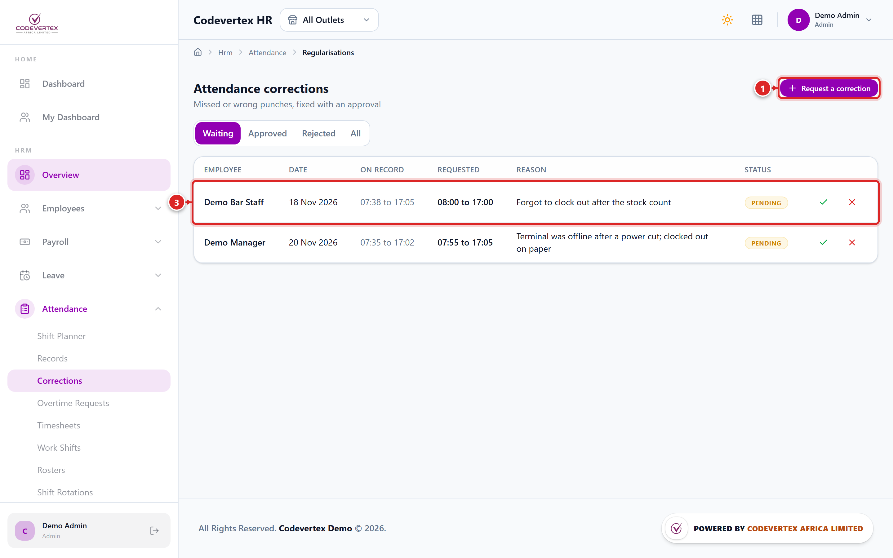

**Overtime requests** work the same way. When overtime needs approval, only approved hours reach
payroll.

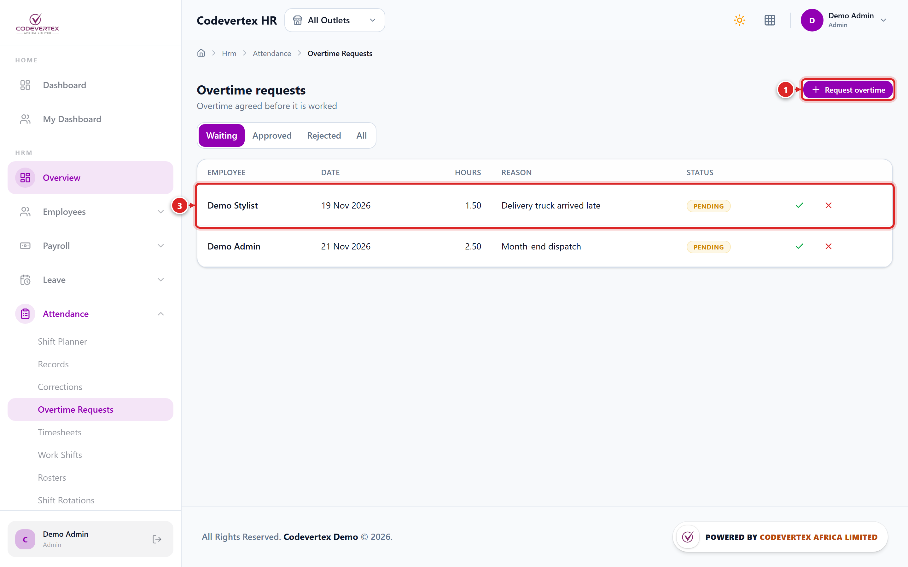

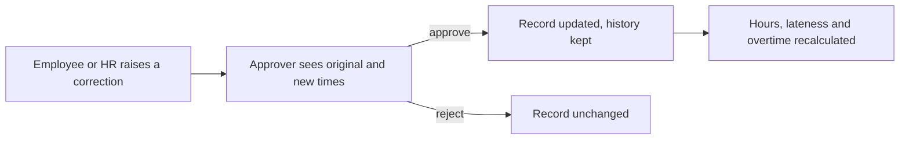

## Phone clock-in, work sites and field staff

Staff open **My Dashboard** on their phone and tap **Clock in**. The ERP reads the phone's location
only at that moment and checks it against the work sites.

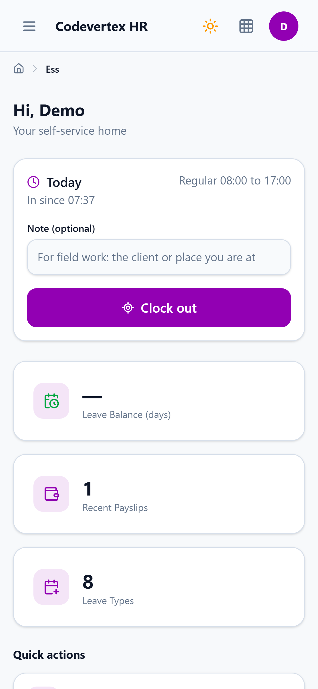

**Work sites** (HRM → Attendance → Work sites) are drawn on a map as a circle with a radius or as an
outline around the premises.

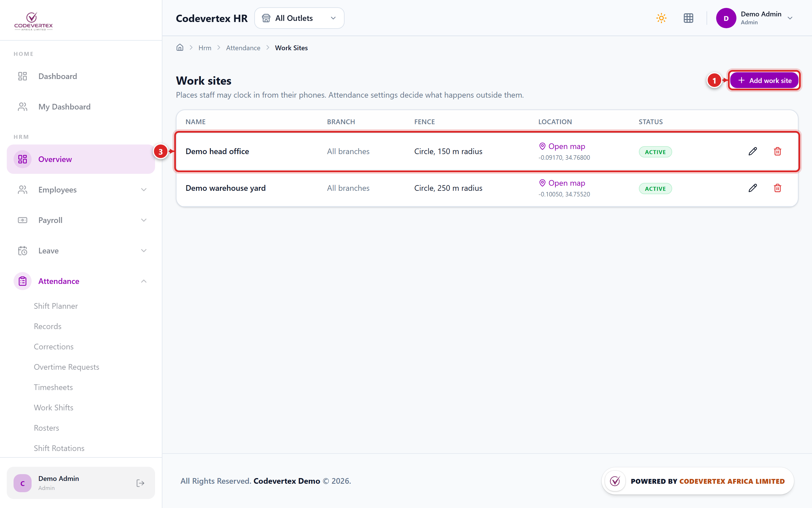

What happens outside a work site depends on the geo mode:

| Geo mode | Result |
|---|---|
| Off | Location is recorded but not checked |
| Flag | The clock-in is saved and flagged for HR review |
| Block | The clock-in is refused with a message saying how far the person is from the site |

The phone's own accuracy is taken into account, up to the tolerance you set, so a weak GPS fix at
the gate does not count as outside.

**Field and technical staff** can be marked as field staff on their profile. They can clock in from
anywhere, and every clock-in records the location, accuracy and an optional photo and note, so
supervisors can see where the work happened.
