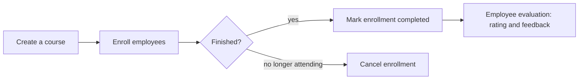
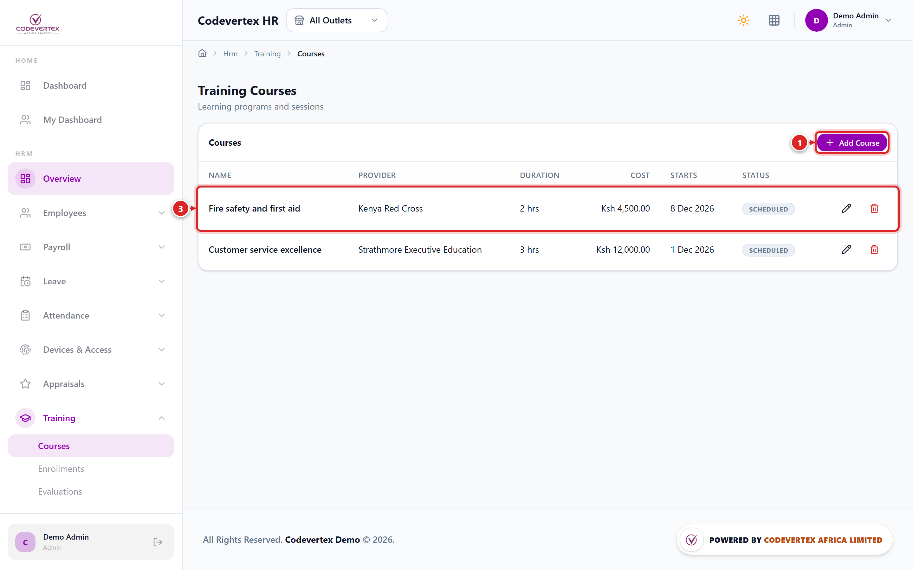
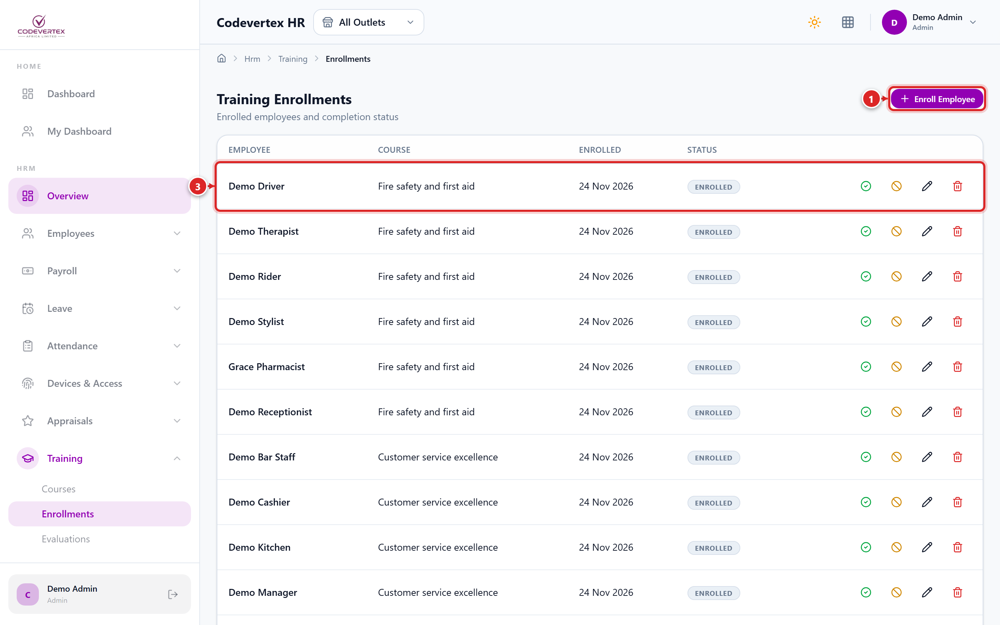
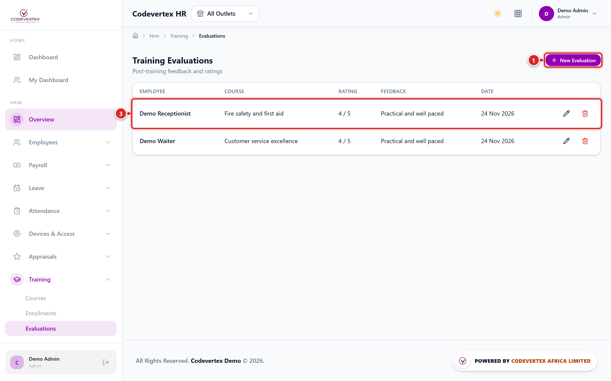

# Training

Training in Codevertex ERP has three parts: the courses you offer, who is enrolled on each, and
what people thought of it afterwards. Find them under **HRM → Training**.

## Courses

Go to **HRM → Training → Courses** and click **Add Course**.

| Field | Notes |
|---|---|
| Course name | For example "Fire safety induction" |
| Start date, end date | When the course runs |
| Description | What it covers and who it is for |

The list shows each course with its start date so you can see what is coming up.

## Enrollments

Go to **HRM → Training → Enrollments** and click **Enroll Employee**. Pick the employee and the
course.

| Status | Meaning |
|---|---|
| Enrolled | Signed up and attending |
| Completed | Finished the course |
| Cancelled | No longer attending |

Use **Complete enrollment** when the person finishes, or **Cancel enrollment** if they drop out.
The ERP asks you to confirm a cancellation. The list also shows each person's score where one
was recorded.

## Evaluations

Go to **HRM → Training → Evaluations** and click **Add Evaluation** to record feedback after a course. Each evaluation is
for one person on one course, with a rating from 1 to 5 and written feedback.

Use evaluations to decide which courses to run again and which providers to keep.
