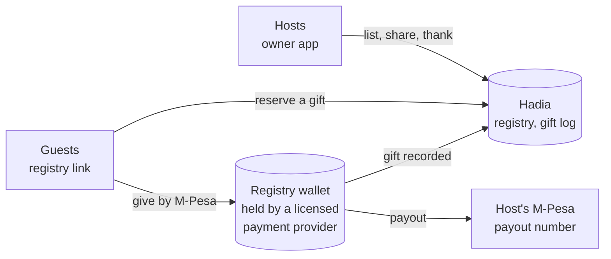

# Hadia: gift registries for Kenyan celebrations

Hadia is a gift registry for weddings, ruracio and nyombo, baby showers, birthdays, graduations,
housewarmings, church celebrations, family harambees, anniversaries, retirements and any other
milestone. A host makes one list of the gifts they would love and the cash funds for bigger plans,
then shares one link. Family and friends open it on any phone. They can reserve a gift to buy
themselves, so nobody brings the same thing twice, or give money toward a gift or a fund by M-Pesa.

Guests need no app and no account. Money gifts are held safely for the registry until the host pays
them out to a confirmed M-Pesa number.

## Who uses it

| You are | Open | What you do there |
|---|---|---|
| A host (registry owner) | `hadiafrica.com`, then **Create a registry** or **My registries** | Make the list, publish and share it, follow gifts, thank guests, take payouts |
| A guest | the link the host sent you, or **Find a registry** on `hadiafrica.com` | See the list, reserve a gift, give money, get a receipt |

## How the money moves

1. **A guest gives.** They choose an amount, see the handling fee and the exact total, then approve
   the M-Pesa prompt on their own phone. If the prompt cannot reach them, the page shows paybill
   **756756** and an account number to pay from the M-Pesa menu instead.
2. **The money is held for the registry.** It sits in an escrow account for that registry with a
   licensed payment provider, not in anyone's personal account. The host sees each gift and the
   guest's message as it lands.
3. **The host takes a payout.** The money goes to the M-Pesa number the host confirmed with a code.
   The payout screen shows the amount, Hadia's commission and what reaches the host before anything
   starts. Payouts can also run by themselves.

Everything guests give reaches the host, less fees, whether a fund passes its target or falls short.
Money given toward a gift that nobody fully funded comes to the host as cash.

Creating, sharing and reserving are free. Hadia charges only on money gifts.

## In this guide

- **[For hosts](owners.md)**: signing up, creating and publishing a registry, adding gifts and cash
  funds, sharing and privacy, the gift log and thank-yous, statements, payouts, closing a registry
  and Premium.
- **[For guests](guests.md)**: opening a registry, reserving a gift, giving by M-Pesa prompt or
  paybill, receipts, and changing or cancelling a reservation.
- **[Staying safe](safety.md)**: how to tell a real Hadia message from a scam, and what to do if
  something looks wrong.
