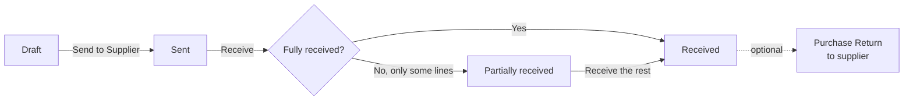
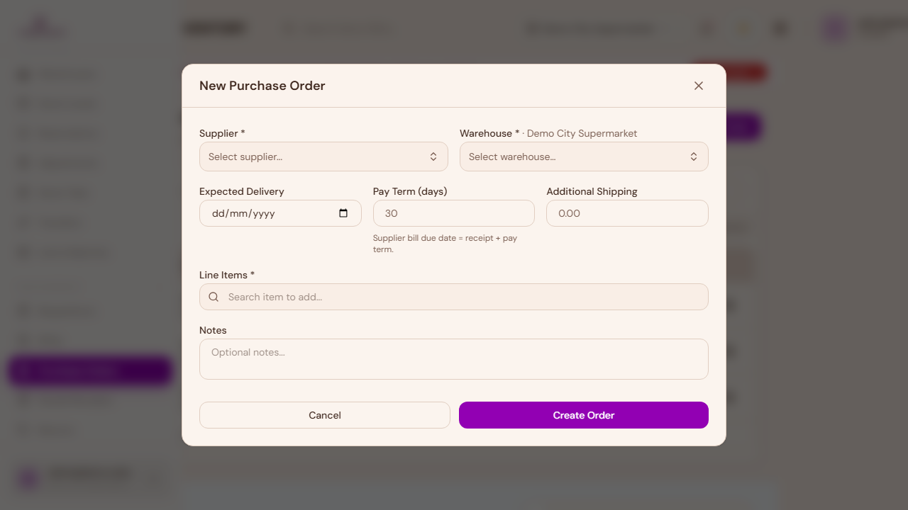
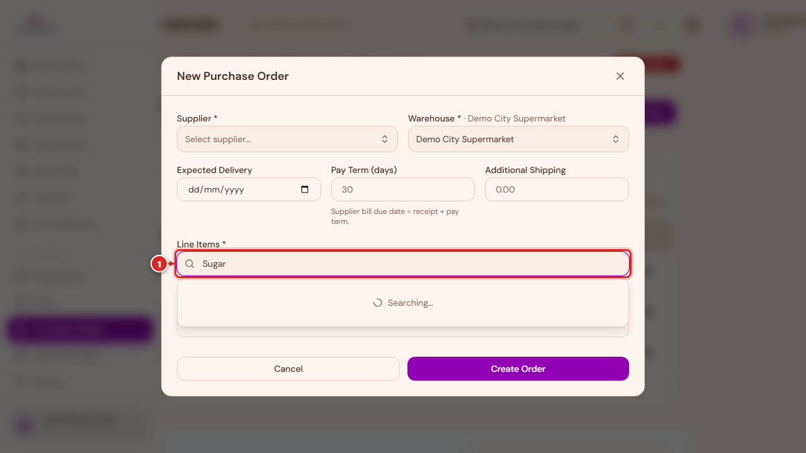
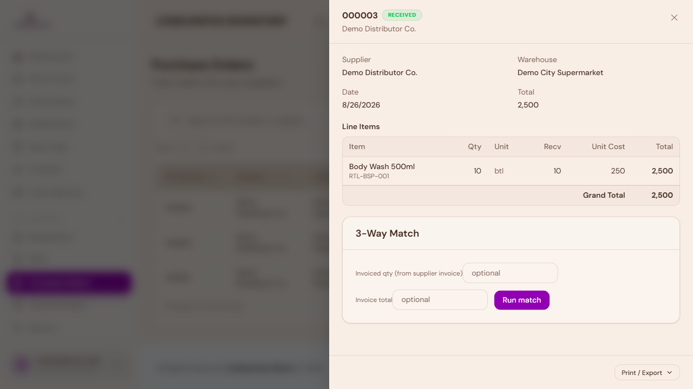
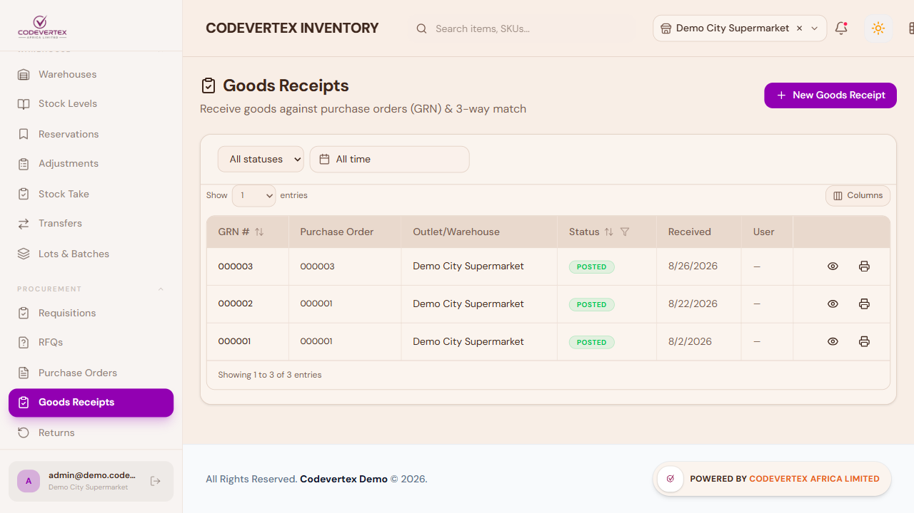
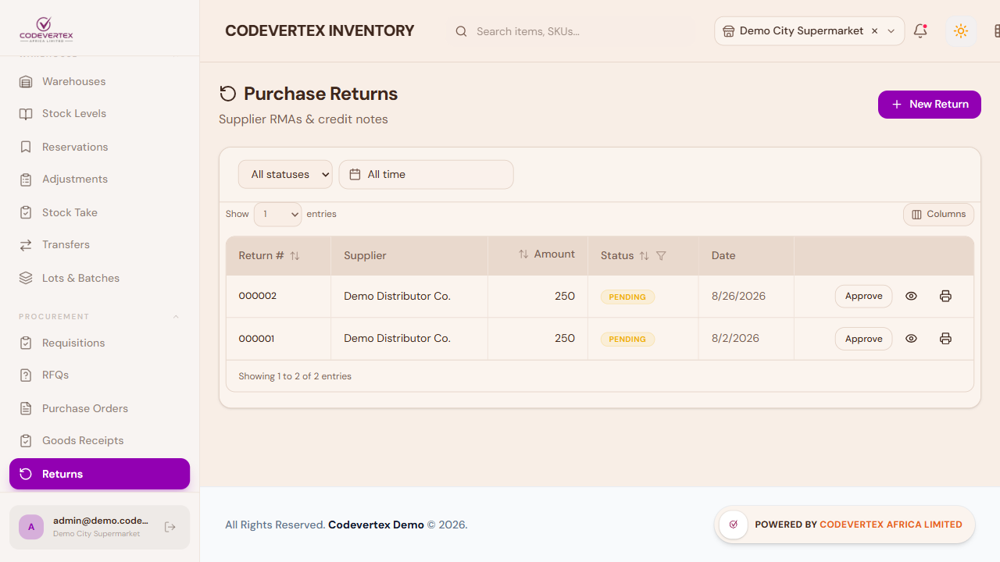
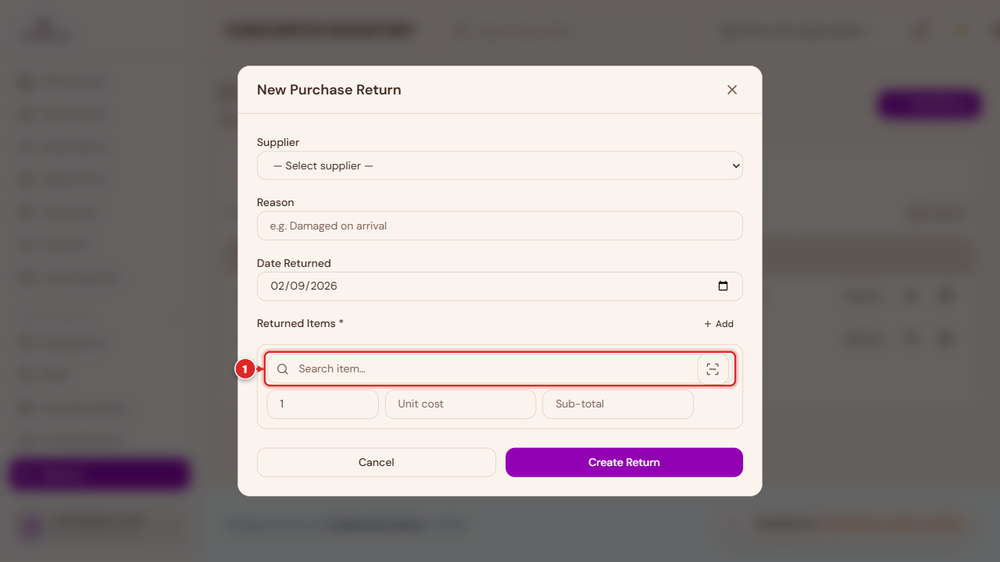

# Purchasing & Receiving

How to order stock from a supplier, receive it in, and record a return — the three steps of the
purchasing cycle, in order. A faulty item does not always go back to the supplier: you can also
send it for repair and receive it back (see
[Sending items for repair or service](#sending-items-for-repair-or-service)).

## Creating a Purchase Order

Go to **Purchase Orders** in the sidebar, then **New Order**.

> **Direct link:** `https://inventory.codevertexafrica.com/{your-tenant-slug}/purchase-orders`
> (demo: `https://inventory.codevertexafrica.com/codevertex-demo/purchase-orders`)

1. **Supplier** — required. Pick an existing supplier or add a new one on the spot.
2. **Warehouse** — required. This is where the stock will post to once received.
3. **Expected Delivery**, **Pay Term**, and **Additional Shipping** are all optional header
   details.

Search for each item you're ordering and it's added as a line in one step, pre-filled with its
unit and last-paid cost — adjust the quantity and cost as needed. Each line also has an optional
**selling price adjustment**: if the supplier's price changed, you can set a new selling price
here and choose whether it applies to all existing stock immediately or only to the new stock once
it's received.

Submitting creates the order as a **Draft**.

## Sending, status, and receiving

Opening a purchase order shows its full detail — supplier, warehouse, line items, and how much has
been received against each line. The actions available depend on its current status:

- **Submit for Approval** — on a draft order, if your organisation requires purchase approval.
- **Send to Supplier** — moves a draft to **Sent**.
- **Mark Received** — a one-click shortcut that receives the *entire* order in one action and
  updates stock immediately. Use this when a delivery arrived complete and you don't need to
  record partial quantities, rejects, or lot/serial detail.
- **Cancel Order** — available on draft or sent orders.

## Goods Receipts — receiving with detail

For anything more than "it all arrived fine" — a partial delivery, some damaged units, items that
need a lot number and expiry date recorded — use **Goods Receipts** instead of the quick Mark
Received shortcut.

> **Direct link:** `https://inventory.codevertexafrica.com/{your-tenant-slug}/goods-receipts`
> (demo: `https://inventory.codevertexafrica.com/codevertex-demo/goods-receipts`)

**New Goods Receipt**, then pick the purchase order you're receiving against — only orders that
are sent or partially received show up in the list, since there's nothing to receive against a
draft. For each line item, the form shows what's outstanding and lets you enter:

- **Received** — pre-filled with the full outstanding quantity; reduce it for a partial delivery.
- **Rejected** — units you're not accepting, with a reason (excluded from what you'll be billed
  for).
- **Actual unit cost** — pre-filled from the order, editable if the supplier's actual invoice
  differs.
- **Lot / batch number and expiry date** — shown up front for items you've marked as
  lot-tracked or perishable (see [Adding Products](adding-products.md)), otherwise available as an
  optional section.
- **Serial numbers** — for serial-tracked items, one serial per accepted unit.

- **New selling price** — pre-filled from the purchase order when the buyer set one there.

Creating the receipt saves it as a **draft** — it does **not** touch your stock yet. Open it and
click **Post — update stock** as a deliberate second step once you're happy the numbers are right.
This two-step design (create, then post) gives you a chance to double-check quantities before
they hit your stock levels.

### What receiving does to your prices

Posting a receipt (or clicking **Mark Received**) updates the product from what you actually paid:

- **Buying price (cost).** The product's cost moves to the price on this receipt, so the product
  form, the catalog cost column and the next purchase order all show what you last paid. Stock
  you already had keeps the cost it was bought at for profit and stock value, so an old batch is
  never revalued. Tenants on weighted average costing see the average across the stock on hand.
- **Selling price.** It changes only when you enter a new selling price on the purchase order or
  the receipt. **All stock** applies it at once everywhere, including the POS. **New stock only**
  keeps the current price until the older stock is sold through, then switches. Mark Received
  applies the price set on the purchase order the same way.

## Purchase Returns

A Purchase Return records stock going back **to your supplier** — damaged goods, an over-delivery,
anything you're sending back for a credit or refund. (This is different from a customer returning
something they bought from you, which is recorded as a Stock Adjustment with reason "Customer
Return" instead — see [Warehouses & Stock](warehouses-and-stock.md#stock-adjustments).)

> **Direct link:** `https://inventory.codevertexafrica.com/{your-tenant-slug}/returns`
> (demo: `https://inventory.codevertexafrica.com/codevertex-demo/returns`)

**New Return**:

Pick the supplier, a reason, and add the item(s) being returned with quantity and unit cost. Once
created, an admin or manager needs to **Approve** the return before it affects your stock — it's
only decremented once approved, not at the moment you create it.

If approving fails for any item (for example an item that cannot be stock-adjusted), nothing is
changed: the items already taken out are put back and the return stays pending, so a return is
never left half approved.

## Sending items for repair or service

Not every faulty item goes back to the supplier. A phone with a swollen battery, a laptop with a
dead screen or a device that develops a fault while it is still in stock is often sent to a
technician, a service centre or a care centre you trust. Those items leave your stock for a while,
but they stay yours and are expected back once repaired. Nothing is credited, because no supplier
is involved.

Use the same **Returns** page for this. Click **New Return** and choose **Send for repair** at the
top of the form:

1. **Sent to** is the technician, service centre or care centre. Type the name once and it is
   offered as a suggestion next time. **Contact** is optional.
2. **Sending from** is the location the items leave from, and **Date sent** is the day they left.
3. **What is wrong** and **Expected back** are optional, but an expected day lets the page warn you
   when an order is overdue.
4. Add the items and quantities. The cost value of each item is filled in from its cost price. It
   is only recorded so the items come back into stock at the cost they left with.

The order starts as **Pending approval**. An admin or manager clicks **Send out** to confirm. That
is the moment the items leave your stock. In the stock history of each item the movement reads
**Sent for Repair** with the order number and the name of the provider.

You can print the **Service / Repair Order** from the order's **Print / Export** menu and hand it
over with the items.

### Receiving the items back

When the items return, open the order (or use **Receive back** on its row) and enter, for each
item:

- **Came back**: units that were repaired. They go back into stock at the cost they left with, and
  the stock history shows **Returned from Repair**.
- **Not repairable**: units the provider could not fix. They come back into stock only to be
  written off straight away as damaged, so the loss appears in your reports like any other
  write-off.

Anything you leave blank stays out for repair, so you can receive an order in several deliveries.
The order moves from **Out for repair** to **Partly back** and finally to **Returned** (or
**Written off** when nothing could be repaired). You cannot receive more units than are still out.

### Keeping track of what is away

When at least one order is out for repair, the top of the Returns page shows how many units are
away, what they cost, how many orders are overdue and which provider holds the most. Click the
**Overdue** tile to see only the late orders. Use the **Sent for repair** filter to look at repair
orders only.

Items that are away are not counted in your stock quantity or stock value, so they cannot be sold
while they are out. They also do not count as a supplier return or as an adjustment in your
reports and the KRA stock position.

## Common Issues

**A repair order was approved but the items still show in stock.** They do not, once the order is
approved. If the order still says **Pending approval**, an admin or manager has to click **Send
out** first.

**You cannot choose "Sent for repair" as a stock adjustment reason.** Repair movements are created
only from a repair order, so the provider, expected day and cost are always recorded. Use
**New Return**, then **Send for repair**.

**A purchase order won't let you click Send to Supplier.** Check whether your organisation
requires approval first (Settings → Stock & Thresholds → "Purchase Order Approval Required," see
[Inventory Administration](administration.md#settings-stock-thresholds)) — if it does, **Submit
for Approval** has to clear before the order can be sent.

**New Goods Receipt shows no purchase orders to pick from.** Only orders that are **Sent** or
**Partially Received** are eligible — a Draft order has nothing to receive yet, and a fully
Received order has nothing left outstanding. Send the order first if it's still a Draft.

**A Goods Receipt doesn't seem to have updated your stock.** Creating a receipt only saves it as a
**draft** — open it and click **Post — update stock** as the deliberate second step. This is by
design, so you get a chance to double-check quantities before they hit your stock levels.

**A Purchase Return doesn't show up in the numbers anywhere.** It won't, until an admin or manager
**Approves** it — an unapproved return is recorded but doesn't touch stock yet.

**The item you're trying to order isn't in the line-item search.** Purchase Order line items can
only reference items that already exist in your catalog — unlike a recipe's ingredient picker,
there's no "type a new name to auto-create it" shortcut here. Add the item to your catalog first
(see [Adding Products](adding-products.md)), then start the purchase order.
