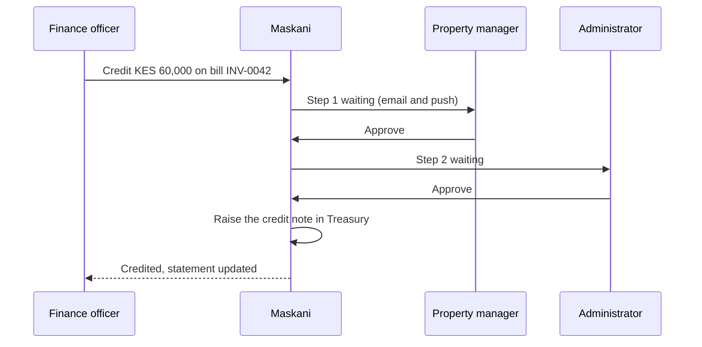

# Approvals

Anything that changes money or commits the estate to spending waits for sign-off in one place:
**Approvals** in the menu. Today that covers credit notes, waivers, manual payments and work order
quotes; more workflows join the same inbox as they arrive.

## The inbox

- **Waiting for me** lists what your role can decide right now.
- **All waiting** shows every open approval you can see, with its steps.
- **Decided** keeps the history.

Each row links to the account or work order behind it, so you can check before deciding. Approve
with an optional comment; reject needs a reason, which the sender sees.

Two rules always hold. The person who sent something never approves it. And on a request with
several steps, one person approves only one of them.

## How a request moves

## Setting who approves what

**Settings, General, Approval rules.** A rule is a workflow, an amount band and the steps in order,
each naming the role that approves it.

| Workflow | Without a rule | Example rule |
|---|---|---|
| Credit notes | One approval by someone who approves credits (administrators) | From KES 50,000: property manager, then administrator |
| Waivers | One approval by someone who approves credits | Any amount: administrator |
| Manual payments | One verification by a property manager, caretaker or administrator | From KES 500,000: property manager, then finance officer |
| Work order quotes | One approval by someone who manages works | From KES 100,000: property manager, then administrator |

Bands for one workflow cannot overlap, so every amount has exactly one rule or the default. Changing
a rule does not change requests already waiting; they finish with the steps they started with.
Administrators can act on any step.
