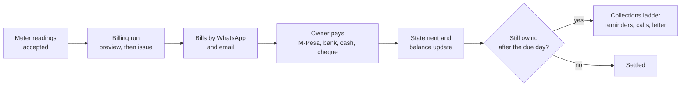
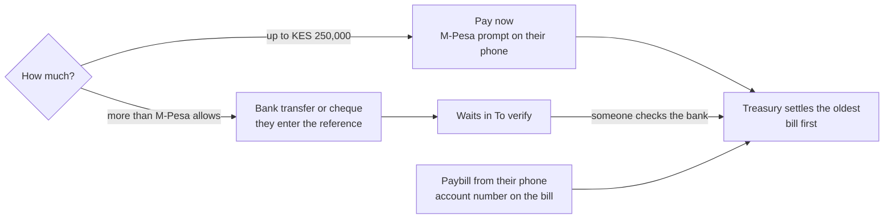

# Billing and collections

Everything about money in Maskani, from the monthly bill to the last shilling of arrears. Bills and
payments are kept in Treasury; Maskani works out what to bill, shows the statement and chases what
is owed.

## The monthly cycle

## Billing runs

**Billing, Billing runs, New run.** Pick the property, fund and month. The preview shows every unit
with its lines (service charge, water from the meter reading, garbage, parking) and total. Issue it
and Maskani raises one Treasury invoice per unit, then messages each owner an itemised bill with the
paybill and account number. A failed line can be retried; running the same month again never bills a
unit twice.

A **billing schedule** on the property can start the run on the billing day by itself. If readings
are missing it either waits and reminds the caretaker, or runs without them once you approve that.

## Statements

Open an account under **Billing, Unit accounts**. The statement lists bills, credits and payments
newest first with the balance after each one, and downloads as PDF or a spreadsheet. A box above it
shows how to pay this account, including the bank account and reference for bank paybills.

## How residents pay

- **Pay now** on the portal or a bill link sends an M-Pesa prompt. A payment always settles the
  oldest unpaid bill first; anything extra is held as credit, and the next bill (or the next sale
  instalment) is paid from that credit the moment it is issued.
- **Paybill.** Owners can pay straight to the fund's paybill with their account number. A payment
  with a wrong or missing account number lands in **Collections, Unmatched payments**, where you
  assign it to the right account.
- **Large amounts.** M-Pesa stops at KES 250,000. Above that the portal asks for a bank transfer or
  cheque reference instead, which waits for review.
- **Staff recording a payment.** On the account page, **Collect payment, Record payment** takes cash,
  a cheque, a bank transfer or an M-Pesa code typed from a statement. It waits in **To verify** until
  someone other than the recorder confirms the money arrived.

### Bank paybills

When the paybill belongs to a bank, confirmations do not reach Maskani, so payments are matched from
the bank's statement. Under **Collections, To verify, Import bank statement**, choose the fund and the
CSV exported from internet banking. Maskani reads the credits, matches each to an account by the unit
reference in the narrative (it understands `2362010#TAN7`), or else by the owner's phone, and sends
the matches for verification. Lines it cannot place are listed so you can record them by hand.

## Chasing arrears

**Collections, Arrears** lists who owes, with how old the debt is. The **collections ladder** acts on
its own every working day, at most one step a day per account:

| Day after due | Default step |
|---|---|
| 1, 7, 14 | Reminder to the owner by WhatsApp and email |
| 30 | The account joins the **Call list** |
| 45 | A demand letter is issued and sent |
| 60 | Finance and the property manager are told |

On the **Call list**, record each call: spoke to them, no answer, promised to pay (with a date),
disputes the amount. A promise holds the letter and escalation until its date.

### Payment plans

For an owner who cannot clear at once, open the account and **Agree a payment plan**: split the
balance into up to 24 dated instalments. While the plan is kept, the demand letter and escalation
wait. Maskani checks every day; if an instalment is more than three days late the plan is marked
broken, finance is told and the ladder carries on. Issue the **Payment plan agreement** letter from
the account's documents.

### Late payment charge

If your estate's rules allow it and you switched it on in settings, once a month Maskani adds a late
charge to each account with bills past the grace days: the percent of what is overdue plus any fixed
amount, never more than the cap. Earlier late charges never count, so it never compounds.

## Credits and waivers

When a bill was wrong, or the estate agrees to forgive a charge, open the account and **Credit a
bill**: choose the bill, credit note or waiver, the amount and why. Only the unpaid part of a bill can
be credited. It goes to [Approvals](approvals.md); once approved, a credit note is raised in Treasury
and the statement shows it under the bill.

## Bill queries

Residents can query a bill from their statement within 30 days of it. Queries land in **Collections,
Bill queries** with an answer date a week out. **Take** one so others see it is being checked, then
**Answer**: resolved (credit the bill first if needed) or no change. The resident gets your answer by
email and on the portal.

## Clearance certificate

When an account owes nothing, issue the **Clearance certificate** from the account's documents.
Maskani refuses it while anything is owed. A unit transfer needs every account clear first.
