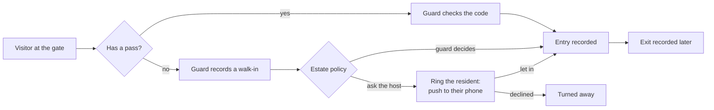

# Gate and security

## Passes

Residents create gate passes on the portal: a single visit, a recurring guest, domestic staff, a
delivery or a contractor. The visitor gets a gate code by WhatsApp. Staff can create passes from the
console too.

## The guard tablet

A tablet at the gate is set up once by the office and then signed into by each guard with a PIN at
the start of the shift. The guard:

- **checks a pass** by its code or QR and lets the visitor in,
- **records a walk-in** for someone without a pass, with name, phone, host unit and vehicle,
- **records the exit** of someone inside,
- sees **who is inside now**, with which guard let them in at which gate.

The tablet keeps working when the internet drops and catches up when it is back.

## Service providers at the gate

Most plumbers, technicians and contractors come in through the gate, so the gate is where the job is
recorded. On the walk-in form the guard ticks **Here to do a job** and adds:

- the **kind of work** (General service when unsure),
- the **company**, picked from your vendors, or left as not listed for a one-off provider (their name
  and phone are kept),
- **what they will do**, in a few words,
- the **unit** for a resident's repair, or for estate work no unit and **where on the estate**, such
  as the pump house.

No quote or cost is asked. Once the provider is let in, Maskani books a work order marked **Booked at
the gate**, with the arrival time, so the office can follow up if the provider has questions to
answer later. If the walk-in waits for the host, the job is booked only when the host or the guard
lets them in; a refusal books nothing. A contractor with a pass made for an existing work order is
linked to that work order instead of a new one. This works offline too: the job is booked when the
tablet catches up.

## Walk-in policy

Under **Settings, General** choose whether the guard decides walk-ins (the host is told who came in)
or the host must answer first. Either way the guard can **ring** the resident, which pushes an alert
to their phone with let in or decline buttons. For the push to reach them, residents open the portal
on their phone once and allow notifications; on an iPhone they add the portal to the Home Screen
first.

## Returning visitors

Maskani remembers visitors by phone, ID and number plate, so a regular visitor is recognised and the
guard's form fills itself.

## Incidents

Guards and staff record incidents with a category, severity and photos. Serious incidents alert the
security manager straight away.
