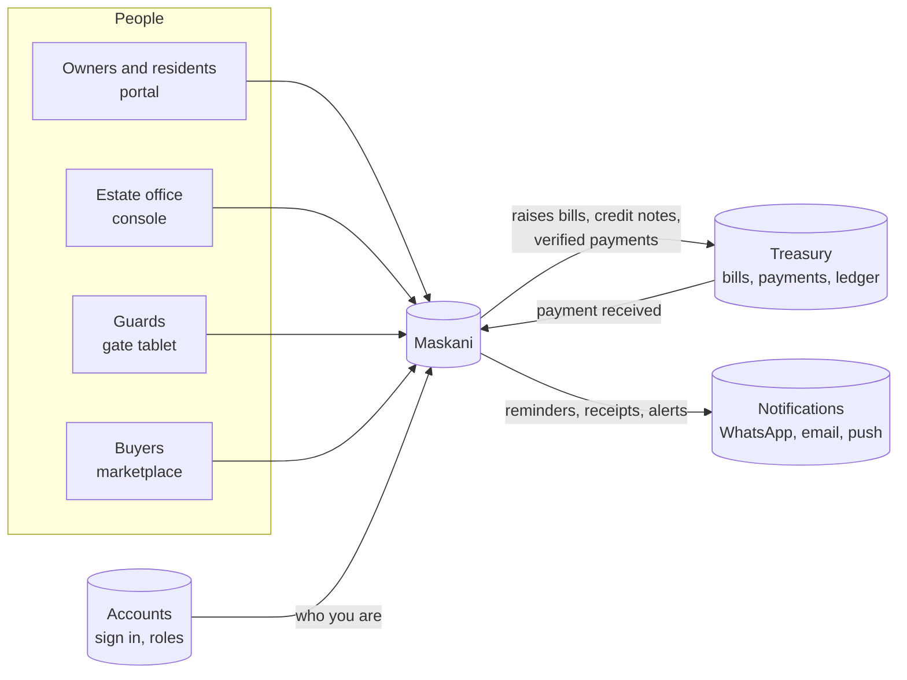

# Maskani: property and estate management

Maskani runs an estate or a portfolio of rental properties day to day: who owns and lives in each
unit, what they are billed, how they pay, the water meters, repairs, the gate and the notices that
keep everyone informed. Owners and residents get their own portal, guards get a gate tablet, and the
estate office works from one console.

Maskani never holds money. Bills, payments and the books live in [Treasury](../treasury/index.md),
and messages go out through [Notifications](../notifications/index.md). Maskani decides what to bill
and who to tell; the other two do the rest.

## Where things are

| You are | Open | What you do there |
|---|---|---|
| Estate office staff | `maskaniapp.codevertexafrica.com/<estate code>` | Run the estate: register, billing, collections, meters, works, gate, notices, approvals |
| Owner or resident | the same address, then **Resident portal** | See your units and statements, pay, raise requests, create gate passes, query a bill |
| Guard | the gate tablet set up by the office | Let visitors in and out, check passes, ring a resident |
| Buyer | `maskani.codevertexafrica.com` | Browse published estates and units for sale, send an enquiry |

## In this guide

- **[Getting started](onboarding.md)**: signing up, choosing how your property is run, and the first
  day of setup, in order.
- **[People, units and moving in or out](people-and-units.md)**: owners, occupants, the portal
  invite, photos, ending a link and transferring a unit to a buyer.
- **[Billing and collections](billing-and-collections.md)**: billing runs, statements, the ways
  residents pay, bank paybills, chasing arrears, payment plans, late charges, credits and bill
  queries.
- **[Approvals](approvals.md)**: the one inbox for everything that needs sign-off, and how to set
  who approves what.
- **[Water meters](meters-and-water.md)**: the reading round, flags, estimates, replacing a meter
  and the water balance.
- **[Repairs and vendors](works-and-vendors.md)**: requests, work orders, quotes and vendor
  documents.
- **[Gate and security](gate-and-security.md)**: passes, the guard tablet, walk-ins and who is
  inside.
- **[Selling units](sales.md)**: price lists, reservations, sale contracts and instalments, changing
  a payment plan, handover and title.
- **[Reports](reports.md)**: every report in one place, on screen or as PDF, Excel or CSV.
- **[The resident portal](resident-portal.md)**: what owners and residents can do, written so you
  can share it with them.

The technical side (data, jobs, events, how it connects to other services) is in
[Maskani architecture](../../architecture/maskani-property-management.md).
