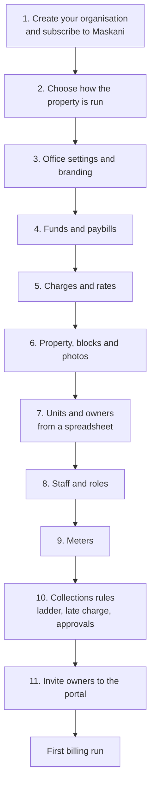
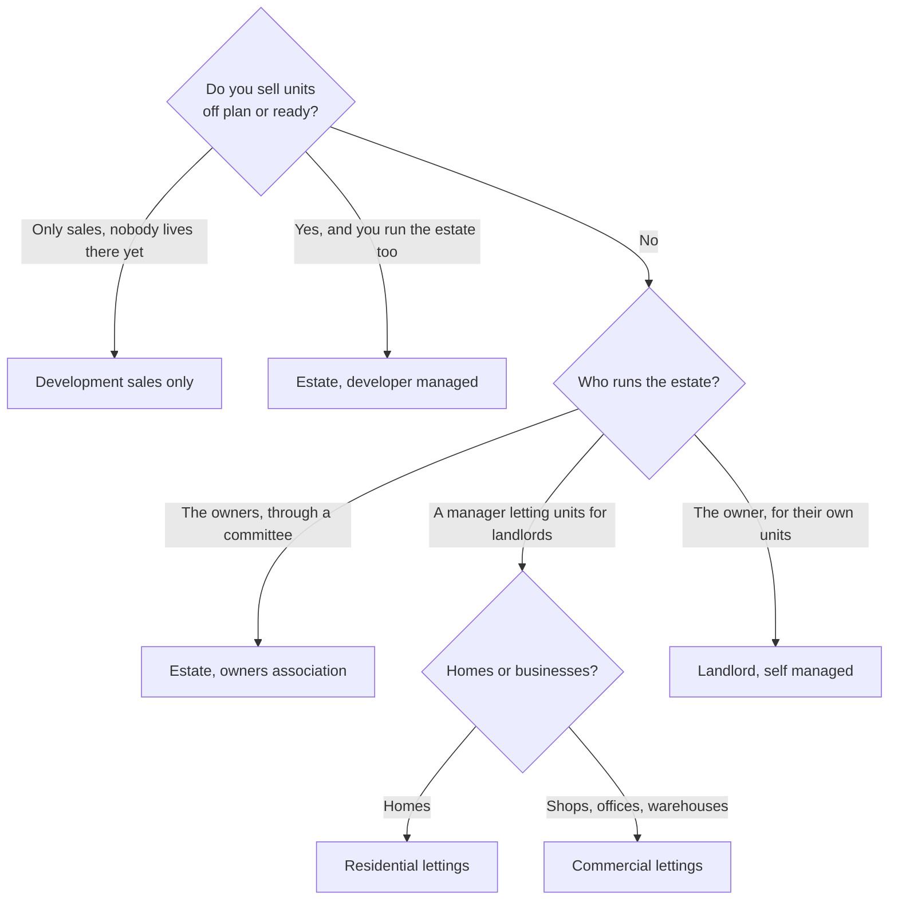

# Getting started with Maskani

This page takes a new estate from sign-up to its first bill. Do the steps in order; each one leans
on the one before it.

## 1. Create your organisation

Sign up as described in [Getting Started](../getting-started.md) and pick a Maskani plan under
[Subscriptions & Billing](../subscriptions-and-billing.md). Your organisation's short name becomes
the **estate code** that staff and residents type to open the estate, so choose something people
can remember, for example `mvumo-gardens`.

The person who signs up is the **tenant administrator** and can do everything. Add the rest of the
team in step 8.

## 2. Choose how the property is run

When you add a property you pick **How it is run**. This is the most important choice in setup,
because it decides which parts of Maskani your staff see and which funds are opened. You can change
it later, and an administrator can switch single modules on or off afterwards.

| Use case | Pick it when | Modules switched on | Funds opened |
|---|---|---|---|
| **Estate, developer managed** | You built the estate, still sell units and also run it (service charge, water, security) | Register, billing, water, sales, estate, maintenance, vendors, gate, staff, notices | Estate service fund, sales collections |
| **Estate, owners association** | The owners took over the estate and run it through a committee or a management company | Register, billing, water, estate, maintenance, vendors, gate, notices | Estate service fund |
| **Development sales only** | You sell units and collect deposits and instalments, but nobody lives there yet | Register, billing, sales, notices | Sales collections |
| **Residential lettings** | You manage rented homes for one or many landlords | Register, billing, water, lettings, portfolios, maintenance, vendors, notices | Estate fund, deposits held, rent for landlords |
| **Commercial lettings** | You manage shops, offices or warehouses | As residential lettings, plus commercial terms | Estate fund, deposits held, rent for landlords |
| **Landlord, self managed** | You own the units and manage them yourself | Register, billing, water, lettings, maintenance, vendors, notices | Estate fund, deposits held |

Lettings modules (leases, portfolios, commercial terms) arrive in the next release; until then those
use cases still give you the register, billing, water, maintenance and notices.

**Sub use cases.** Inside an estate you fine tune with modules rather than a second choice. A gated
estate with guards keeps **Gate** on; a block of flats without a gate turns it off. An estate on
council water with no meters turns **Water** off. An association that does not sell units leaves
**Sales** off. Change these under **Settings, Modules**, either for the whole organisation or for one
property from its edit form.

## 3. Office settings and branding

**Settings, General** holds the billing day, the due day, the meter reading window, quiet hours for
messages and the support phone and email residents see. **Settings, Branding** sets your logo and
colours for the portal, documents and emails.

## 4. Funds and paybills

A fund is a separate pot of money with its own paybill and bank account. Funds never mix: a payment
to the service charge paybill can only settle service charge bills. Open **Billing, Charges and
funds, Funds** and for each fund set:

- the **paybill number** connected in Treasury,
- the **account prefix** (account numbers then read like `B07` or `S-B07`),
- the **paybill account number** format, only if your paybill belongs to a bank.

**Bank paybills.** Some estates collect through a bank's paybill, for example Paybill 222111 with
the estate's bank account `2362010` as the account number. Enter `2362010#{ref}` if the bank accepts
the unit after a `#`, or just `2362010` if it does not. Owners then see exactly what to type on bills,
messages and the portal, and payments are matched from your bank statement (see
[Billing and collections](billing-and-collections.md#bank-paybills)).

## 5. Charges and rates

Each use case starts with sensible charges: service charge, water, garbage, a sinking fund, extra
parking, special levies and repair recharges. Under **Charges and funds** switch on the ones you bill,
then add **rates**: a rate can apply to the whole estate, a property, a unit type or one unit, and
starts on a date so price changes never rewrite old bills. Water uses a rate per cubic metre, with
blocks if your tariff has them.

## 6. Property, blocks and photos

Add the property (name, code, type, how it is run, location), then its blocks or phases. Add a few
real photos on the property page; the first is the cover on cards and on the public marketplace if
you publish the estate.

## 7. Units and owners

**Units, Import CSV** loads units and owners from a spreadsheet. Maskani checks every row first and
shows what it will create before anything is saved. Each owner linked to a unit opens the unit's
account in the estate fund. You can also add units and link people one at a time.

## 8. Staff and roles

Invite staff under **Settings, Users** and give each a role. Staff limited to some properties only
see those.

| Role | Typical person | What they do |
|---|---|---|
| Tenant administrator | Estate manager, director | Everything, including settings, roles and approvals |
| Property manager | Estate or property manager | Runs assigned properties: register, works, gate, notices, documents; verifies manual payments |
| Finance officer | Accountant | Billing runs, collections, credits and bill queries |
| Sales officer | Sales team | Price lists, reservations, sale contracts |
| Caretaker | On-site caretaker | Meter readings, work orders, resident requests, notices; verifies manual payments |
| Security manager | Head of security | Gate, passes, incidents |
| Viewer | Board member, auditor | Read only |
| Guard | Gate guard | The gate tablet only |

## 9. Meters

If the property has water meters, add them (unit meters, the bulk supply and any borehole), with the
walking order the caretaker follows on the round. See [Water meters](meters-and-water.md).

## 10. Collections rules

Under **Settings, General**:

- **Collections ladder.** What happens how many days after a bill falls due. The default reminds the
  owner on days 1, 7 and 14, puts the account on the call list at 30, sends a demand letter at 45 and
  tells finance at 60.
- **Late payment charge.** Off unless your estate rules allow it. Set a percent of what is past due,
  a fixed amount, or both, a monthly cap and grace days.
- **Approval rules.** Who approves credits, waivers, large manual payments and work order quotes, by
  amount. Without rules, one approval is enough. See [Approvals](approvals.md).

## 11. Invite owners to the portal

From a person's page press **Invite to portal**. They get a WhatsApp and an email with the link and
sign in with a code sent to their phone, so there is no password to forget. Share
[The resident portal](resident-portal.md) with them.

## Your first billing run

Open **Billing, Billing runs, New run**, pick the property, fund and month, review the preview (each
unit's lines and total) and issue. Bills go out by WhatsApp and email with the paybill and account
number. You can also set a **billing schedule** so the run starts itself on the billing day, or waits
for missing meter readings and reminds the caretaker.
