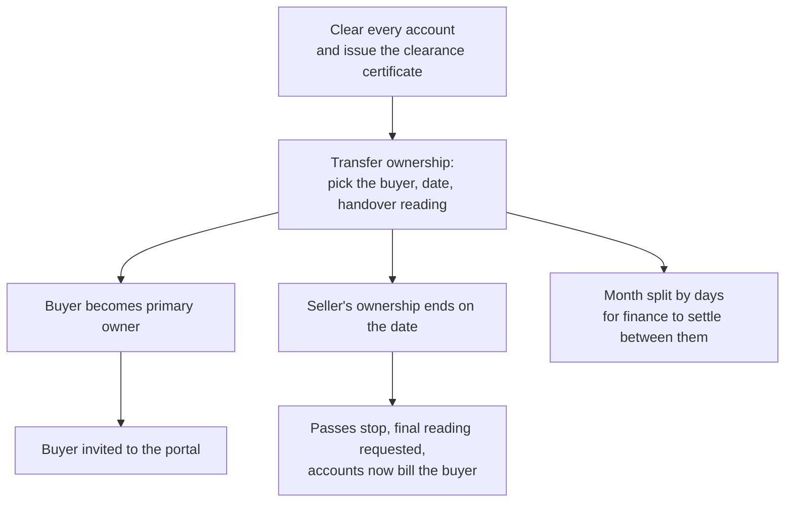

# People, units and moving in or out

## Who is who

Every person is recorded once under **Owners and residents** and then linked to units with a role
and a start date. One person can own several units, and a unit can have several people.

| Role on a unit | Sees on the portal |
|---|---|
| Owner, joint owner, buyer, landlord | Every account of the unit, statements, payments, requests, passes |
| Occupant (a tenant living there) | Requests and passes; the estate accounts only if the owner assigned them charges to pay |
| Household member, domestic staff | Their own passes and the estate's notices |
| Emergency contact | Nothing; kept for the office |

An occupant never sees the owner's purchase account.

Owners and occupants add their own household members, domestic staff and cars from the portal's
**Household** page, so the office does not have to. Those entries show on the unit page like any
other link.

## Inviting someone to the portal

On the person's page, **Invite to portal** sends a WhatsApp and an email with the link. They sign in
with a code sent to their phone. Owners land on their units and statements; occupants on requests and
passes.

## Photos

The property page and each unit page have a **Photos** card. Add real photos, move them into order
and mark the cover; the cover shows on the property cards and, for a published estate, on the public
marketplace. Estate and unit photos are public once added, so never upload anything private there.

## Moving out

On the unit page, **End** a person's link with the date they leave. A date in the future keeps them
active until that day. When the link ends, Maskani:

1. stops their portal access to that unit and cancels the gate passes they created for it,
2. asks the caretaker for a final meter reading if they owned or lived there,
3. moves any account billed to them to the unit's remaining owner,
4. clears charges assigned to a departed occupant after the estate's revert days (30 by default), so
   they have time to settle a final bill.

## Selling or transferring a unit

**Transfer ownership** on the unit page hands the unit to a buyer in one step.

Maskani refuses the transfer while any account on the unit still owes. The handover reading is kept
as a move-out reading and shown as water used up to the handover; it is never billed twice. The
result shows how many days of the month belong to the seller and the buyer, so finance can settle
the fixed charges between them.
