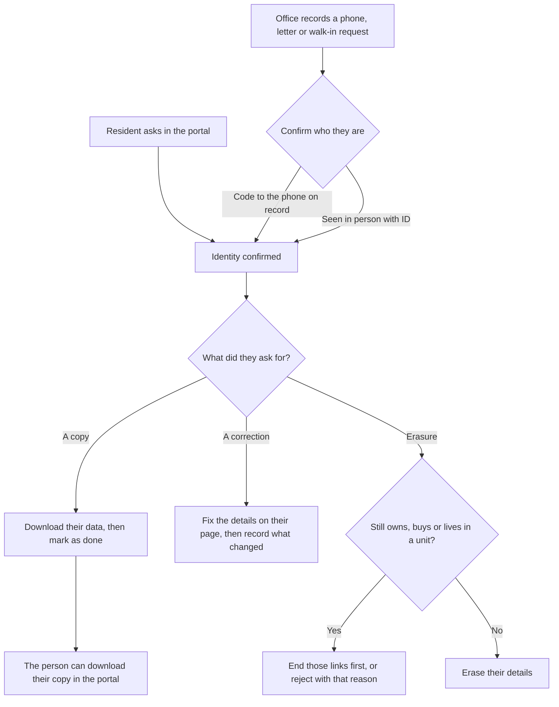

# Privacy and personal data

Kenya's Data Protection Act gives every owner and resident the right to a copy of their data, to
have it corrected, and to have it erased. Maskani handles each of these as a request with a legal
deadline, and keeps personal data only as long as the schedule below allows.

## Who handles requests

Anyone with the **Handle data subject requests** permission sees **Settings, Privacy requests**.
Tenant administrators have it. Give it to whoever answers the estate's data protection questions,
and nobody else: they can download a person's data and erase it.

## The deadlines

| Request | What the person asks for | Deadline from receipt |
|---|---|---|
| A copy of their data | Everything the estate holds about them | 7 days |
| A correction | A wrong name, phone, email or other detail fixed | 14 days |
| Erasure | Their details removed | 14 days |

Each request shows **Respond by**. Late ones turn red and the **Overdue only** switch lists them. The
estate contact gets an email when a request arrives.

## How a request moves

### Requests from the portal

A resident signed in to the portal has already proved who they are, so the request goes straight to
**To do**. They find it under the account menu, **Your data and privacy**.

### Requests made to the office

Press **Record a request**, find the person and choose what they ask for. Before anything else,
confirm it is really them:

- **Send code** sends a six digit code to the phone and email already on their record, never to a
  number the caller gives you. Ask them to read it back and type it in. A code lasts five minutes.
- **They are here in person**: write down what you saw, for example the last digits of their ID.

### A copy of their data

**Download their data** gives a zip file with one spreadsheet per part (units, accounts, vehicles,
visitor passes, repair requests, bill queries, privacy requests) and the same in one `data.json`
file. Identity numbers show only their last four characters and their visitors' phones are hidden,
because the file may travel by email. Send it to them, then **Mark as done**; they can also download
it from the portal from then on. Bills and statements stay in the portal under each account.

### A correction

Correct the details on the person's page as usual, then record what changed and press **Mark as
corrected**.

### Erasure

The law requires the estate to keep its financial records. Erasing a person therefore:

- replaces their name with "Former resident" and a short reference;
- clears their phone, email, identity numbers, address, notes and consents;
- ends their portal access and removes their cars;
- cancels any visitor passes still running;
- keeps every bill, payment, contract and statement, under that reference.

Someone who still owns, is buying or lives in a unit cannot be erased: they are in a contract with
the estate. End their link to the unit first (a sale or move-out does this), or reject the request
and tell them why.

### Rejecting a request

Any open request can be rejected with a reason, for example when the person could not be identified.
The person sees the reason in the portal.

## What the audit trail records

Confirming someone's identity, downloading their data, erasing them and rejecting a request all
appear in **Settings, Audit trail** under **Personal data**, with who did it and when.

## How long data is kept

A daily job removes personal data once it has done its job:

| Data | Kept for |
|---|---|
| Gate entries, exits and guard patrol scans | 90 days |
| Visitor passes (visitor names, phones, number plates) | 90 days after the pass ends |
| Returning visitors | One year after their last visit, unless banned or expected on a current pass |
| Who opened a document, and from where | 1 year |
| The audit trail | 1 year |
| Bills, payments, contracts, statements | Kept, as the law requires |

## Terms and privacy notice

Residents accept the estate's terms and privacy notice the first time they sign in, and again when
the estate changes its **Resident terms version** under **Settings, General**. Each acceptance is
kept with the date, the privacy notice version and where it came from, and the resident can see the
whole list on **Your data and privacy**.
