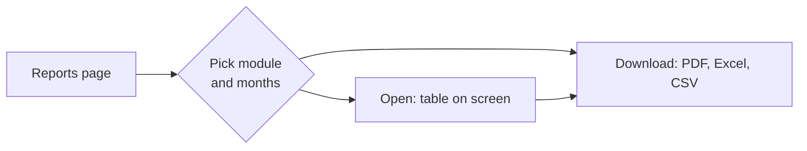

# Reports

Every Maskani report lives on one page: **Reports** in the menu. It only lists reports for the parts
of Maskani your estate runs and the ones your role may see.

## Finding a report

Pick a module on the left, or **All reports**, and choose the months at the top. Reports cover the
property picked at the top of the console, or all your properties when none is picked.

| Module | Report | Answers |
|---|---|---|
| Billing and collections | Collections by month | Are we collecting what we bill? |
| | Collections by block | Which blocks are behind? |
| | Billing by charge | How much of our billing is service charge, water, garbage? |
| | Payment channels | How do owners pay: M-Pesa, bank, cheque, cash? |
| | Arrears | Who owes, and how old is each debt? |
| | Estate performance | The month's headline pack for the board |
| Water | Water trend | Are we losing water between the bulk meter and the units? |
| Maintenance | Maintenance performance | Are repairs answered and fixed on time? |
| Vendors | Vendor scorecard | Which vendors deliver on time, at what cost, with valid papers? |
| Security | Security summary | How busy is the gate, and how many incidents? |

## Opening and downloading

**Open** shows the report on screen with a total row. **PDF**, **Excel** and **CSV** download the
same figures, branded with your estate's logo, for the board, auditors or owners. A report that
covers one property (the water trend) asks you to pick a property first.

Figures refresh as payments arrive and billing runs finish, so the same report run twice a few
minutes apart can differ if money came in between.
