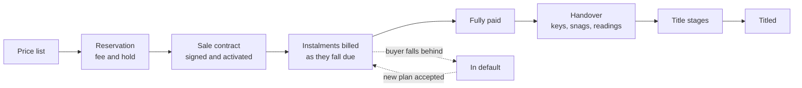
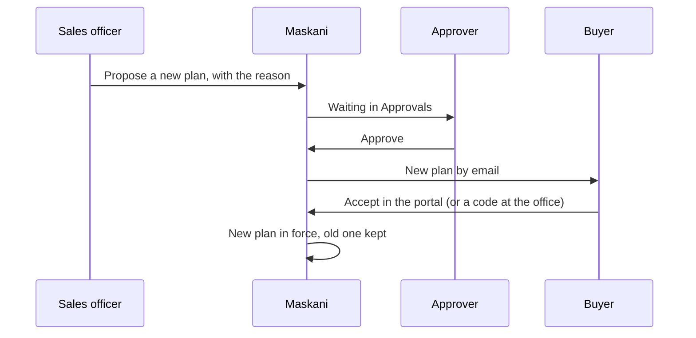

# Selling units

For developers who sell units on the estate. Maskani keeps the price lists, holds units for buyers,
writes the sale contract and its payment plan, bills each instalment when it falls due and follows
the sale through handover to title. Bills and payments sit in Treasury on the buyer's sales account
(`S-` and the unit code, for example `S-B07`), apart from estate charges.

Everything here is under **Sales** in the menu and needs the Sales module switched on (Settings,
Modules).

## Price lists

**Sales, Price lists.** A price list gives each unit type a price, a reservation fee, a deposit
percentage and the longest payment term allowed. The list **in force** prices the availability board
and every new reservation and contract.

To change prices, press **New price list**. It starts from the prices in force, so you change only
what has changed, then choose **Put it in force now**. The old list is retired with the date the new
one starts. Lists are never edited in place: every price a buyer was quoted stays on record, and
signed contracts keep their own price.

## The availability board

**Sales, Availability** shows every unit by block, coloured by sale status: green available, gold
reserved, blue under agreement, grey sold or not for sale. The figures above it count the units in
each state, the value under contract and what has been collected. Tap a unit to see its price and
terms, then **Reserve** or **Start sale**.

## Reservations

Reserving holds a unit for one buyer for the number of days you choose (14 by default). Maskani bills
the reservation fee to the buyer's sales account straight away, and the fee counts towards the
deposit when the sale goes ahead.

**Sales, Reservations** lists every hold with the buyer, whether the fee is paid and how many days
are left. A hold that is not turned into a contract by its date lapses on its own and the unit goes
back on the board.

## The sale contract

**Start sale** opens the contract form: the buyers and their shares, the price and any discount (with
the reason), the deposit, the payment option and term, and each side's advocate.

| Payment option | How it is billed |
|---|---|
| Outright | Deposit, then the balance on one date |
| Instalments | Deposit, then equal monthly or quarterly instalments over the term; the last one carries any rounding |
| Milestones | Deposit, then a share of the price at each building stage, billed when the office releases that stage |
| Financed | Deposit from the buyer, the rest from the financier named on the contract |

The contract stays a **draft** until it is signed. On the contract page, **Mark signed and activate**
with the signing date builds the payment schedule. From then on:

- each instalment is billed in Treasury when it falls due, with the paybill details on the bill;
- the buyer is reminded three days before, on the day, and a week and two weeks late, by WhatsApp and
  email;
- a payment larger than the bill is held as credit and pays the next instalment as soon as it is
  billed;
- a buyer still behind after the grace days in the agreement is marked **in default**, and the sales
  team is told.

For a milestone plan, press **Release** on the stage when it is reached. Maskani asks you to confirm,
then bills that share at once.

## Changing a payment plan

When a buyer needs more time, or wants to finish early, propose a new plan from the contract page
under **Payment plan changes**:

1. Give the reason, then choose instalments (monthly or quarterly, over a number of months) or one
   balance payment, and the date of the first payment.
2. The new plan covers only what has not been billed yet. Bills already sent stay as they are.
3. It goes to **Approvals**. Someone who manages sales approves it by default; your estate can add
   steps by amount under Settings, Approval rules. The person who proposed it never approves it.
4. Once approved, the buyer gets it by email and accepts it in the portal. If they are at
   the office, press **Send the buyer a code** and type in the code they read back (it lasts five
   minutes).
5. On acceptance the new plan is in force, the old version is kept in the history, and a contract in
   default is back in good standing.

Nothing changes for the buyer until they accept. Only one new plan can wait at a time.

## Handover

Once a contract is **fully paid**, the contract page shows **Handover**:

1. **Book the handover** for a date.
2. On the day, walk the unit with the buyer. Tick the checklist (doors and keys, windows, plumbing,
   electrics, finishes, kitchen, bathroom, meter seals; add your own items), record the keys and
   other items handed over, and note any **snags** with where they are.
3. **Complete the handover** with the date and a reading on each meter in the unit.

On completion the buyer becomes the owner of the unit, estate charges start from that date (the
first month is prorated), and their water is billed from the handover reading. Snags stay on the page after completion; mark each one **Fixed** as the
contractor closes it, and the buyer sees how many are still open.

## Title

From full payment, the **Title** panel lists your estate's title stages in order (by default:
sectional plan registered, consents obtained, stamp duty paid, lease or transfer registered, title
issued, title released to owner). Change the list under Settings, Lists, Title stages, but keep
**Title released to owner**: marking it done is what marks the sale and the unit **titled**. For each
stage record the status, the date (needed once it is done), a reference such as the registry number,
and notes.

## Sales reports

**Reports**, under Sales, has three reports, each on screen or as PDF, Excel or CSV:

| Report | Answers |
|---|---|
| Sales position | For every live sale: price, paid, balance, what is overdue and the next date, most overdue first |
| Instalment receivables | By due month: what falls due, what is billed and paid, and what is still owed. Choose months ahead to see what is coming |
| Handover and title | Every paid-up sale: handover state and date, snags still open, title stages done and held up |

## Who can do what

| Action | Permission |
|---|---|
| See the board, contracts, reservations, price lists and sales reports | Sales: view |
| Reserve, write and activate contracts, release milestones, propose new plans, run handovers and title stages, add price lists | Sales: manage |
| Approve a new payment plan | Sales: manage, or the role your approval rule names |
