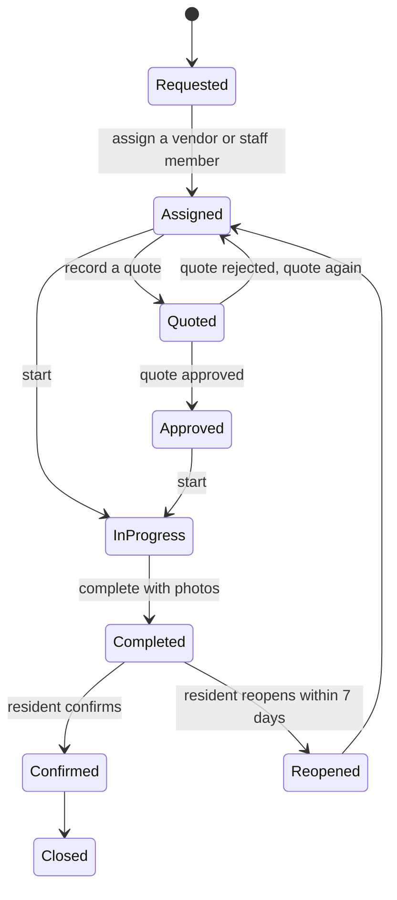

# Repairs and vendors

## A work order's life

Residents raise requests from the portal with photos; staff raise work orders from the console or a
phone; the guard books one at the gate when a service provider comes in (see
[Gate and security](gate-and-security.md#service-providers-at-the-gate)). Every work order carries a
priority with response and fix times. A quote or cost is optional: routine jobs and walk-in
providers often have neither.

To follow up on providers who came through the gate, filter **Work orders** by **At the gate**. Each
one shows who was let in, their phone and when they arrived.

| Priority | Respond within | Fix within |
|---|---|---|
| Emergency | 1 hour | 4 hours |
| High | 4 hours | 24 hours |
| Normal | 24 hours | 72 hours |
| Low | 3 days | 14 days |

Work past its fix time is flagged and the manager is told. When a job is complete the resident is
asked to confirm; they can reopen it within seven days.

## Quotes

When a vendor quotes, record it on the work order. The quote then waits in
[Approvals](approvals.md): by default one approval by someone who manages works, never the person who
entered the quote. Larger quotes can need more steps if you set a rule. Approved, the work can start;
rejected, it goes back for a new quote with your reason. A repair caused by an owner can be recharged
to their unit.

## Vendors

Under **Vendors** keep each contractor with its category and documents. Each category lists the
documents it must hold (a security agency needs its PSRA licence, a garbage collector its NEMA
licence, and so on). Maskani warns before a document expires. When a vendor renews, add the new
document of the same type: it replaces the old one, which stays on record marked **Replaced** and
no longer counts as expired anywhere.

## Assigning work to your own staff

**Assign** on a work order offers **A vendor** or **Our staff (from ERP)**. Staff come from ERP, the
staff and payroll records that come with your plan: pick the caretaker or plumber by name or staff
number and the work order shows who has it. If your plan does not include ERP, Maskani shows how to
upgrade and asks ERP for nothing; assign the work to a vendor, and pay casual hands with a payment
voucher in Books.

## Service contracts

Open a vendor to keep its contracts, one per property and service (cleaning, security, garden care):

- the fee and how it is charged: a fixed amount per month, per visit, per guard post or by rate card,
- the service level: respond within and fix within so many hours, and how many visits a month,
- the credit taken off the fee for each missed visit,
- start and end dates, how many days before the end you are reminded, and whether it renews itself,
- the budget line it is paid from.

Only a live contract can be changed. **Terminate** ends it with a reason, which is kept. On the same
page, **Paid in treasury as** links the vendor to the supplier it is paid as in Books, picked from
Books' own list, so its invoices become supplier bills against the right account.

## Visit plans and service visits

The calendar icon on a contract opens its **visit plans**: every day, set weekdays, or set days each
month, quarter or half year, with a time window, a zone and a checklist. Maskani plans a week of
visits ahead from each plan.

**Service visits** shows a week of visits at the property. Record each as **All done** or **Part
done** with photos. A visit nobody records by the end of its day is marked **Missed**; missed visits
are what the contract's service credit is applied to.

## Preventive maintenance

**Preventive maintenance** lists the equipment that needs regular servicing: pumps, lifts,
generators, fire equipment. Each plan has how often, the next due date and the vendor that does it.
A week before a plan falls due Maskani raises a work order for it, assigned to that vendor, and
moves the plan on to its next date. Pause a plan to stop it raising work orders.
