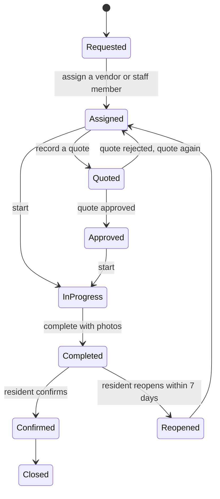

# Repairs and vendors

## A work order's life

Residents raise requests from the portal with photos; staff raise work orders from the console or a
phone; the guard books one at the gate when a service provider comes in (see
[Gate and security](gate-and-security.md#service-providers-at-the-gate)). Every work order carries a
priority with response and fix times. A quote or cost is optional: routine jobs and walk-in
providers often have neither.

To follow up on providers who came through the gate, filter **Work orders** by **At the gate**. Each
one shows who was let in, their phone and when they arrived.

| Priority | Respond within | Fix within |
|---|---|---|
| Emergency | 1 hour | 4 hours |
| High | 4 hours | 24 hours |
| Normal | 24 hours | 72 hours |
| Low | 3 days | 14 days |

Work past its fix time is flagged and the manager is told. When a job is complete the resident is
asked to confirm; they can reopen it within seven days.

## Quotes

When a vendor quotes, record it on the work order. The quote then waits in
[Approvals](approvals.md): by default one approval by someone who manages works, never the person who
entered the quote. Larger quotes can need more steps if you set a rule. Approved, the work can start;
rejected, it goes back for a new quote with your reason. A repair caused by an owner can be recharged
to their unit.

## Vendors

Under **Vendors** keep each contractor with its category and documents. Each category lists the
documents it must hold (a security agency needs its PSRA licence, a garbage collector its NEMA
licence, and so on). Maskani warns before a document expires. When a vendor renews, add the new
document of the same type: it replaces the old one, which stays on record marked **Replaced** and
no longer counts as expired anywhere.
