# Delivery orders

A delivery order is accepted and prepared like a pickup order, then a rider takes it to the
customer. This page follows one from Demo City Supermarket to a customer in Kondele (KES 150
delivery), paid on delivery.

## 1. Accept and prepare

The order rings under **Delivery** in the POS **Online orders** queue. Accept it the same way as
a [pickup order](pickup-orders.md#1-accept-or-reject).

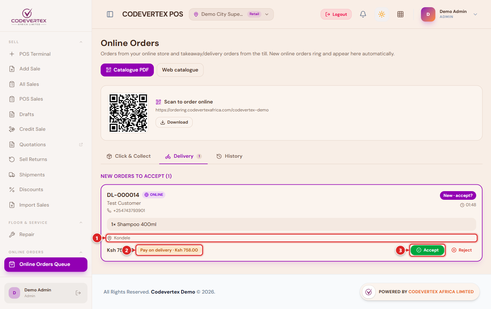

In a shop the accepted order becomes a pick list under **To pick & pack**. The counter picks the
items, bags them and presses **Packed & ready**.

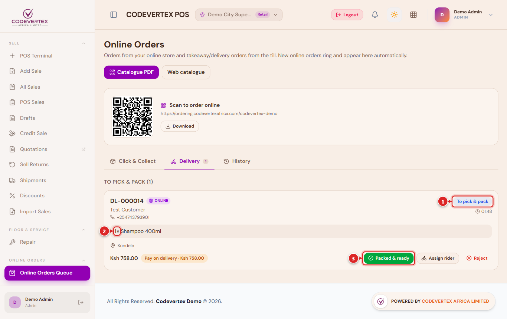

In a restaurant the accepted order goes to the kitchen as a ticket marked **Online delivery**.
The kitchen presses **Start**, then **Ready** when the food is packed. A kitchen that works from
printed chits instead presses **Ready** on the queue card.

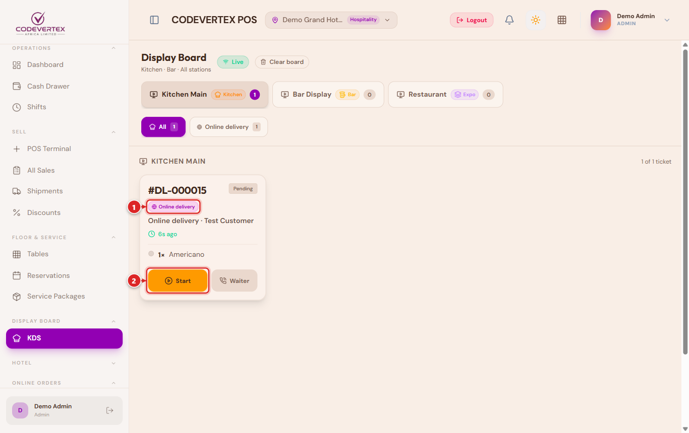

Either way the customer is told it is ready, the card moves to **Ready for the rider**, and a
delivery job is created for your riders.

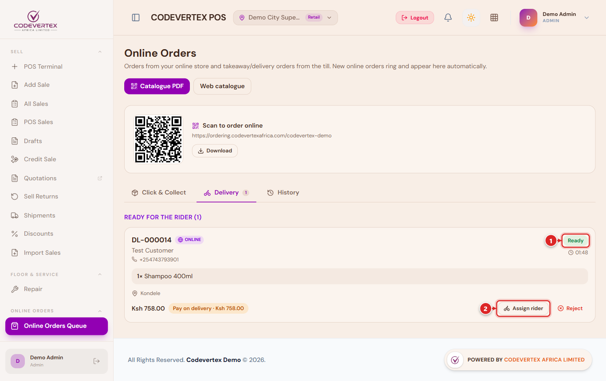

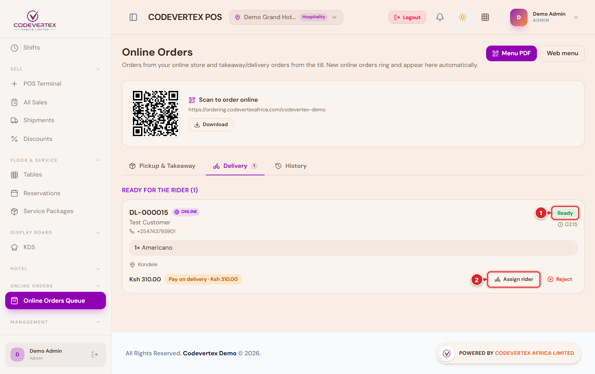

The kitchen ticket closes by itself when the rider collects the order. From here on a
restaurant delivery works exactly like a shop's.

## 2. Getting a rider

The job goes to a rider in one of three ways, depending on your
[dispatch settings](setting-up.md#how-jobs-reach-riders):

- **Automatically** to the nearest available rider on shift.
- **By a dispatcher**, from **Logistics, Deliveries** (or **Assign rider** on the POS card).
- **By a rider** taking it from **Available Work** in the rider app (**Take job**). Only one rider can take a job.

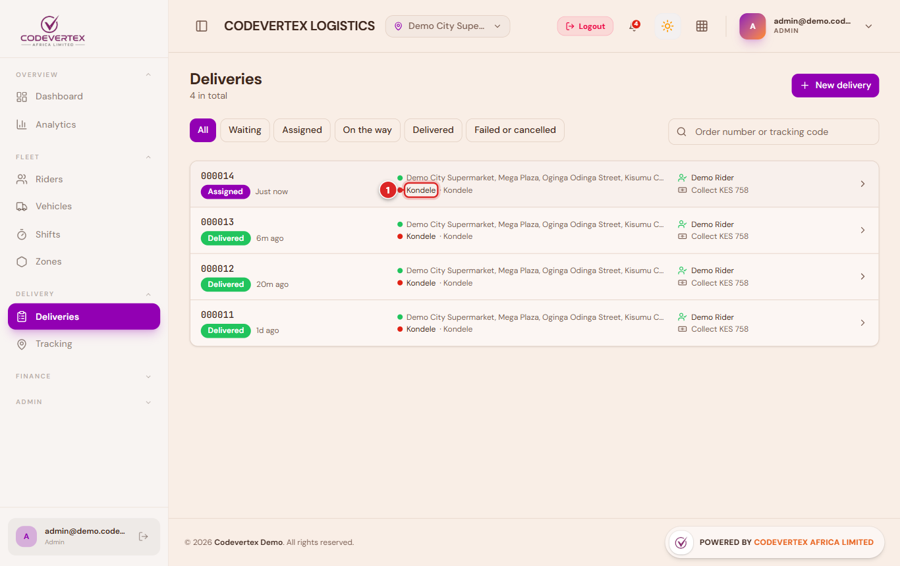

Once a rider has the job, the POS card shows their name and phone and the customer sees who is
coming.

## 3. The rider app

Riders use the rider app on their phone (`https://riderapp.codevertexafrica.com`). To get jobs
they switch themselves **online**, which also shares their location while they work.

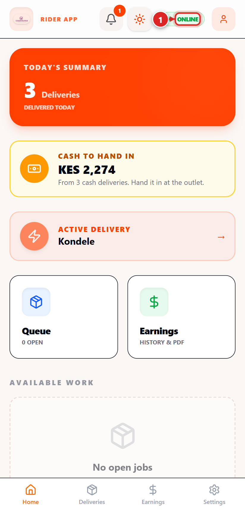

**Available Work** on the rider app home lists jobs waiting for a rider, with the outlet, the area and the fee. **Take job** gives it to that rider.

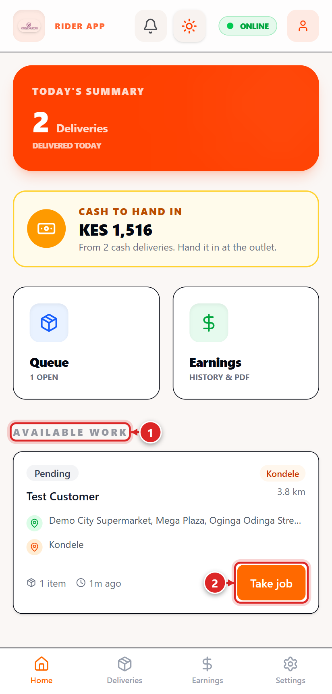

After taking a job the rider works through it one button at a time (on the way to the outlet, at the outlet, picked up, on the way, at the customer), with the route on the map:

1. **At the counter**, checks the bag against the order on screen and marks it **Picked up**. The
   customer's page changes to *On the way* and shows the rider on the map. Any kitchen tickets
   still open for the order close.
2. **At the door**, asks for the customer's **6-digit delivery code**, enters it and writes who
   received the order. The code is checked by the system, not the phone; after five wrong codes
   the job stops taking codes and the dispatcher is alerted.
3. For **pay on delivery**, records how the customer paid: cash, or M-Pesa with the code. The app
   says **Collect payment at the door** with the amount.
4. Presses **Confirm & Complete**. The order is delivered, the customer is told, and the stock is
   taken off.

If the customer cannot find the code, the rider presses **Customer can't find the code? Ask the
dispatcher**. The rider cannot finish the delivery without the code; see
[The customer has no code](when-things-go-wrong.md#the-customer-has-no-code).

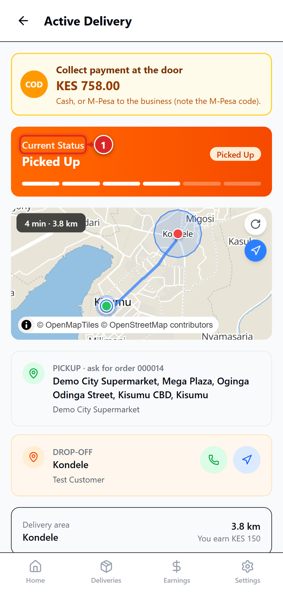

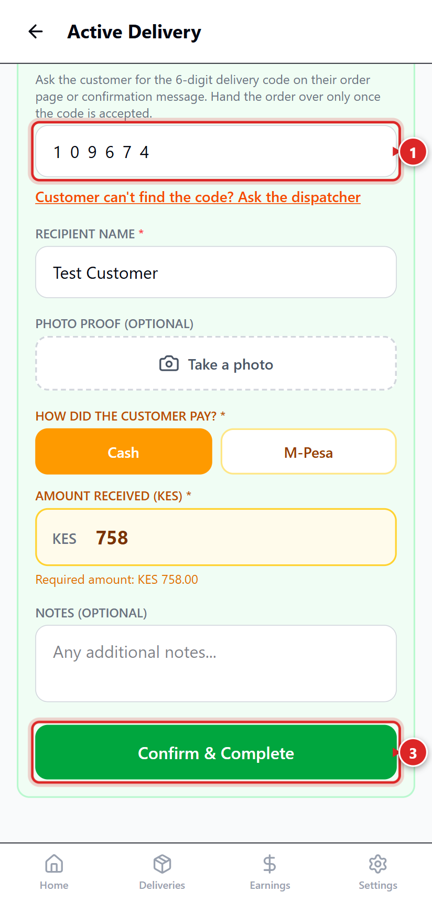

If the customer is not reachable or refuses the order, the rider reports a failed delivery with a
reason instead (see [When things go wrong](when-things-go-wrong.md#a-delivery-fails)).

## 4. Rider cash

Cash a rider collects belongs to the business until they hand it in. Riders see what they hold
as **Cash to hand in** on their app. In **Logistics, Rider cash**, the dispatcher or manager
counts the cash, enters the amount received with **Record hand-in**, and any shortfall stays on
the record for a manager to follow up.

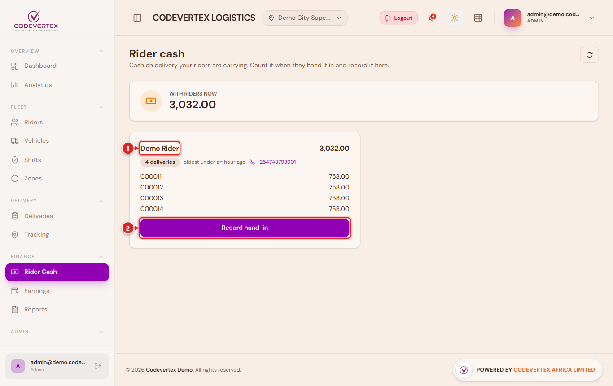

## Delivering with your own staff

Staff who deliver for you are added as riders in **Logistics, Riders** and use the rider app like
anyone else. Every delivery ends with the customer's delivery code in the rider app, so the POS
has no button to mark a delivery as delivered. Once the rider has delivered, the order closes by
itself; a card still on the queue shows **Close order**.

## What the customer sees

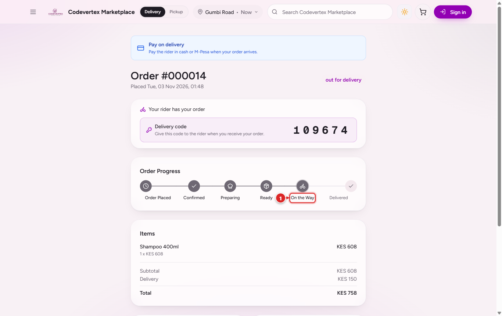

On WhatsApp the customer gets the rider's name and phone when the order leaves, and a thank-you
with **Leave Feedback** and **Review us on Google** once it is delivered.

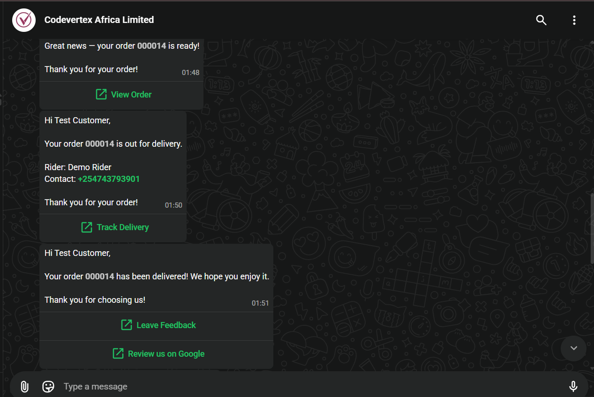
