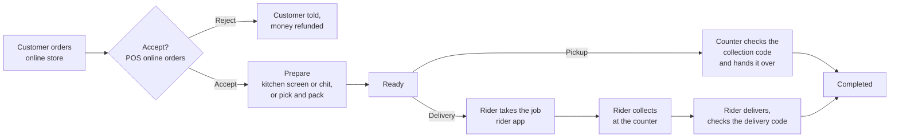

# Online Ordering

Your online store lets customers order from their phone or computer, pay online or when they get
their order, and follow it until it is in their hands. Behind the store, each order travels
through the apps your team already uses: the POS accepts it, the kitchen or the packing counter
prepares it, and for deliveries a rider takes it to the door.

This guide follows one order at a time through every screen it passes, for a restaurant and for
a shop. The screenshots come from the platform's demo business, whose outlets are in Kisumu CBD,
so the places and prices you see are real Kisumu examples.

## How an order moves

Every step tells the customer what is happening by email and WhatsApp, and their order page
updates on its own.

## Pages in this guide

### Setting up (owners and admins)

- **[Setting up online ordering](setting-up.md)**: what the store needs before it opens, where
  each setting lives (menu in Inventory, payment methods in Treasury, messages in Notifications,
  delivery areas and riders in Logistics), order acceptance, and adding a rider with their
  vehicle.

### Customers

- **[Ordering as a customer](ordering-as-a-customer.md)**: browsing the menu, the cart,
  checking out as a guest or signed in, choosing a delivery location or a pickup outlet, paying,
  and following the order with its collection or delivery code.

### Your team

- **[Pickup orders](pickup-orders.md)**: accepting an order in the POS, preparing it with or
  without a kitchen screen, and handing it over with the collection code.
- **[Delivery orders](delivery-orders.md)**: getting a ready order to a rider (automatically, by
  a dispatcher, or by riders taking open jobs), what the rider does in the rider app, proof of
  delivery, and the cash riders hand in.
- **[When things go wrong](when-things-go-wrong.md)**: rejected and cancelled orders, unpaid
  orders, places you do not deliver to, missing codes, a rider who cannot take a job, a failed
  delivery, and answers to common questions.

## Who does what

| Step | Who | Where |
|---|---|---|
| Place the order, pay, follow it | Customer | Online store |
| Accept or reject | Cashier, waiter, supervisor, receptionist or manager | POS, Online orders |
| Prepare | Kitchen, bar or barista; in a shop, whoever packs | Kitchen screen (KDS) or printed chit; POS for packing |
| Hand over a pickup order | Counter staff | POS, Online orders |
| Assign a rider | Dispatcher or counter staff | Logistics, Deliveries; or POS, Online orders |
| Take a job, deliver, record cash | Rider | Rider app |
| Count rider cash | Dispatcher or manager | Logistics, Rider cash |
| Store settings | Admin | Online store dashboard, Settings |

Staff accounts, roles and outlets are managed in the client portal, see
[Account & Organisation](../organisation/index.md). The POS side of the queue is also covered in
the POS guide, [Online Orders](../pos/online-orders.md).
