# Ordering as a customer

This is what your customers see, step by step. It is worth walking through once yourself so you
can help a customer on the phone.

## 1. Choose delivery or pickup, and where

The store opens on your outlets and menu. At the top, **Delivery** or **Pickup** and the
location tell the store what to show: delivery fees and times for that place, or the outlets to
collect from.

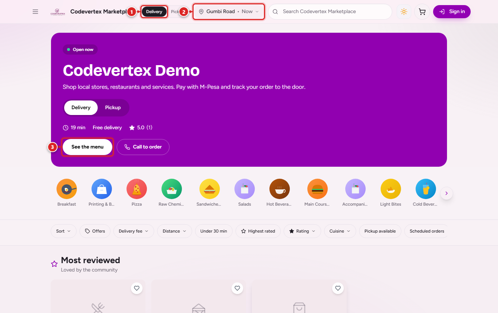

1. Delivery or pickup.
2. The delivery location and time ("Now" or a booked time).
3. The menu.

## 2. Pick items

Filter the menu by category and by outlet, open an item to see its photo, options and what
delivery to your location costs, and add it to the cart.

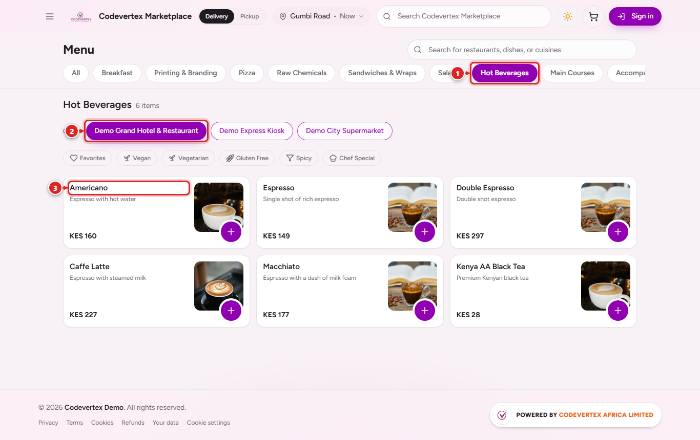

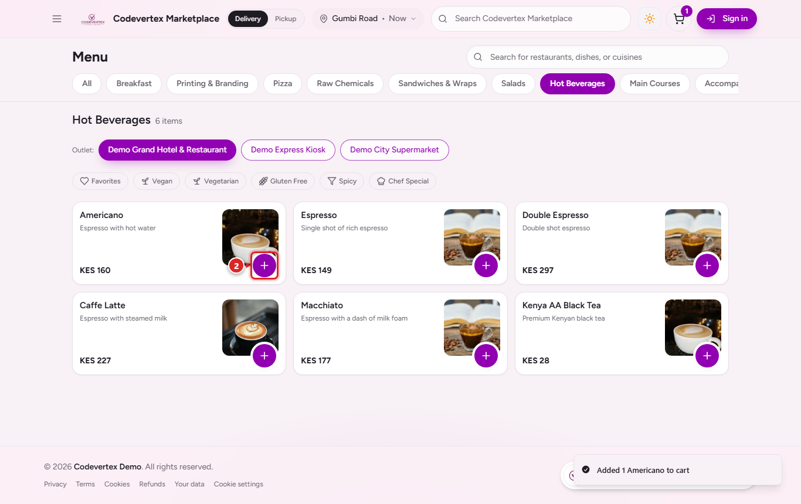

## 3. The cart

The cart shows each item, the subtotal and the total so far. The delivery fee is added at
checkout, once the customer has chosen where to deliver. Customers can ask for cutlery and leave
a note for the kitchen here.

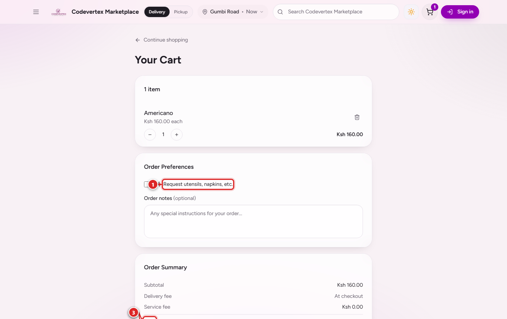

## 4. Checkout

Customers can check out **as a guest** with an email address and phone number, or sign in to
keep their addresses, see past orders and earn loyalty points. Order updates go to that email
and phone (WhatsApp), so they need to be the customer's own.

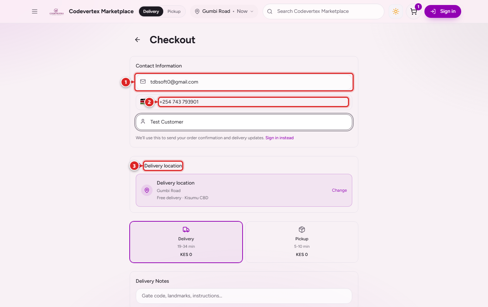

### Delivery location

The location window opens on the customer's current location. They can search an area, street
or landmark (your delivery areas are listed first) or drag the pin. The fee and the time appear
under the map before they confirm with **Deliver here**.

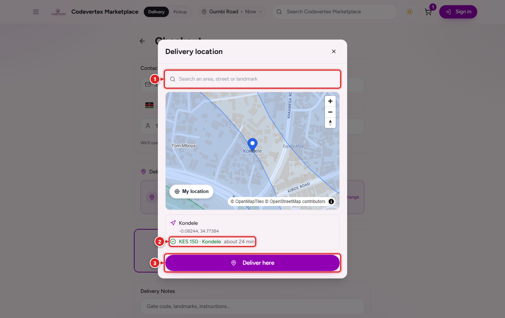

A place you do not deliver to cannot be confirmed for delivery. The store says so and names the
nearest area you serve, and the customer can pick a different place or collect instead.

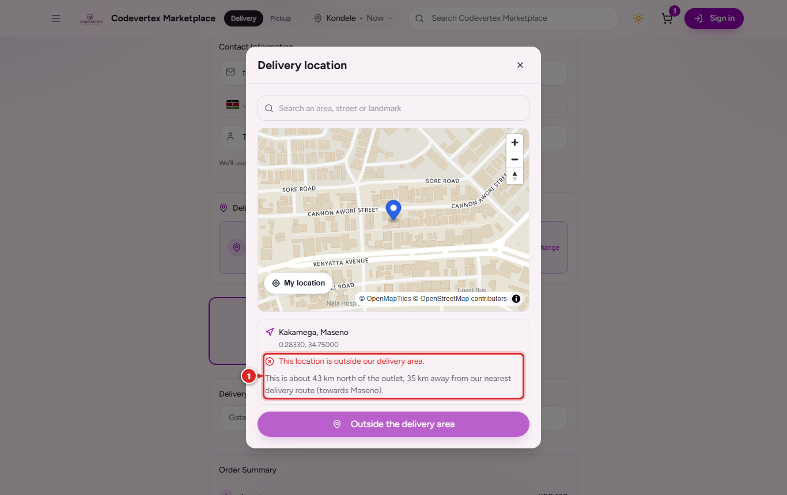

When your plan includes scheduled delivery, **Schedule** in the same window lets the customer
book a later time instead of **Deliver now**.

### Delivery or pickup

Both options show their time and cost. Delivery adds the rider notes box for a gate code or a
landmark.

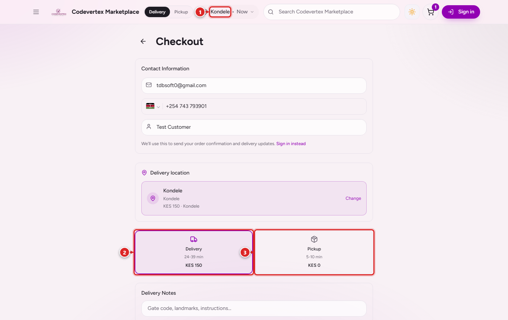

For **pickup**, the customer chooses the outlet they will collect from.

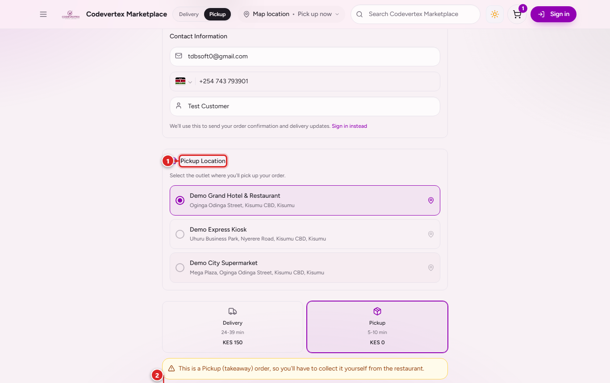

### Paying

The payment choices come from your payment settings in Treasury:

| Option | What happens |
|---|---|
| Pay now (M-Pesa prompt, PayHero, card) | The customer pays at once; the order goes to the outlet when the money arrives |
| M-Pesa to your Till or Paybill (enter code) | The customer pays your own number and types the M-Pesa code; your counter checks it before handing the order over |
| Pay on delivery / Pay at the counter | Cash or M-Pesa to the rider or at the counter |

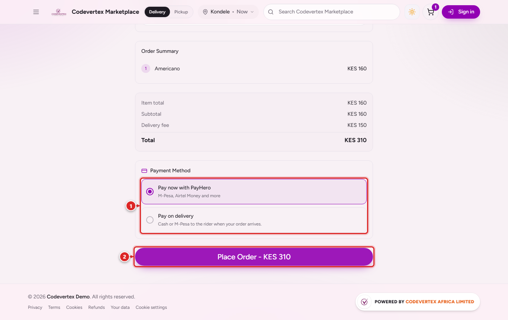

The customer places the order by sliding the button (or pressing Enter on a keyboard).

## 5. Following the order

After placing the order the customer gets a confirmation by email and WhatsApp, and lands on
their order page. The page updates on its own as the order moves: placed, accepted, preparing,
ready, on the way, delivered.

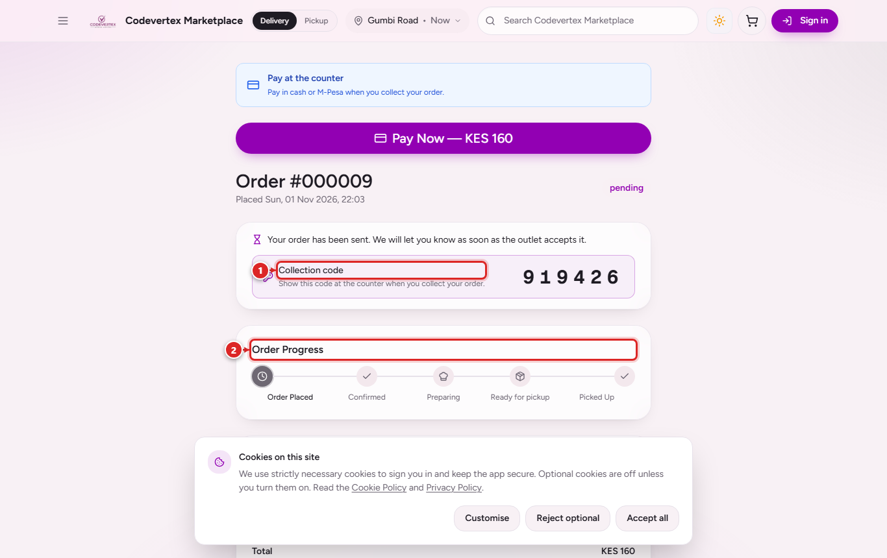

**The 6-digit code.** Every pickup and delivery order has one:

- **Collection code** (pickup): shown at the counter when collecting.
- **Delivery code** (delivery): given to the rider at the door.

It is on the order page and in the confirmation message. Staff never see it on their screens;
the POS and the rider app only check it.

**Where it goes.** A delivery order shows the place chosen, the delivery area, the rider notes
and an **Open in Maps** link. Once a rider has the job the customer sees their name and phone,
and where they are on the map.

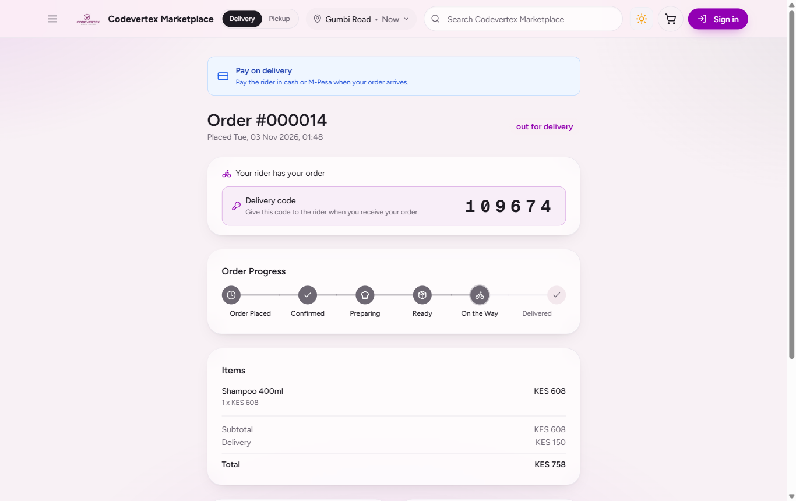

**Payment not completed.** If a pay-now payment is cancelled or times out, the order stays open
with its items reserved for 30 minutes (your setting) and the page shows **Retry payment** with
the time left.

**Cancelling.** Until the outlet starts preparing, the customer can cancel from the order page
with a reason. After that they need to call the outlet.

**Rating.** After a completed order the customer can rate it, and the rider for a delivery. If
your Google Business Profile is set up, the page also asks them to review you on Google.
