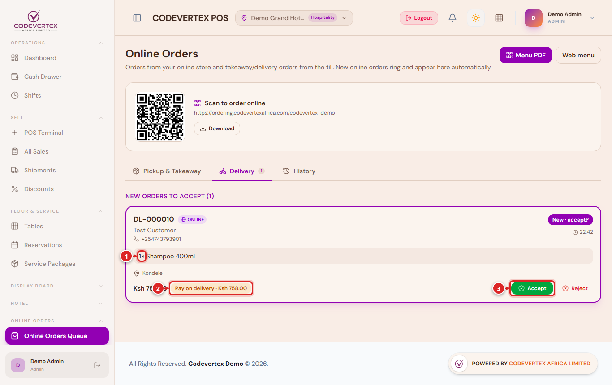
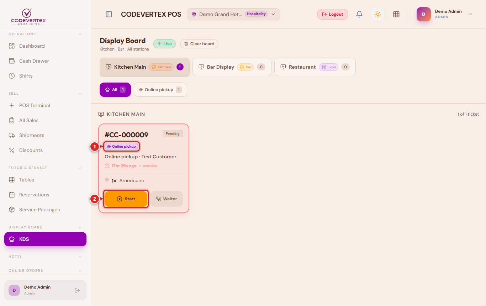
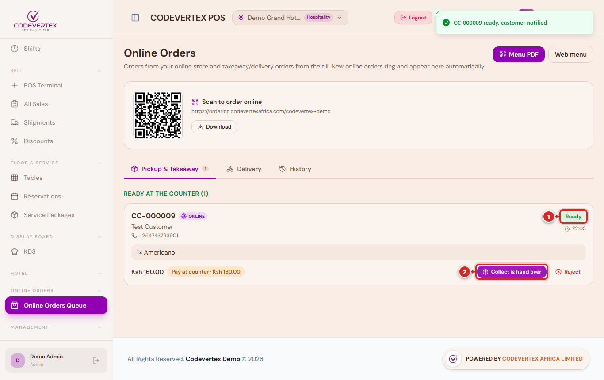
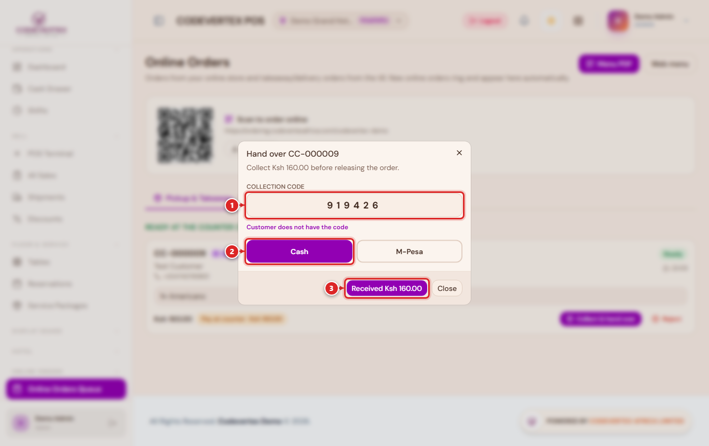
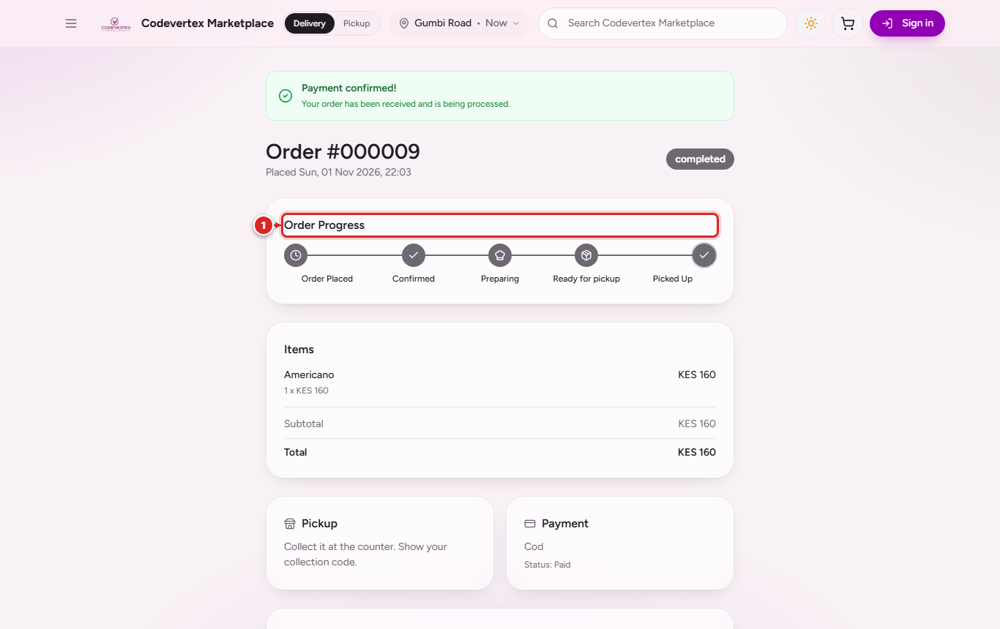

# Pickup orders

A pickup order is collected by the customer at the counter. This page follows one from the
moment it rings in the POS to the moment the customer walks out with it. The example is an
Americano ordered from Demo Grand Hotel & Restaurant, paid at the counter.

Open the queue in the POS from **Online orders** in the menu, or go straight to
`https://pos.codevertexafrica.com/{your-business}/online-orders`. Make sure the outlet chip in
the header shows the outlet the order is for.

## 1. Accept or reject

A new order rings and shows **New · accept?** under **Pickup & Takeaway** (called **Click &
Collect** in a shop), numbered after the online order (online order 000009 is **CC-000009**). It
keeps ringing every 30 seconds until someone acts.

1. What the customer ordered, with options and notes.
2. How it is paid. **Pay at counter** with the amount means you take the money at hand-over.
3. **Accept** or **Reject**.

Check you can make it (items in stock, the kitchen is not overloaded), then press **Accept**. The
customer is told straight away. If you cannot make it, see
[Rejecting an order](when-things-go-wrong.md#rejecting-an-order).

## 2. Prepare

What happens next depends on how your kitchen works.

**With a kitchen screen (KDS).** The order appears on the station that makes each item. The cook
presses **Start**, and the customer's page changes to *Preparing*. When everything is done they
press **Ready**, and the customer is told to come and collect.

**With printed chits only** (no kitchen screen, as at Urban Loft). The chit prints when the order
is accepted, with **ONLINE PICKUP** in large letters, the order number and the customer's name.
When it is made, press **Ready** on the order card in the POS queue.

**In a shop.** There is no kitchen step. The order is a pick list: pack it, then press **Ready**
on the card.

Kitchen tickets for an online order close by themselves once the order is handed over or picked
up by a rider, so nothing stays on the kitchen screen after the customer has their food.

## 3. Hand over

When the customer arrives, press **Hand over** on the card.

1. Ask for the **6-digit collection code** from their order page or message and type it in. The
   POS checks it; it never shows you the code.
2. For an order paid at the counter, choose **Cash** or **M-Pesa** (with the M-Pesa code) for the
   amount shown. The order cannot be released until the money is recorded.
3. Press **Received Ksh 160.00** (the amount you took). For an order already paid online the
   button reads **Handed over**.

If the customer cannot show the code (phone off, message deleted), choose **Customer does not
have the code** and write how you checked them, for example their name and phone number. This is
kept on the order.

The order moves to **History**, the customer's page shows it as completed, and the stock is taken
off.

## Orders paid with your own M-Pesa number

If the customer chose to pay your Till or Paybill and typed their M-Pesa code, the card shows
**M-Pesa (code) · confirm payment**. Find the payment in your M-Pesa messages, then press
**Confirm M-Pesa**. If it is not there, do not hand the order over; reject it with *Payment was
not received*.
