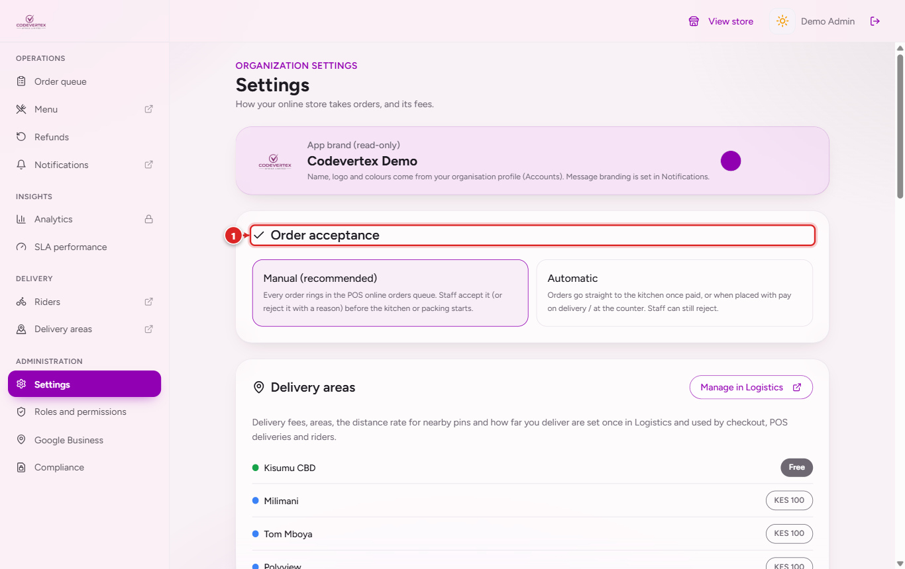
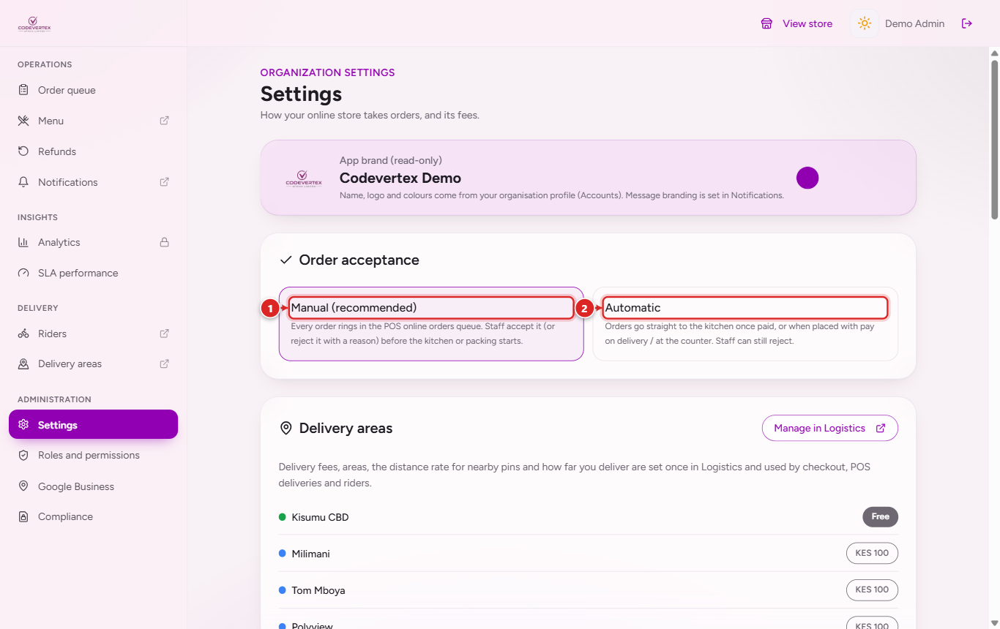
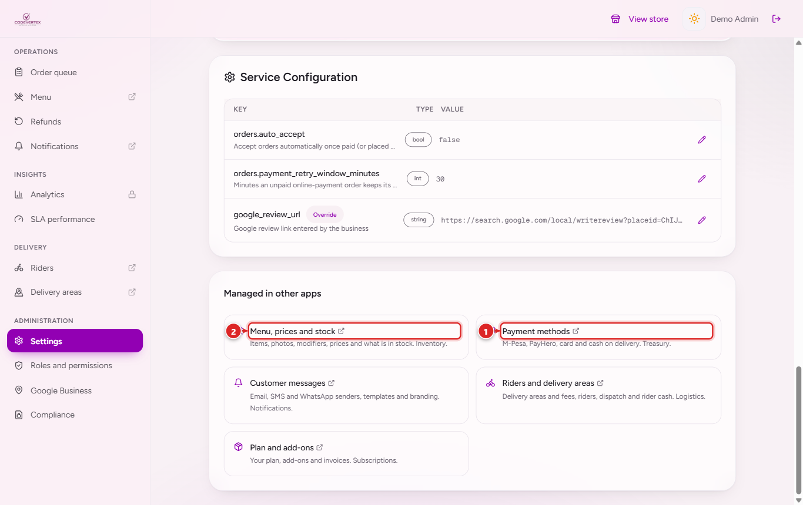
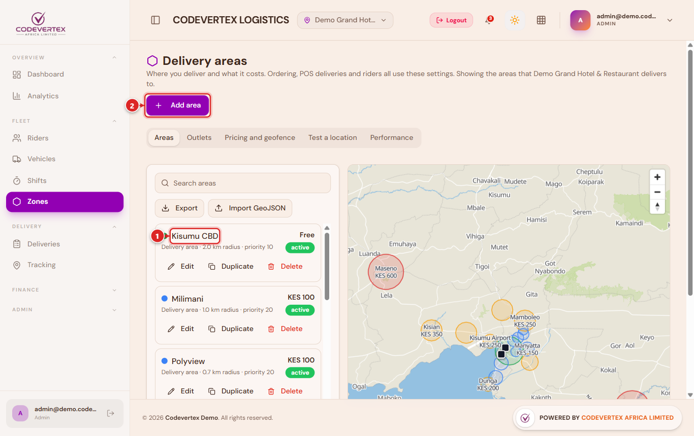
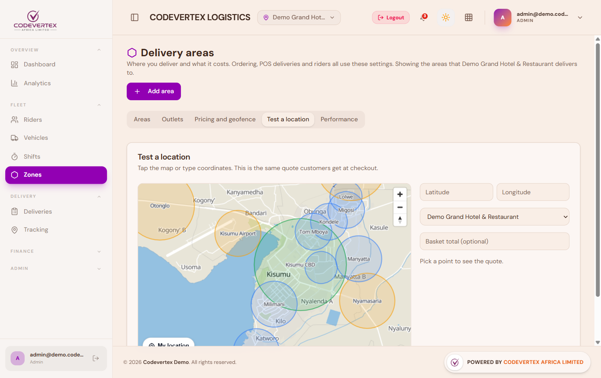
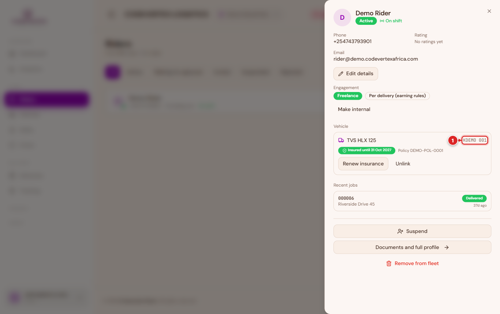
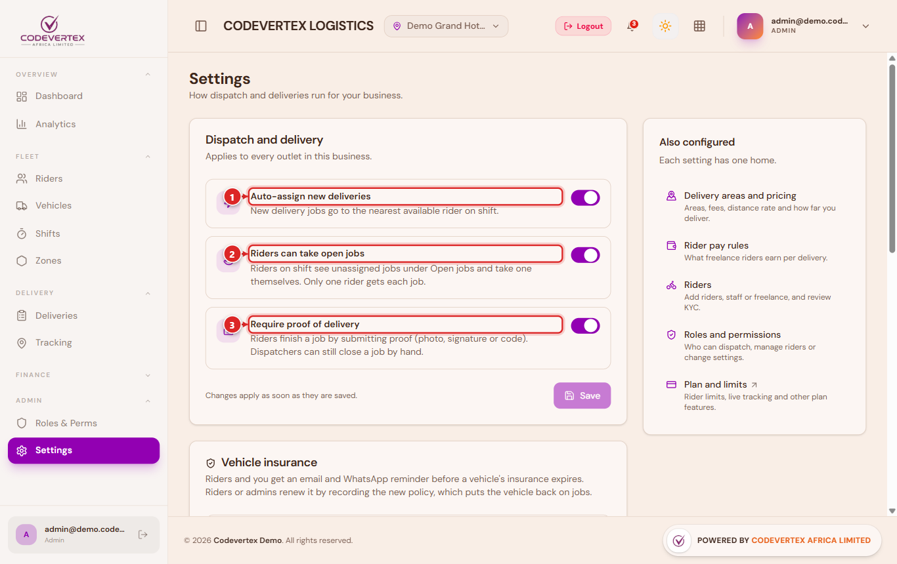

# Setting up online ordering

Before your store takes its first order, five things need to be in place: the menu, where your
outlets are, how customers can pay, where you deliver, and who delivers. Each lives in the app
that owns it, and the online store reads it from there, so you set it once and the POS, the
store and the riders all see the same thing.

| What | Where you set it |
|---|---|
| Menu, photos, prices, stock | Inventory, Catalogue |
| Outlet address and map pin | Accounts, My Organisation, Branches |
| Payment methods (M-Pesa, PayHero, card, cash on delivery) | Treasury, Settings, Payments |
| Your own M-Pesa Till or Paybill for "pay and enter the code" | POS, Settings, Payments, for each outlet |
| Customer messages and sender name | Notifications, Settings |
| Delivery areas and fees | Logistics, Delivery areas |
| Riders and their vehicles | Logistics, Riders |
| Order acceptance, store fees, payment retry time | Online store dashboard, Settings |
| App name and icon (for example "Urban Eats") | Accounts, My Organisation, Branding, App Names and Icons |

## The store's own settings

Open the online store, sign in as an admin, and choose **Settings** in the dashboard menu.

### Order acceptance

- **Manual (recommended).** Every new order rings in the POS **Online orders** queue and waits
  until someone accepts it. The kitchen only gets it after that, so nothing is cooked for an
  order you cannot fulfil.
- **Automatic.** An order goes straight to the kitchen once it is paid, or as soon as it is
  placed when the customer pays on delivery or at the counter. Staff can still reject it.

### Fees and service configuration

Below acceptance you set the store's own fees (packaging and service fees). The delivery fee is
not set here: it comes from the delivery area the customer's location falls in.

**Service configuration** lists the store's remaining settings. The one most businesses change
is `orders.payment_retry_window_minutes`: how long an order that was not paid online keeps its
items reserved and lets the customer try paying again (30 minutes unless you change it, between
5 minutes and a day).

### Everything else

The **Managed in other apps** card opens each of the other apps on the right page for your
business.

## Outlet locations

Delivery fees and rider directions are worked out from each outlet's map pin. Open **Accounts,
My Organisation, Branches**, edit the outlet, and place the pin on its entrance. An outlet with
no pin can still take pickup orders but cannot deliver.

## Delivery areas

In **Logistics, Delivery areas** you draw where you deliver and what it costs. The demo business
delivers from Kisumu CBD like this:

| Area | Fee |
|---|---|
| Kisumu CBD (2 km around Kisumu Central) | Free |
| Milimani, Tom Mboya, Polyview | KES 100 |
| Kondele, Manyatta, Migosi, Lolwe, Nyalenda | KES 150 |
| Nyamasaria, Dunga | KES 200 |
| Mamboleo, Riat, Kisumu Airport | KES 250 |
| Otonglo | KES 300 |
| Kisian | KES 350 |
| Maseno, Ahero | KES 600 |

A few things worth knowing:

- **An area can serve chosen outlets only.** The demo's areas serve the hotel and the
  supermarket; its kiosk is pickup only.
- **Smaller areas win where they overlap.** Give the big free circle a lower priority (10) than
  the estates inside it (20) so an estate's own fee applies there.
- **Places between areas** are priced per kilometre along the road (the demo charges KES 50 a
  km, at least KES 100) when they lie on the way to one of your areas. A place far off every
  route is refused, and the customer is told the nearest area you do deliver to.
- **A pin at the outlet itself** (within 200 metres) is treated as pickup: the customer is
  standing in your shop.
- **Test a location** shows the fee and the reason for any place before a customer finds out.

## Riders

In **Logistics, Riders**, add each rider with **Add rider**. A rider signs in to the rider app
with their own account, so give them an email they can open.

- **Employment.** A staff rider is paid by you as an employee (per diem claims go to HR); a
  freelance rider earns per delivery and goes through a document check before getting jobs.
- **Vehicle and insurance.** Link the rider's vehicle. A motorbike or car with no insurance
  recorded, or with expired insurance, gets no jobs unless you change that rule in Logistics
  settings. Bicycles never need insurance. Riders and you are reminded before a policy expires.
- **Phone number.** Customers see the rider's name and phone on the tracking page once the
  rider has the job. Riders keep their number up to date on their profile in the rider app.

## How jobs reach riders

**Logistics, Settings, Dispatch and delivery** has three switches:

| Setting | On | Off |
|---|---|---|
| Auto-assign new deliveries (Growth plans and up) | The nearest available rider on shift gets the job | Jobs wait for a dispatcher |
| Riders can take open jobs | Riders on shift see unassigned jobs under Available Work and take one; only one rider gets each job | Riders only get jobs given to them |
| Require proof of delivery | Riders finish a job with the customer's code or a photo | Riders can mark a job delivered without proof |

A rider only gets jobs while their app shows them as online and their phone is sharing its
location.
