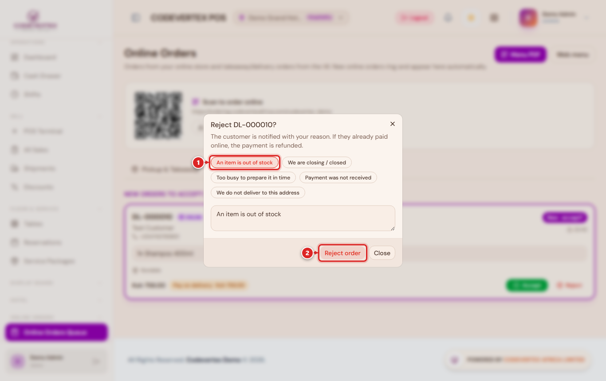
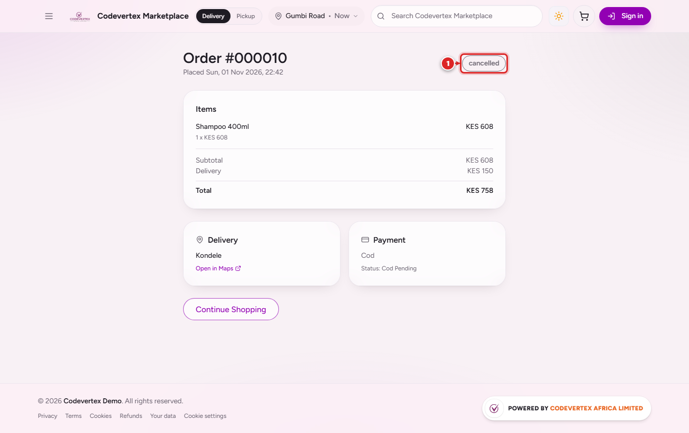

# When things go wrong

## Rejecting an order {: #rejecting-an-order }

Press **Reject** on the order card in the POS and choose a reason: an item is out of stock, too
busy to prepare it in time, payment was not received, or we do not deliver to this address. You
can also write your own. The reason is shown to the customer.

The customer is told at once, a paid order is refunded, the items held for the order are
released and the order disappears from the queue.

## The customer cancels

A customer can cancel from their order page until your outlet starts preparing it. If the kitchen
has already started, the page asks them to contact you, and only your staff can call it off.
Either way, the kitchen tickets are voided, a paid order is refunded and the items are released.

## The customer did not finish paying

When a pay-now payment is cancelled or times out, the order stays open for 30 minutes (your
**payment retry** setting) with its items reserved, and the customer can retry from the order
page. The POS shows it as **Awaiting payment** without an Accept button. If nobody pays within
the window, the order is cancelled and the items are released.

## The customer is outside your delivery areas

Checkout will not confirm a place you do not deliver to, and names the nearest area you do
serve. The customer can pick another place or collect. If customers keep asking for an area, add
it in **Logistics, Delivery areas**.

A customer whose pin is inside your outlet (within 200 metres) is offered pickup instead.

## The customer has no code

At the counter or the door, choose **Customer does not have the code** and write how you checked
who they are. Never hand over an order with no record.

## A rider cannot take a job

Before collecting the order, a rider can hand the job back from the rider app with a reason (bike
problem, too far, ending their shift, order not ready). The job goes back to waiting, the
dispatch board is alerted, and with auto-assign on it goes to the next rider. Riders cannot
cancel a customer's delivery; a dispatcher can unassign, reassign or cancel it from the job in
Logistics.

## A delivery fails {: #a-delivery-fails }

After collecting the order, a rider who cannot deliver it reports a failed delivery with the
reason (customer not answering, wrong or unreachable address, customer refused, could not collect
payment). The rider is freed for other jobs, your business gets an email, and the POS card shows
**Delivery failed, send it again**. Bring the order back and either send it again with **Assign
rider** or contact the customer.

## Common questions

**The queue is empty but a customer says they ordered.** Check the outlet chip in the POS header:
the queue shows the active outlet's orders. Then check the order is not still awaiting payment.

**An order never reached the kitchen.** With manual acceptance the kitchen only gets an order
after someone presses **Accept**. A pay-now order can only be accepted once it is paid.

**Nothing is left on the kitchen screen after hand-over, is that right?** Yes. An online order's
tickets close by themselves when it is handed over at the counter, picked up by a rider, or
delivered, and are voided if it is cancelled. Assigning a rider does not close them, because the
food may still be cooking.

**Customers cannot choose delivery.** The outlet needs a map pin and at least one active delivery
area that serves it.

**A rider is online but gets no jobs.** Check the rider app is sharing location, the rider is
approved, and their vehicle's insurance is recorded and current.
